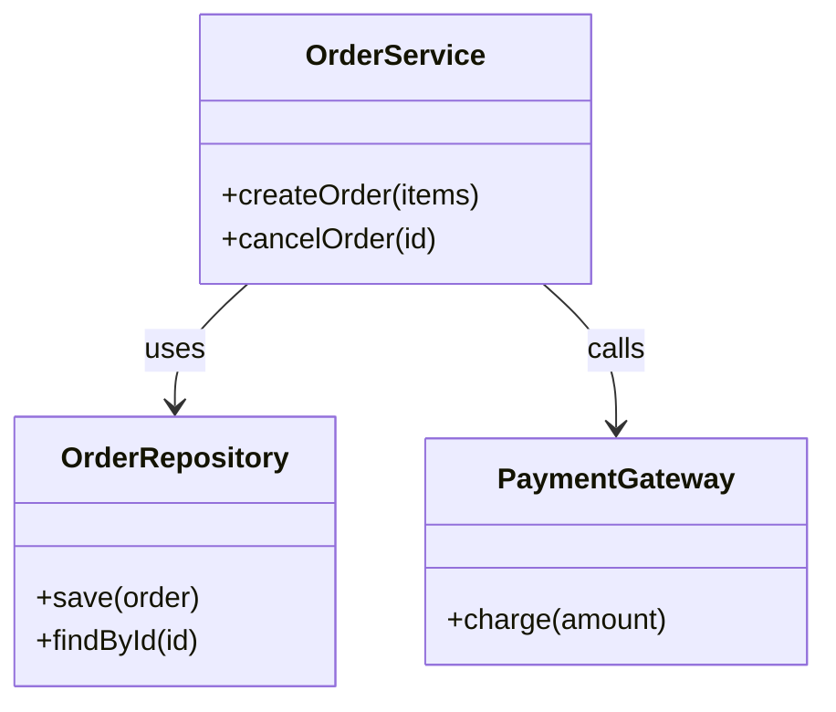
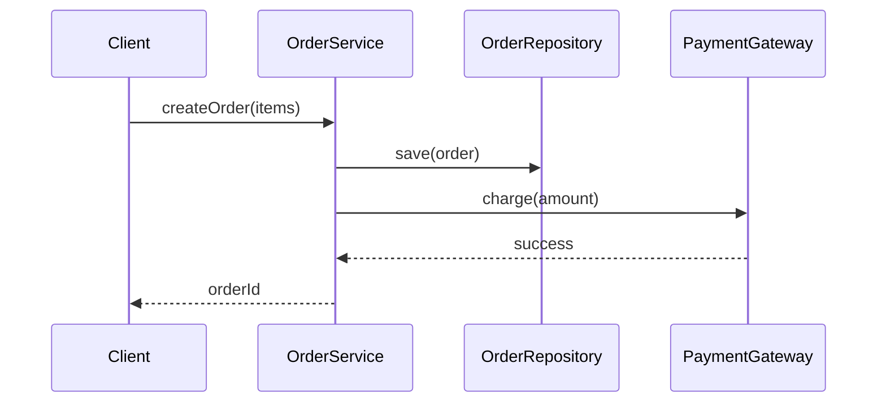

# CodeLens · 项目结构可视化工具

[](https://github.com/kane0204/CodeLens/actions/workflows/ci.yml)


> **一句话简介**：CodeLens 给一个项目文件夹，还你一张看得懂的架构图——自动生成类图、时序图与模块依赖图，帮助初学者快速建立对陌生代码库的整体认知。

## 目录

- [项目简介](#项目简介)
- [核心功能](#核心功能)
- [输出示例（规划）](#输出示例规划)
- [技术栈](#技术栈)
- [快速开始](#快速开始)
- [项目结构](#项目结构)
- [分支与提交规范](#分支与提交规范)
- [协作流程](#协作流程)
- [迭代计划](#迭代计划)
- [团队与分工](#团队与分工)
- [文档索引](#文档索引)

## 项目简介

拿到一个陌生项目时，初学者面对的往往是一屏目录树、几十上百个源文件、分散在文件之间的类关系与调用链。README 通常只讲「怎么跑」，很少讲「结构是什么」；IDE 的跳转只能一次看一个文件；类图插件往往只支持单文件或单一语言，时序图更是少有工具能一键生成。结果是：**能跑起来，但说不清它由哪些模块组成、谁调用了谁、一次请求经过了哪些类。**

CodeLens 要解决的是「**看懂一个项目**」，而不是「学会一门语言」：

- **输入**：一个本地项目文件夹（或打包后的项目压缩包）；
- **处理**：多文件静态解析，构建符号表、类型关系图与调用图；
- **输出**：类图、时序图、模块依赖图等可视化结果，并支持导出为 Mermaid / PlantUML / SVG 与 Markdown 报告；
- **面向对象**：刚加入课程项目组的学生、第一次接手项目的初级开发者、需要快速评估项目结构的教师与评审。

本工具**不做**逐行代码讲解、不做刷题与练习生成、不替代 IDE——它是理解项目结构的「望远镜」。

本项目为课程小组协作开发项目，按「需求 → 算法 → 软件 → 管理 → 复盘」五个阶段推进，全过程在 GitHub 上以 Issue / Kanban / PR 的方式协作与留痕。

## 核心功能

| 编号 | 功能 | 说明 | 阶段 |
|---|---|---|---|
| F1 | 项目扫描与多文件解析 | 递归扫描文件夹，识别语言、源文件、包/模块结构，构建符号表 | MVP |
| F2 | 类图生成 | 抽取类、属性、方法及继承、实现、组合、关联、依赖关系，输出标准类图 | MVP |
| F3 | 时序图生成 | 从入口函数（如 `main`、路由处理函数）或用户指定函数出发，跨文件推导调用链，生成消息序列图 | MVP |
| F4 | 模块依赖图 / 调用图 | 包与文件级依赖、函数级调用关系，用于理解整体分层与耦合 | MVP（基础版） |
| F5 | 交互式浏览 | Web 页面查看图，点击节点跳转到对应源码位置（文件 + 行号） | 迭代 2 |
| F6 | 导出与报告 | 导出 Mermaid / PlantUML / SVG，生成 Markdown 架构报告，可接入 CI 自动更新 | MVP（导出）/ 迭代 2（报告） |
| F7 | 智能补充说明 | 可选的模型辅助：为模块/类生成一句话职责说明；**图结构始终来自静态分析** | 迭代 2 |

**准确性原则**：图中的节点与边必须可溯源到代码位置（文件:行号）；模型只负责文字描述，不参与「猜结构」，避免生成看起来合理但不存在的类或调用。

## 输出示例（规划）





> 上图为格式示意，实际输出将由分析器从项目源码中抽取，并附源码位置索引。

## 技术栈

| 层 | 选型 | 说明 |
|---|---|---|
| 解析与图构建 | Python 3.11 + tree-sitter（多语言）+ networkx | 多文件 AST 解析、符号解析、依赖与调用图构建 |
| 图生成与布局 | Mermaid / PlantUML 生成器 + Graphviz（可选） | 类图、时序图、依赖图输出；大规模图自动裁剪与聚类 |
| 后端 | Python（FastAPI）+ 任务队列 | 接收项目、调度分析任务、产出图表与报告 |
| 前端 | TypeScript + React + 图渲染库 | 上传/选择项目、交互式查看图、源码跳转 |
| 测试 | pytest + 样例项目集 + Playwright | 解析准确率回归、图表渲染、E2E |
| CI/CD | GitHub Actions | 结构检查 → 单元测试 → 样例项目分析回归 |

> 具体版本与依赖将在 W3 架构设计中锁定；首期支持语言见 [docs/requirements/problem_definition.md](docs/requirements/problem_definition.md) 第 5 节的待确认项。

## 快速开始

目标形态（W3 起提供，当前尚未实现代码）：

```bash
# 克隆仓库
git clone https://github.com/kane0204/CodeLens.git
cd CodeLens
git checkout develop

# 分析一个项目文件夹（规划中的 CLI 形态）
codelens analyze ./examples/shop \
  --out ./out \
  --format mermaid

# 产出（示意）
# out/class-diagram.mmd      类图
# out/sequence/*.mmd         时序图（每个入口一条）
# out/module-deps.mmd        模块依赖图
# out/report.md              架构报告（含源码位置索引）
```

## 项目结构

```text
CodeLens/
├── docs/
│   ├── requirements/     # 需求工程：问题定义、5W1H、用户故事、用例
│   ├── algorithm/        # 算法设计：多文件解析、符号解析、类图/调用链/时序图
│   ├── software/         # 软件设计：架构、接口、数据模型、测试方案
│   ├── mgmt/             # 项目管理：看板说明、迭代计划、Backlog、协作规范
│   └── retrospection/    # 阶段复盘与经验教训
├── code/
│   ├── backend/          # 服务端 API、分析任务调度、报告产出
│   ├── frontend/         # Web 前端：项目导入、图表浏览、源码跳转
│   └── core_engine/      # 核心引擎：解析、符号表、关系图、图表生成
├── tests/
│   ├── unit/             # 单元测试（解析器、图构建、生成器）
│   └── integration/      # 集成测试（样例项目端到端分析）
└── .github/
    ├── workflows/        # CI 流水线
    └── ISSUE_TEMPLATE/   # 任务 / 缺陷 / 需求 / 检查点模板
```

## 分支与提交规范

- `main`：生产/交付分支，始终保持可发布状态，只接受来自 `develop` 或 `release/*` 的 PR；
- `develop`：开发主分支，集成所有已完成的功能；
- `feature/<name>`、`fix/<name>`、`docs/<name>`：日常开发分支，从 `develop` 切出，完成后 PR 回 `develop`；
- 提交信息遵循 [Conventional Commits](https://www.conventionalcommits.org/zh-hans/)，须关联 Issue 编号。

完整规则见 [docs/mgmt/branching-and-commit.md](docs/mgmt/branching-and-commit.md) 与 [CONTRIBUTING.md](CONTRIBUTING.md)。

## 协作流程

项目在 GitHub 上建立三个看板（Projects）：

| 看板 | 用途 | 主要内容 |
|---|---|---|
| **Team planning** | 迭代规划与容量管理 | 按周排期、成员认领、优先级排序 |
| **Kanban** | 日常任务流转 | Backlog → Ready → In progress → Review → Done |
| **Bug tracker** | 缺陷跟踪 | 缺陷提交、复现、修复、回归验证 |

看板入口：<https://github.com/kane0204/CodeLens/projects>（创建后请 Pin 到仓库侧边栏）

流程约定：先在 Issue 中描述任务或缺陷，由负责人在看板上认领并移动状态，通过分支与 PR 提交代码，至少 1 人 Review 后合并，最后关闭 Issue。标签与看板配置见 [docs/mgmt/project-setup.md](docs/mgmt/project-setup.md)。

## 迭代计划

| 周次 | 目标 | 交付物 | 检查点 |
|---|---|---|---|
| W1 | 立项与问题定义 | 仓库结构、README、5W1H 与产品描述、三个看板 | 提交仓库链接，通过 Issue 获得第一轮反馈 |
| W2 | 需求与算法设计 | 用户故事、用例、多文件解析与类图/时序图算法方案 | 需求评审 |
| W3 | 架构与骨架 | 架构与接口定义、CLI 解析出「类 + 调用」结构化 JSON、可用假数据渲染图 | 设计评审 |
| W4–W6 | MVP 实现 | 项目扫描 → 类图 → 时序图 → 导出 Mermaid，样例项目端到端跑通 | 迭代演示 |

详细排期与任务分解见 [docs/mgmt/backlog.md](docs/mgmt/backlog.md)。

## 团队与分工

| 角色 | 成员 | 职责 |
|---|---|---|
| 组长 / 项目管理 | TBD | 排期、看板维护、对外提交检查点 |
| 需求与算法 | TBD | 需求文档、解析与图生成算法设计 |
| 核心引擎 | TBD | 多文件解析、符号表、关系图、图表生成 |
| 前端 / 后端 | TBD | 项目导入、图交互、API 与报告 |
| 测试与质量 | TBD | 样例项目集、准确率回归、CI、缺陷跟踪 |

> 成员与分工确定后请更新本表，并在 `docs/mgmt/` 中同步任务认领。

## 文档索引

| 文档 | 内容 |
|---|---|
| [docs/requirements/problem_definition.md](docs/requirements/problem_definition.md) | 问题定义：5W1H 报告与产品描述（第 1 周交付物） |
| [docs/mgmt/project-setup.md](docs/mgmt/project-setup.md) | GitHub 看板、标签、里程碑配置 |
| [docs/mgmt/backlog.md](docs/mgmt/backlog.md) | 迭代 Backlog 与验收标准 |
| [docs/mgmt/branching-and-commit.md](docs/mgmt/branching-and-commit.md) | 分支策略与提交规范 |
| [docs/algorithm/README.md](docs/algorithm/README.md) | 算法文档规划（解析、类图、调用链、时序图） |
| [docs/software/README.md](docs/software/README.md) | 软件设计文档规划（架构、接口、数据模型） |
| [CONTRIBUTING.md](CONTRIBUTING.md) | 贡献指南（新成员从这里开始） |

## 许可证

本项目采用 [MIT License](LICENSE)，版权归项目组所有。
