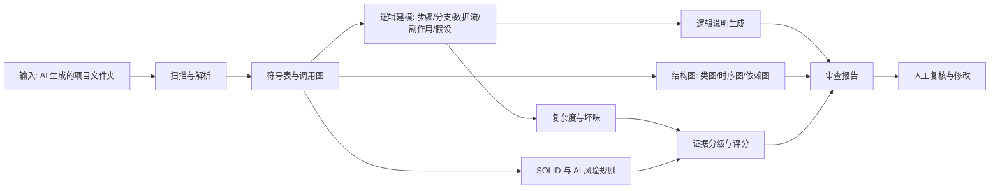

# 问题定义与产品描述（Problem Definition）

| 项目 | 内容 |
|---|---|
| 项目名称 | CodeLens · AI 生成代码的可解释性与可信度分析 |
| 文档版本 | v0.5（第 1 周修订） |
| 状态 | 待评审 |
| 负责人 | TBD（需求负责人） |
| 更新日期 | 2026-10-17 |
| 对应检查点 | 第 1 周：提交仓库链接，通过 GitHub Issue 获得第一轮反馈 |

> 说明：文中标注 ⚠️ 的条目为**尚未确认的决策或假设**，需在 W2 评审与样例项目校准后回填。

## 0. 摘要

AI 编码工具正在大量产出可运行代码，但这些代码对团队而言往往是**黑盒**：能跑，却说不清它在做什么、依赖了哪些未声明的假设、哪些地方最可能出错。代码评审因此退化为「看格式、看命名、跑一下」，风险在合并后持续累积。

CodeLens 的主任务是**打开这个黑盒**。它以项目文件夹为输入，输出三类可审查的结果：

1. **代码逻辑**：函数/模块在做什么——步骤、分支、异常路径、数据流、副作用、隐含假设；
2. **结构视图**：类图、时序图、模块依赖与调用图；
3. **可信度证据**：复杂度、坏味、SOLID 违规、AI 代码特有风险，以及每条结论的证据等级与代码位置。

质量指标与结构图不是目的，而是回答「**这段 AI 写的代码能不能信、该重点看哪里**」的证据。全部结论来自静态分析，**全流程不调用大模型**。

## 1. 5W1H 分析

### 1.0 汇总表

| 维度 | 关键提问 | 结论 |
|---|---|---|
| **What** | 要解决什么问题？ | AI 生成代码的逻辑、结构与风险不透明，团队无法有效理解与审查 |
| **Why** | 为什么必须解决？ | 代码产量远超人工审查能力；隐含假设与缺陷在合并后才暴露，返工与事故成本高 |
| **Who** | 谁遇到了这个问题？ | 使用 AI 编码的开发者、代码评审者、技术负责人、项目接手者 |
| **When** | 什么时候发生？ | AI 生成代码后、合并前、接手 AI 编写的模块时、上线前 |
| **Where** | 在哪个环境发生？ | 本地项目目录；PR / CI 流水线；浏览器中的审查报告 |
| **How** | 如何解决？ | 静态解析 → 逻辑建模 → 结构图 → 指标与规则 → 证据分级 → 审查报告 |

### 1.1 What — 黑盒问题的具体表现

**（1）逻辑不透明**

- 能运行，但说不清输入经过哪些处理步骤；
- 分支条件背后的业务含义不明，异常路径未被检查；
- 副作用（写库、发请求、改全局状态）隐藏在调用链深处；
- 代码中的假设（参数非空、外部服务可用、金额单位、时区、编码）没有声明。

**（2）结构不可见**

- 目录树不代表模块职责，依赖方向不清；
- 类关系与调用链跨文件分散，评审只能逐文件阅读；
- 同一功能在多个位置重复实现，行为不完全一致。

**（3）质量不可量**

- 复杂度、嵌套、类规模、耦合没有统一度量；
- 坏味与设计原则违规靠个人感觉，无法形成可跟踪的改进项。

**（4）风险不可查**

- AI 生成的代码可能依赖不存在的 API、参数或配置项；
- 异常处理缺失或不一致，硬编码密钥/路径，死代码与未使用依赖堆积；
- 上述问题不会让程序立刻崩溃，却会在特定输入或环境下暴露。

### 1.2 Why — 为什么必须解决

| 影响 | 说明 |
|---|---|
| 审查失效 | 代码量超过人工逐行审查能力，评审退化为形式检查 |
| 责任模糊 | 没人能解释 AI 代码为什么这样写，出问题时难以定位原因 |
| 维护成本 | 逻辑不可读、结构不可见，后续修改依赖试错 |
| 风险累积 | 隐含假设与边缘情况在合并后才暴露，修复成本远高于合并前 |
| 团队协作 | 新成员无法快速接手 AI 编写的模块，知识集中在少数人手中 |

### 1.3 Who — 为谁解决

| 优先级 | 用户 | 特征 | 真实诉求 |
|---|---|---|---|
| 主要用户 | 使用 AI 编码的开发者 | 用助手快速产出功能，但对生成结果没有完整把握 | 「告诉我它到底做了什么、哪里需要我确认」 |
| 主要用户 | 代码评审者 / 技术负责人 | 面对大量 AI 生成代码，审查时间有限 | 「按风险排序，指出必须人工看的点」 |
| 直接相关者 | 项目接手者 / 新成员（含初学者） | 接手陌生或 AI 生成的模块 | 「先给我逻辑说明和结构图，再让我读代码」 |
| 次要用户 ⚠️ | 课程评审 / 质量负责人 | 需要评估代码质量与可维护性 | 「有没有客观、可复核的证据」 |

### 1.4 When — 何时发生

| 时间节点 | 场景 | 对产品的含义 |
|---|---|---|
| AI 生成代码后 | 判断这段代码能否直接采用 | 需要快速逻辑说明 + 风险清单 |
| 提交 PR 前 / 评审中 | 评审者需要重点看高风险部分 | 需要按风险排序的审查报告 |
| 接手 AI 编写的模块 | 理解现有实现 | 需要模块级逻辑与调用链 |
| 迭代前 / 重构前 | 评估技术债与改动风险 | 需要复杂度、耦合、循环依赖 |

### 1.5 Where — 在什么环境发生

- **本地**：项目文件夹为主要输入，全部分析默认在本地完成；
- **PR / CI**：随提交生成审查报告，作为合并前的参考；
- **浏览器**：查看逻辑步骤、结构图与风险清单，点击定位源码。

### 1.6 How — 如何解决

关键设计决策：

1. **先有事实，再有文字**：逻辑说明必须建立在控制流/数据流/调用图之上，每个步骤引用代码行；
2. **证据分级**：事实 / 推断两级；文字由模板生成，不引入模型；
3. **风险优先**：报告按「可能造成错误的程度」排序，而不是按文件顺序；
4. **全静态、确定性**：不调用大模型；相同输入与配置产生完全相同的输出，可用 golden file 逐字节比对。

## 2. 产品描述

### 2.1 产品定位与价值主张

> **一句话定位**：CodeLens 是 AI 生成代码的「X 光机」——输入项目文件夹，输出它在做什么、结构如何、哪里不可信。

| 面向 | 价值主张 |
|---|---|
| 使用 AI 的开发者 | 生成之后先看懂，再决定改什么、测什么 |
| 评审者 | 按风险排序的审查清单，每条都有代码位置与依据 |
| 接手者 | 逻辑说明 + 结构图，先建立整体认知再读细节 |
| 与代码助手相比 | 助手负责生成，CodeLens 负责解释与审查 |
| 与 Lint/静态分析相比 | 不止单文件规则，而是项目级逻辑、结构与风险 |

### 2.2 用户画像

**画像 A · 小 Q（使用 AI 编码的开发者）**

- 用 AI 助手生成模块后，代码能跑但自己说不清细节；
- 担心隐藏假设与边界情况，评审时被问住；
- 目标：得到一份能逐条核对的逻辑说明与风险清单。

**画像 B · 李工（代码评审者）**

- 每周要评审大量 AI 参与的 PR，时间有限；
- 目标：先看高风险点，再决定深入读哪几个函数。

**画像 C · 小王（接手者）**

- 接手一个由 AI 生成、几乎没有注释的模块；
- 目标：快速理解模块职责与调用链。

### 2.3 黑盒问题 → 需求映射

| 编号 | 黑盒表现 | 需求陈述 | 对应功能 | 优先级 |
|---|---|---|---|---|
| B1 | 不知道函数在做什么 | 我需要函数级逻辑步骤说明，并引用代码行 | F2、F3 | 必须 |
| B2 | 不知道分支与异常路径 | 我需要列出关键条件与异常路径 | F2、F3 | 必须 |
| B3 | 不知道有哪些副作用 | 我需要标出写库、网络、文件、全局状态等副作用 | F2 | 必须 |
| B4 | 不知道依赖哪些假设 | 我需要列出隐含假设并提示人工确认 | F2、F3 | 必须 |
| B5 | 不知道模块如何组成 | 我需要类图、时序图与模块依赖图 | F4、F5、F6 | 必须 |
| B6 | 不知道哪里最危险 | 我需要复杂度、坏味与风险排序 | F7、F9 | 必须 |
| B7 | 不知道是否违反设计原则 | 我需要 SOLID 检查 | F8 | 必须 |
| B8 | 结论无法核实 | 我需要证据等级与代码位置 | 全流程 | 必须 |

### 2.4 核心功能与验收标准

| 编号 | 功能 | 输入 / 输出 | 关键验收标准 |
|---|---|---|---|
| **F1** | 项目扫描与多文件解析 | 项目文件夹 → 文件/模块/符号清单 | 源文件纳入率 ≥ 95%；语法错误文件不中断整体分析 |
| **F2** | 逻辑抽取 | AST + 调用图 → 逻辑模型（语句轨迹/CFG/def-use/分支/异常/副作用/假设） | 对 20 个人工标注函数，语句与分支覆盖正确率 ≥ 85% ⚠️ |
| **F3** | 逻辑说明 | 逻辑模型 → 模板化说明（无模型） | 每条说明可回溯到代码行；相同输入输出逐字节一致 |
| **F4** | 类图 | 解析结果 → 类与五类关系 | 人工标注样例关系 F1 ≥ 0.85 ⚠️ |
| **F5** | 时序图 | 入口/指定函数 → 消息序列 | 20 条调用链消息顺序正确率 ≥ 80% ⚠️ |
| **F6** | 模块依赖 / 调用图 | 导入与调用关系 → 图 | 循环依赖检出率 100%（构造样例） |
| **F7** | 复杂度与坏味 | 指标 + 规则 → 分级与清单 | 指标与参考实现偏差 ≤ 5%；坏味检出率 ≥ 90% ⚠️ |
| **F8** | SOLID 检查 | 规则 → S/O/D 命中 | 每条规则 ≥ 3 正例、3 反例通过 |
| **F9** | AI 代码风险检查 | 规则 → 风险清单 | 构造样例中风险检出率 ≥ 85%，误报率 ≤ 20% ⚠️ |
| **F10** | 交互式审查（迭代 2） | 逻辑步骤/图/风险联动 | 点击步骤或节点定位到正确源码位置 |
| **F11** | 报告导出 | 结果 → Markdown / JSON / 图 | 报告含逻辑说明、评分、风险、位置与证据等级 |

### 2.5 「输出代码逻辑」的明确定义

逻辑模型以函数/方法为基本单位，包含七类信息：

| 类别 | 内容 | 示例 |
|---|---|---|
| **语句轨迹** | 按源码顺序的语句，附 AST 节点类型、赋值目标、调用表达式 | `total += o.amount` → assign / BinOp |
| **控制流（CFG）** | 基本块与边：顺序、条件真/假、循环回边、异常边 | `:4 --true--> :5 → :3` |
| **分支** | 条件表达式及各分支去向 | `Compare: total > 1000` → `:7` |
| **异常路径** | 可能抛出的异常、未捕获位置 | 调用未包裹 try/except |
| **数据流（def-use）** | 定义点、使用点、参数 → 返回值链路 | `orders → o → o.amount → total → return` |
| **副作用** | 文件、网络、数据库、全局/属性写入 | `pay.charge(...)` |
| **隐含假设** | 从守卫条件推导出的前置条件 | 直接访问 `o.status`，未判空 |

模块级逻辑 = 对外接口 + 关键流程 + 模块间依赖；跨模块流程用时序图表达。

### 2.6 证据分级

| 等级 | 来源 | 使用规则 |
|---|---|---|
| **事实** | 语法树、符号表、CFG、def-use、调用图 | 可直接作为结论 |
| **推断** | 启发式规则（多态解析、副作用判断、风险规则） | 必须标注置信度 |

> 文字描述由模板从上述事实生成，不调用模型，因此不产生「模型编造结构」的问题。

### 2.7 质量指标（作为可信度证据）

| 指标 | 定义 | 默认阈值 | 粒度 |
|---|---|---|---|
| 圈复杂度 CC | 1 + 判定点数量 | >10 警告，>20 严重 | 函数 |
| 认知复杂度 | 嵌套加权的判定点 | >15 警告 | 函数 |
| 函数长度 | 有效代码行 | >50 警告 | 函数 |
| 最大嵌套深度 | 控制流嵌套层数 | >4 警告 | 函数 |
| 参数个数 | 形参数量 | >4 警告 | 函数 |
| WMC / DIT / CBO / LCOM | 类规模、继承深度、耦合、内聚 | 见算法文档 | 类 |
| 循环依赖 | 依赖图强连通分量 | 任何一处 | 模块 |

坏味：长函数、God Class、长参数、深层嵌套、重复代码、数据类、特性依恋、散弹式修改、循环依赖、死代码。

SOLID：首期 SRP-01、OCP-01、DIP-01；LSP / ISP 列入迭代 2。

健康度：单项扣分 = 权重 × 严重度系数；文件得分 = max(0, 100 − 10 × 扣分和 / 千行)；模块/项目按行数加权。分档：≥90 健康、75–89 良好、60–74 需关注、40–59 高风险、<40 屎山。

### 2.8 AI 生成代码的特有风险（F9）

| 编号 | 风险 | 检测思路 | 证据等级 |
|---|---|---|---|
| A1 | 可疑依赖调用 | 调用的模块/属性无法解析到已声明依赖或标准库 | 推断 |
| A2 | 重复实现 | 多个函数/代码块的 token 序列高度相似 | 事实（相似度） |
| A3 | 未处理异常 | 外部调用（IO/网络/DB）未包裹异常处理 | 推断 |
| A4 | 硬编码敏感信息 | 字符串中出现密钥、令牌、绝对路径、内网地址模式 | 事实 |
| A5 | 死代码 | 未被引用的私有函数/类/导入 | 事实（可达性） |
| A6 | 假设未校验 | 参数直接解引用/索引，缺少空值与边界检查 | 推断 |
| A7 | 注释与实现不一致 | 文档字符串/注释描述与逻辑模型冲突 | 推断（需人工确认） |
| A8 | 过度防御 | 同一条件反复校验、无意义 try/except | 推断 |

### 2.9 非功能需求

| 类别 | 需求 | 指标（MVP） |
|---|---|---|
| 性能 | ≤200 文件项目完成解析、逻辑建模与报告 | ≤ 120 秒 |
| 可解释性 | 每条结论可复核 | 100% 结论包含证据等级与位置 |
| 准确性 | 逻辑步骤与代码一致 | 抽样人工核对 ≥ 90% ⚠️ |
| 隐私 | 源码默认不外传 | 全部分析本地完成，不调用任何外部服务 |
| 确定性 | 相同输入与配置的输出一致 | 两次运行结果逐字节相同 |
| 可移植 | 跨平台 | Windows / macOS / Linux |
| 可扩展 | 多语言与多规则 | 解析层与规则层插件化 |

### 2.10 竞品与替代方案

| 方案 | 能做什么 | 不足 |
|---|---|---|
| AI 代码助手本身 | 生成、解释单段代码 | 解释不可复核、无项目级结构、无审查清单 |
| IDE 类图插件 | 类结构可视化 | 无逻辑说明与风险分析，语言受限 |
| Lint / SonarQube | 单文件规则与质量门禁 | 缺项目级逻辑与调用链，配置重 |
| 商业静态分析 | 结构与指标分析强 | 价格高、上手成本高 |
| 人工评审 | 判断最可靠 | 速度慢、覆盖有限、依赖个人经验 |

**差异化**：面向 AI 生成代码的**可解释性 + 可信度**：逻辑说明与结构图同源，风险按严重度排序，每条结论都可追溯。

### 2.11 范围边界

**本期要做（MVP）**

- Python 3.11 项目（标准库 `ast`）；
- 函数/模块级逻辑模型与逻辑说明；
- 类图、时序图、模块依赖图；
- 复杂度、坏味、SOLID S/O/D、AI 风险基础规则；
- Markdown 审查报告 + JSON + 图文件。

**本期不做**

- 不做运行时动态追踪；
- 不做自动修复或自动重构；
- 不替代人工评审；
- 不做 LSP / ISP 自动判定（迭代 2）；
- 不做 IDE 插件；
- 不做模型生成的总结、问答或润色（全部输出由模板与规则生成）；
- 不对反射、动态导入、框架魔法做完全还原，相关结论标注为推断。

### 2.12 成功度量指标

| 类型 | 指标 | MVP 目标 |
|---|---|---|
| 可用性 | 样例项目端到端成功率 | ≥ 90% |
| 逻辑准确性 | 步骤/分支覆盖正确率 | ≥ 85% ⚠️ |
| 可追溯性 | 结论带位置与证据等级比例 | 100% |
| 风险有效性 | AI 风险检出率 / 误报率 | ≥ 85% / ≤ 20% ⚠️ |
| 审查效率 | 评审者定位高风险点用时 | 下降 ≥ 50% ⚠️ |
| 可读性 | 报告可读性评分（5 分制） | ≥ 4.0 |

## 3. 假设、风险与依赖

| 编号 | 类型 | 内容 | 影响 | 应对 |
|---|---|---|---|---|
| R1 | 风险 | 静态分析无法完全确定动态调用与副作用 | 高 | 标注推断与置信度；支持人工指定入口 |
| R2 | 风险 | 逻辑说明冗长，用户不看 | 中高 | 分层输出：一句话摘要 → 步骤 → 展开细节 |
| R3 | 风险 | 模板描述机械、冗长，可读性不足 | 中 | 分层输出：语句轨迹 → 摘要 → 展开；措辞模板化评审 |
| R4 | 风险 | 指标阈值误报 | 中 | 阈值可配置 + 样例校准 + 分级展示 |
| R5 | 风险 | AI 风险规则误报（如硬编码检测） | 中 | 规则分级、白名单、报告标注置信度 |
| R6 | 风险 | 多语言扩展成本 | 中 | 首期单语言，插件化 |
| R7 | 假设 ⚠️ | 目标项目以 Python 为主 | 中 | 与课程项目确认 |

## 4. 里程碑与验证方式

| 周次 | 里程碑 | 验证方式 |
|---|---|---|
| W1 | 仓库与问题定义完成 | 提交仓库链接，获得第一轮反馈 |
| W2 | 需求与算法设计定稿 | 逻辑模型、指标、规则、样例项目与标注基准通过评审 |
| W3 | 架构与最小链路 | 文件夹 → 解析 → 逻辑模型 JSON → 类图与指标骨架 |
| W4–W6 | MVP | 样例项目产出逻辑说明 + 图 + 风险报告；指标与检出率达标 |

## 5. 待确认问题

1. 逻辑说明的详细程度：语句级轨迹是否足够，还是需要逐行解释每个表达式？
2. 首期是否必须支持 Web 界面，还是 CLI + Markdown 报告即可？
3. 目标项目规模上限？
4. 是否需要与 CI 集成（PR 中自动评论审查结果）？
5. 小组角色与成员分工（README 团队表待填）。

## 附录 A · 术语表

| 术语 | 含义 |
|---|---|
| 黑盒问题 | 代码可运行但内部逻辑、假设与风险不透明 |
| 逻辑模型 | 对函数/模块行为的结构化描述：语句轨迹、CFG、def-use、分支、异常、副作用、假设 |
| 逻辑说明 | 由逻辑模型经模板生成的文字描述，逐条引用代码位置 |
| 证据等级 | 事实 / 推断 / 说明，用于区分结论可靠性 |
| 圈复杂度 | 衡量函数独立路径数量的指标 |
| 坏味 | 结构中暗示潜在设计问题的模式 |
| SOLID | 五条面向对象设计原则 |
| 健康度 | 由指标与规则命中聚合的 0–100 分 |

## 附录 B · 已确认决策

| 决策 | 结论 |
|---|---|
| 核心问题 | AI 生成代码的黑盒问题 |
| 主要输出 | 代码逻辑说明 + 结构图 + 可信度/风险报告 |
| 输入形态 | 项目文件夹 |
| 首期语言 | Python 3.11（标准库 `ast`） |
| SOLID 范围 | 首期 S / O / D，L / I 迭代 2 |
| 分析方式 | 静态分析为主，结论可溯源、分级 |
| 生成方式 | 不调用大模型；模板化输出，确定性可复现 |
