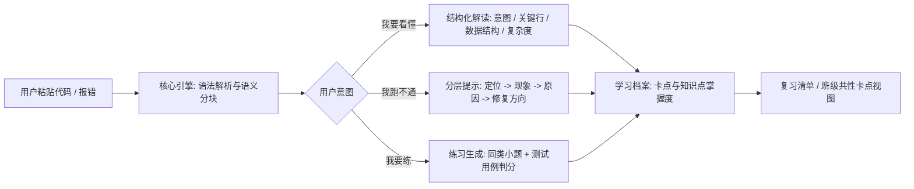

# 问题定义与产品描述（Problem Definition）

| 项目 | 内容 |
|---|---|
| 项目名称 | CodeLens · 智能代码学习平台 |
| 文档版本 | v0.1（第 1 周初稿） |
| 状态 | 待评审 |
| 负责人 | TBD（需求负责人） |
| 更新日期 | 2026-10-17 |
| 对应检查点 | 第 1 周：提交仓库链接，通过 GitHub Issue 获得第一轮反馈 |
| 依据 | 课程任务要求；小组讨论记录（见 `docs/mgmt/`） |

> 说明：文中标注 ⚠️ 的条目为**尚未与指导教师/真实用户确认的假设**，需在第 2 周用户调研后回填证据（见第 5 节）。

## 0. 摘要

编程初学者在「读代码」这一环普遍缺少可用的脚手架：搜索引擎给的是零散结论，通用 AI 助手给的是可以直接抄走的完整答案，课堂与教材给的是统一进度而非个人卡点。CodeLens 要做的是把**代码解读、调试引导、针对性练习**三件事串成一条闭环，并且在每一步都**先引导、后给答案**，让学习者保持在「自己想一想」的区间内。

目标用户是**正在上第一门编程课的大学生**（以 C/C++、Python 入门课为主）以及他们的助教。最小可用产品（MVP）聚焦一个高频场景：**贴进一段看不懂或跑不通的代码，5 秒内得到分层解读；点开提示后知道错在哪、为什么错、该补哪个知识点。**

## 1. 5W1H 分析

### 1.0 汇总表

| 维度 | 关键提问 | 结论 |
|---|---|---|
| **What** | 要解决什么问题？ | 初学者「读不懂代码、定位不到错误、练不到薄弱点」，现有工具给出的帮助要么太浅（只报错），要么太满（直接给答案） |
| **Why** | 为什么必须解决？ | 读代码能力是编程课的核心目标，也是作业/考试/后续课程的门槛；卡点长期无法自行解决会直接转化为畏难与抄袭 |
| **Who** | 谁遇到了这个问题？ | 主要：入门课的低年级学生；相关：课程的助教与任课教师；次要：跨专业转码者、自学编程者 ⚠️ |
| **When** | 什么时候发生？ | 写作业与实验报告时、考试前复习时、课后自主刷题时；集中在学期第 3–12 周课业压力上升期 |
| **Where** | 在哪个环境发生？ | 课后机房/宿舍的浏览器与 IDE 环境；课堂与实验课现场；线上答疑群与课程平台 |
| **How** | 如何解决？ | 以「代码解析 + 分层引导提示 + 练习生成」为核心引擎，提供 Web 端贴码即用的闭环，并把卡点沉淀为学习档案与教学反馈 |

### 1.1 What — 我们要解决什么问题

问题可以从三个层面描述：

1. **理解层**：面对一段陌生代码，初学者只能逐行线性阅读，无法识别「这段在做什么」「哪几行是关键」「用了什么数据结构、复杂度如何」。结果是能看懂语法，却说不出程序的意图。
2. **调试层**：报错信息通常是英文且信息密度高（如 `Segmentation fault`、`RecursionError: maximum recursion depth exceeded`），初学者缺少「症状 → 可能原因」的映射经验，常常随机改代码直到碰巧能跑，而不知道自己真正错在哪里。
3. **练习层**：即使通过提问搞懂了一道题，也没有机制确保同类问题下次会做。学习者很难从「我不懂」跳到「我该怎么练」，练习即刷整套题，效率低、打击热情。

**核心矛盾**：现有 AI 工具默认「给答案」，而教学场景需要「先引导、后揭示」。这个矛盾既是问题的组成部分，也是 CodeLens 的差异化立足点。

### 1.2 Why — 为什么值得解决

- **对学习者**：缩短「卡住 → 搞懂」的时间，把挫败感控制在可承受范围；把零散的问答沉淀为可复习的知识点清单。
- **对课程与教师**：班级共性卡点可视化后，课堂讲评可以针对真实薄弱点，减少重复答疑；助教答疑负担下降，同时保留对学生求助行为的可观测性。⚠️（需在第 2 周访谈助教验证）
- **对本项目组**：选题场景明确、评价指标可量化（解读准确率、提示采纳率、练习正确率、满意度），且能覆盖课程要求的算法设计（代码解析、复杂度分析）与软件工程实践（多端联调、CI、测试）。
- **风险反面**：如果工具直接给答案，将放大抄袭与「不看过程只要结果」的行为，与教育目标相悖。这是我们必须主动设计规避的。

### 1.3 Who — 为谁解决

| 优先级 | 用户 | 特征 | 真实诉求 |
|---|---|---|---|
| 主要用户 | 入门课学生（大一/大二，C/C++、Python） | 有基础语法，缺工程经验；遇到报错束手无策 | 「告诉我大概错在哪，但别直接把答案给我」 |
| 直接相关者 | 助教 / 任课教师 | 面对几十到上百人答疑，重复问题多 | 「看看全班卡在哪，讲评时讲重点」 |
| 次要用户 ⚠️ | 跨专业转码者、在校自学者 | 学习时间零散，缺少同伴与反馈 | 「随时能问、能练、能看到进步」 |
| 环境相关者 | 课程组 / 教学管理者 | 关注工具是否可被引入教学流程 | 「是否合规、是否增加负担」 |

### 1.4 When — 何时发生

| 时间节点 | 场景 | 对产品的含义 |
|---|---|---|
| 课后完成作业（每周 2–3 次） | 对着题目看不出思路、调不出结果 | 主场景，要求响应快、贴码即用 |
| 实验课 / 课堂现场 | 教师演示后自行练习时卡住 | 需要低门槛、无需注册即可试用 |
| 考试前集中复习（第 14–16 周） | 复习错题与知识点 | 需要学习档案与复习清单（F4） |
| 自由刷题时间 | 想按知识点练习 | 需要个性化练习生成（F3） |

### 1.5 Where — 在什么环境发生

- **物理/设备环境**：宿舍或机房的普通 PC，浏览器为主；部分用户使用 VS Code 等 IDE 与在线判题平台。
- **软件环境**：Windows / macOS 桌面浏览器，移动端仅需保证可查看。
- **协作/社交环境**：课程 QQ/微信群、课程平台讨论区、GitHub Issue —— 这也是我们获取第一轮反馈的渠道。
- **边界提醒**：涉及学生代码与报错信息，属于学习行为数据，需明确不用于公开传播，并默认不长期保存原文。⚠️（合规口径待与教师确认）

### 1.6 How — 如何解决

总体思路：**解析在前、生成在后、引导优先。**

关键设计决策：

1. **先解析再询问模型**：用 AST/tree-sitter 抽出结构信息（函数、控制流、可疑行）后再交给大模型，降低幻觉、减少无效 token。
2. **提示分层、逐级展开**：默认只展示第一层提示，用户点击才进入下一层，把「直接抄答案」的成本抬高。
3. **判分靠测试用例**：练习结果由可执行测试判定，而不是让模型自评，保证反馈可信。
4. **数据回流**：卡点记录形成个人档案与班级视图，让一次答疑的价值扩展到复习与讲评。

## 2. 产品描述

### 2.1 产品定位与价值主张

> **一句话定位**：CodeLens 是面向编程初学者的「引导式代码学习平台」——先让你自己想，再告诉你答案。

| 面向 | 价值主张 |
|---|---|
| 学习者 | 贴一段代码，5 秒内知道它在做什么、错在哪、该练什么，而且不会被直接喂答案 |
| 助教/教师 | 班级卡点聚集到一张视图上，答疑与讲评有的放矢 |
| 与通用 AI 助手的区别 | 教育场景的「限制性设计」：分层提示 + 测试判分 + 学习档案，而不是一问一答即给完整解 |

### 2.2 用户画像

**画像 A · 小 Q（主要用户）**

- 大一，计算机或电子类专业，学 C 语言第 8 周；
- 语法能看懂，但遇到 `Segmentation fault` 只会注释代码块试；
- 常用手段：问同学、百度「XX 报错怎么办」、把代码丢给 AI 要完整答案；
- 目标：作业能自己调通、期末不挂科；
- 顾虑：「提示给太细我也懒得想，但只报错我又不会。」

**画像 B · 张助教（直接相关者）**

- 带 2 个班共 90 人，每周答疑 3–4 小时；
- 同一类错误（指针未初始化、数组越界、循环边界）要讲几十遍；
- 目标：把时间花在「讲思路」而不是「重复定位」上。

**画像 C · 转码自学者（次要用户）⚠️**

- 非科班，学习时间零散，缺少同伴反馈；
- 目标：有稳定的学习节奏与可量化的进步。

### 2.3 痛点 → 需求映射

| 编号 | 痛点（谁 / 何时） | 需求陈述 | 对应功能 | 优先级 |
|---|---|---|---|---|
| P1 | 学生读不懂整段代码的意图 | 我需要一段代码的「整体说明 + 关键行解释」 | F1 | 必须 |
| P2 | 学生看不懂英文报错、定位不到错误 | 我需要按层次给的定位提示，而不是一次性答案 | F2 | 必须 |
| P3 | 学生搞懂一题但同类题仍不会 | 我需要针对我卡住的知识点的同类练习，并且有客观判分 | F3 | 必须 |
| P4 | 学生无法判断自己是否真的在进步 | 我需要看到卡点记录与知识点掌握度 | F4 | 应该 |
| P5 | 助教重复答疑、教师不了解班级整体情况 | 我需要看到班级共性卡点 | F5 | 可选 |
| P6 | 学生担心代码被上传、被传播 ⚠️ | 我需要明确的数据处理说明与可控的保存策略 | 非功能需求 | 必须 |

### 2.4 核心功能（MVP 范围）

| 编号 | 功能 | 输入 / 输出 | 关键验收标准 |
|---|---|---|---|
| **F1** | 代码结构化解读 | 输入：≥5 行的单文件代码；输出：整体意图、语义块说明、关键数据结构、时间复杂度估计 | 对课程内 20 段示例代码，学生判定「说明与代码相符」的比例 ≥ 80% |
| **F2** | 调试引导（分层提示） | 输入：代码 + 报错信息；输出：四层提示（定位 → 现象 → 原因 → 修复方向） | 20 个已知缺陷样本中，第一层提示能指向正确代码区域的比例 ≥ 70%；完整答案默认折叠 |
| **F3** | 练习生成与判分 | 输入：薄弱知识点；输出：同类小题 + 可执行判分 | 生成的题目中可直接运行判分的比例 ≥ 90%；题干无语法错误 |
| **F4** | 学习档案与复习清单 | 输入：历史卡点；输出：知识点掌握度与每周复习清单 | 第 2 迭代交付 |
| **F5** | 班级/助教视图 | 输入：班级卡点聚合；输出：共性错误 Top N | 第 3 迭代交付 |

**一条典型用户旅程（MVP 主流程）**

1. 小 Q 打开 CodeLens，粘贴 30 行 C 代码和报错 `Segmentation fault (core dumped)`；
2. 系统 5 秒内返回结构解读，并在第 17 行标注「可疑：指针未初始化即解引用」；
3. 小 Q 点开第一层提示「问题出现在第 15–20 行之间」，再点开第二层「访问了未指向有效内存的指针」；
4. 小 Q 自己改好后点「验证」，系统运行测试用例确认通过；
5. 系统提示「你本周在第 3 次遇到指针相关问题」，推荐 2 道同类练习；
6. 卡点写入学习档案，周末生成复习清单。

### 2.5 非功能需求

| 类别 | 需求 | 指标（MVP） |
|---|---|---|
| 性能 | 贴码到首屏解读返回的响应时间 | P95 ≤ 8 秒（≤200 行代码） |
| 可靠性 | 判分与提示服务可用性 | 演示期 ≥ 99%；失败时给出明确错误而非静默失败 |
| 成本 | 单次解读的大模型调用成本可控 | 通过预解析裁剪上下文，单次解读 ≤ 0.02 元 ⚠️（按选定模型计价测算） |
| 安全与隐私 | 用户代码不出现在公开日志；密钥不入库不入仓库 | `.env` 不进版本库；上传文本默认 7 天自动删除 ⚠️ |
| 可用性 | 无需培训即可上手；首次使用 3 步内完成一次解读 | 新用户任务完成率 ≥ 90% ⚠️ |
| 可维护性 | 核心引擎与提示策略解耦，提示模板可配置 | 新增一类语言支持不改动前端代码 |
| 可扩展性 | 支持从 Python 扩展到 C/C++ | 解析层按语言插件化 |

### 2.6 竞品与替代方案对比

| 方案 | 能做什么 | 不足（对我们的机会） |
|---|---|---|
| 通用 AI 助手（ChatGPT 等） | 解释、改错、生成练习都能做，能力强 | 默认一次给完整答案，缺少分层引导与学习档案；学生易产生依赖 |
| 在线判题平台（LeetCode 等） | 题目与判分体系成熟 | 面向刷题与面试，不解释「我这段代码错在哪」，不面向课程与班级 |
| 代码可视化执行工具（如 Python Tutor 类） | 逐步执行、内存可视化 | 只呈现过程不讲原因，不生成练习，与课程知识点不挂钩 |
| 搜索引擎 / 问答社区（CSDN、Stack Overflow） | 覆盖大量具体报错 | 结果零散、需自行匹配场景；信息质量参差 |
| 课程助教人工答疑 | 最贴合课程与个体 | 响应慢、覆盖有限；教师难获知班级整体卡点 |

**差异化定位**：不做「更强的聊天机器人」，而做**教学流程中的引导层**：分层提示控制答案释放节奏，测试用例保证反馈客观，学习档案让一次答疑产生长期价值。

### 2.7 范围边界

**本期要做（MVP）**

- 单文件代码的结构化解读（先支持 Python，其次 C/C++）；
- 基于报错信息与代码的分层提示；
- 按知识点生成练习并用测试用例判分；
- Web 端可用，桌面浏览器优先。

**本期不做**

- 不做在线 IDE / 完整编译运行环境（仅后端沙箱执行判分用途）；
- 不做班级管理、作业收发、成绩系统（仅班级卡点视图）；
- 不做代码自动重构、性能优化建议；
- 不覆盖多文件/大型工程与竞赛级题目；
- 不提供可直接提交作业的完整答案输出（产品层面的刻意限制）。

### 2.8 成功度量指标

| 类型 | 指标 | MVP 目标 |
|---|---|---|
| 有效性 | 解读与代码相符率（学生判定） | ≥ 80% |
| 有效性 | 第一层提示命中正确代码区域的比例 | ≥ 70% |
| 教学价值 | 提示被逐层展开（而非直接跳到答案）的比例 | ≥ 60% ⚠️ |
| 学习效果 | 完成推荐练习后同类问题再次卡点率下降 | 下降 ≥ 30% ⚠️ |
| 效率 | 助教答疑重复问题占比变化 | 下降 ≥ 20% ⚠️ |
| 满意度 | 试用学生评分（5 分制） | ≥ 4.0 |

## 3. 假设、风险与依赖

| 编号 | 类型 | 内容 | 影响 | 应对 |
|---|---|---|---|---|
| R1 | 风险 | 大模型解释不准确（幻觉），误导学习者 | 高 | 先解析后生成、限制上下文、以测试用例校验可执行结论；输出中标注不确定项 |
| R2 | 风险 | 用户绕过引导，反复点击直到拿到完整答案 | 中 | 分层次数可视化、答案需确认后展开；教学中配合说明使用规范 |
| R3 | 风险 | 调用成本随使用量上升 | 中 | 预解析裁剪输入、缓存热门问题、设定单用户配额 |
| R4 | 风险 | 学生代码隐私与学术诚信争议 | 中高 | 明确的隐私说明与自动删除策略；禁止输出「作业可直接提交的完整答案」⚠️ |
| R5 | 风险 | 组内人力不足导致 MVP 范围失控 | 中 | 按 F1→F2→F3 顺序收敛，先保证主流程闭环 |
| R6 | 假设 | 学生对「先引导后答案」接受度高 | 中 | 第 2 周用问卷/A-B 小样本验证，若不接受则调整提示粒度 |
| R7 | 假设 | 课程示例代码以单文件为主 | 低 | 与教师确认课程作业形态 |
| R8 | 依赖 | 大模型 API 可用性与配额 | 中 | 准备本地小模型降级方案，保证演示不中断 |
| R9 | 依赖 | 沙箱执行环境（判分用） | 中 | 限制资源与超时，避免恶意代码影响服务 |

## 4. 里程碑与验证方式

| 周次 | 里程碑 | 验证方式 |
|---|---|---|
| W1 | 仓库与问题定义完成 | 提交仓库链接，通过 GitHub Issue 获得第一轮反馈 |
| W2 | 需求与算法设计定稿 | 需求评审会：用户故事与用例通过组内评审；痛点假设完成小样本调研 |
| W3 | 架构与最小链路可运行 | 设计评审：粘贴代码 → 返回解读的端到端链路演示 |
| W4–W6 | MVP（F1–F3）实现与测试 | 迭代演示 + 单元/集成测试通过；用 20 段课程代码做准确率抽样 |

## 5. 待确认问题

1. 课程/教师对 AI 辅助工具用于作业的边界要求是什么？（可否使用、如何标注）
2. 是否可获得真实的课程代码样本与报错日志用于测试？（不涉及个人信息）
3. 用户代码保存策略：默认保存多久、是否允许用户选择不保存？
4. 首期语言范围：Python 优先还是按课程进度先做 C/C++？
5. 是否需要与现有课程平台（如在线判题/作业系统）对接，还是独立 Web 应用？
6. 小组角色与成员分工（README 团队表待填）。

## 附录 A · 术语表

| 术语 | 含义 |
|---|---|
| 5W1H | What / Why / Who / When / Where / How，问题定义的结构化分析框架 |
| MVP | Minimum Viable Product，最小可用产品，本项目指 F1–F3 功能闭环 |
| 分层提示 | 将完整答案拆成由浅入深的若干层，用户主动展开才看到下一层 |
| 语义分块 | 按函数、循环、分支等语义单元把代码切分为带说明的片段 |
| 卡点 | 学习者在某个知识点上反复出错或反复求助的记录 |
| 判分用例 | 用于验证练习答案正确性的可执行测试输入输出 |

## 附录 B · 参考与依据

- 课程任务要求：建立项目仓库与规范 README、建立 Kanban / Team planning / Bug tracker、完成 5W1H 报告与产品描述（第 1 周检查点）；
- 仓库协作规范：`CONTRIBUTING.md`、`docs/mgmt/branching-and-commit.md`；
- 迭代任务分解：`docs/mgmt/backlog.md`。
