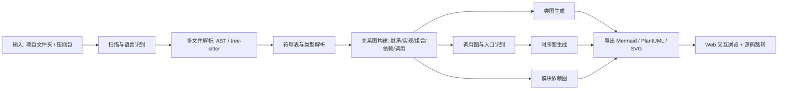

# 问题定义与产品描述（Problem Definition）

| 项目 | 内容 |
|---|---|
| 项目名称 | CodeLens · 项目结构可视化工具 |
| 文档版本 | v0.2（第 1 周修订） |
| 状态 | 待评审 |
| 负责人 | TBD（需求负责人） |
| 更新日期 | 2026-10-17 |
| 对应检查点 | 第 1 周：提交仓库链接，通过 GitHub Issue 获得第一轮反馈 |
| 依据 | 课程任务要求；小组讨论结论（输入为项目文件夹，输出类图/时序图等） |

> 说明：文中标注 ⚠️ 的条目为**尚未确认的决策或假设**，需在 W2 调研与评审后回填（见第 5 节）。

## 0. 摘要

初学者进入一个陌生项目时，最缺的不是语法知识，而是一张「结构地图」：项目由哪些模块组成、类之间是什么关系、一次调用从哪里进来又经过谁。现实中的项目往往缺少文档，或文档已经过时；IDE 只能在单个文件间跳转，商业静态分析工具门槛高。CodeLens 把**一个项目文件夹**变成可直接阅读的**类图、时序图与模块依赖图**，帮助使用者在最短时间内建立对项目的整体认知。

本项目面向刚接触陌生项目的初学者，但产品目标不是「教学」或「刷题」，而是**理解与可视化**：图中的每个节点、每条关系都可回溯到源码位置，使用者看图即可定位代码、读代码即可验证图。

## 1. 5W1H 分析

### 1.0 汇总表

| 维度 | 关键提问 | 结论 |
|---|---|---|
| **What** | 要解决什么问题？ | 陌生项目缺乏可读的结构视图：模块关系、类关系、调用链分散在大量文件中，初学者难以建立整体认知 |
| **Why** | 为什么必须解决？ | 上手成本高、误改风险大、文档维护成本高；对初学者而言，「从文件到架构」的抽象能力最欠缺 |
| **Who** | 谁遇到了这个问题？ | 主要：新加入项目的学生与初级开发者；相关：项目组长、教师/评审、接手遗留系统的工程师 |
| **When** | 什么时候发生？ | 加入新项目的第一天、接手他人模块、课程设计/答辩准备、代码评审与验收前 |
| **Where** | 在哪个环境发生？ | 本地项目目录（Windows/macOS/Linux）；浏览器中的交互式报告；CI 中自动生成的架构文档 |
| **How** | 如何解决？ | 多文件静态解析 → 符号表与关系图 → 类图/调用链/时序图 → 可视化与导出，全部可溯源到源码行号 |

### 1.1 What — 我们要解决什么问题

问题发生在「项目级」而不是「代码片段级」：

1. **结构不可见**：一个中等规模项目有几十上百个文件，目录树只能表达物理位置，无法表达模块职责与依赖方向；初学者不知道该从哪里读起。
2. **类关系分散**：继承、实现、组合、关联、依赖散落在不同文件，IDE 只能逐个跳转；全局的类图难以获得。
3. **调用链跨文件**：一次操作会跨越 Controller → Service → Repository 等多层，静态阅读时很难还原完整时序；而时序图是最贴近「程序如何运行」的视图。
4. **文档与代码脱节**：手工绘制的架构图维护成本高，很快就过时；项目 README 通常只讲运行方式，不讲结构。

**核心矛盾**：初学者最需要的是「全局视图」，而现有工具大多提供「局部信息」（单文件跳转、单个函数定义、单条问答）。CodeLens 的切入点就是把局部信息自动聚合为全局可读的图。

### 1.2 Why — 为什么值得解决

- **对上手的价值**：把「几天摸清结构」压缩到「几十分钟建立地图」，显著降低新成员进入项目的门槛；
- **对质量的价值**：结构可见之后，改动的连带影响更清楚，减少误改与回归缺陷；
- **对文档的价值**：图从代码自动生成，可随代码更新，避免「文档写完即过期」；
- **对课程的适配**：本题覆盖多文件解析、图构建、可视化与导出，技术含量充分，且可用课程项目本身作为样例数据验证效果。

**明确不做的价值主张**：我们不做逐行讲解、不做练习生成、不做作业辅导。产品的成功标准是「看完图能说清项目结构」，不是「刷题正确率」。

### 1.3 Who — 为谁解决

| 优先级 | 用户 | 特征 | 真实诉求 |
|---|---|---|---|
| 主要用户 | 刚加入项目组的学生 | 会写代码，但第一次面对多人协作的完整项目 | 「先给我一张图，告诉我从哪读起」 |
| 主要用户 | 初级开发者 / 实习生 | 需要在一两天内接手一个陌生模块 | 「这条请求到底经过了哪些类？」 |
| 直接相关者 | 组长 / 教师 / 评审 | 需要快速评估项目结构与完成度 | 「模块划分是否清晰、耦合是否合理」 |
| 次要用户 ⚠️ | 接手遗留项目的工程师 | 代码无文档、原作者已离开 | 「有没有能自动生成的架构视图」 |

### 1.4 When — 何时发生

| 时间节点 | 场景 | 对产品的含义 |
|---|---|---|
| 加入项目第 1 天 | 看目录、看 README、逐文件浏览 | 需要「一键生成」与快速出图 |
| 接手他人模块 | 定位某个功能的实现路径 | 需要按入口生成时序图 |
| 课程设计中期/答辩前 | 需要画出系统架构与关键流程 | 需要导出到 Mermaid/PlantUML/SVG |
| 代码评审 / 验收前 | 评估改动影响与模块耦合 | 需要依赖图与调用图 |

### 1.5 Where — 在什么环境发生

- **本地开发环境**：Windows/macOS/Linux 下的项目文件夹，作为主要输入；
- **浏览器**：交互式查看图、点击节点跳转到源码位置；
- **CI 环境**：提交代码后自动重新生成架构图与报告，作为文档产出；
- **隐私边界**：默认在本地完成解析与出图；若启用模型辅助说明，需明确提示上传内容并获得确认。

### 1.6 How — 如何解决

总体思路：**静态解析为主，图结构可溯源；模型只做文字补充。**

关键设计决策：

1. **以静态分析为事实来源**：类与调用关系来自解析结果，可定位到 `文件:行号`，保证图与代码一致；
2. **多视图互补**：类图回答「有哪些角色」，时序图回答「流程如何发生」，模块依赖图回答「系统如何分层」；
3. **先支持单语言完整链路**：把一个语言（含导入、包结构、多态）做扎实，再扩展语言插件；
4. **图要能读**：对大型项目做按模块聚类、按层次裁剪，默认只展示核心结构，支持展开；
5. **模型只做描述**：可选的模型辅助仅用于为类/模块生成一句话职责说明，不参与结构推断。

## 2. 产品描述

### 2.1 产品定位与价值主张

> **一句话定位**：CodeLens 是面向初学者的项目结构可视化工具——给一个项目文件夹，自动生成类图、时序图与模块依赖图。

| 面向 | 价值主张 |
|---|---|
| 新成员 | 一个命令得到项目的「全局地图」，按图读代码，而不是无目的地翻文件 |
| 接手者 | 按入口生成时序图，快速还原一条完整调用路径 |
| 评审者 | 直接查看类关系与模块依赖，评估结构与耦合 |
| 与 IDE / 商业工具相比 | 轻量、无需逐文件配置、一次输出多视图，且面向初学者优化可读性 |

### 2.2 用户画像

**画像 A · 小 Q（主要用户：刚加入课程项目组）**

- 大二，学过 C/C++ 与 Python，第一次接手组内三人协作项目；
- 拿到代码后能看懂单个函数，但说不清模块划分；
- 目标：一天内能讲清楚「项目由哪些部分组成、主要流程有哪些」；
- 顾虑：「别给我一堆文件列表，我要一张能看懂结构的图。」

**画像 B · 李工（主要用户：初级开发者）**

- 入职两周，被安排修复订单模块的缺陷；
- 需要知道一次下单请求经过哪些类、哪一层做了校验；
- 目标：快速定位改动点及其影响范围。

**画像 C · 王老师 / 组长（直接相关者）**

- 需要评估课程设计项目结构是否合理；
- 目标：看一眼类图与依赖图，判断分层与耦合。

### 2.3 痛点 → 需求映射

| 编号 | 痛点（谁 / 何时） | 需求陈述 | 对应功能 | 优先级 |
|---|---|---|---|---|
| P1 | 新成员不知道从哪读起 | 我需要项目级总览：模块、目录职责与依赖方向 | F1、F4 | 必须 |
| P2 | 类关系散落在多文件 | 我需要自动生成的类图，包含继承/实现/组合/关联 | F2 | 必须 |
| P3 | 调用链跨文件难追踪 | 我需要从入口出发的时序图，能看清消息顺序 | F3 | 必须 |
| P4 | 手工架构文档很快过时 | 我需要从代码直接生成、可随代码更新的图 | F6 | 必须 |
| P5 | 商业工具昂贵、上手复杂 | 我需要轻量、一键可用、可导出的工具 | 整体 | 必须 |
| P6 | 担心源码外泄 ⚠️ | 我需要本地处理，且上传内容可控 | 非功能需求 | 必须 |
| P7 | 图太大看不懂 | 我需要按模块聚类、分层展示，可展开细看 | F5 | 应该 |
| P8 | 不知道某个类负责什么 | 我需要一句话的职责说明作为图注 | F7 | 可选 |

### 2.4 核心功能（MVP 范围）

| 编号 | 功能 | 输入 / 输出 | 关键验收标准 |
|---|---|---|---|
| **F1** | 项目扫描与多文件解析 | 输入：项目文件夹；输出：语言识别、源文件清单、包/模块结构、符号表 | 对样例项目，非生成代码的源文件纳入分析比例 ≥ 95% |
| **F2** | 类图生成 | 输入：解析结果；输出：类、属性、方法、继承/实现/组合/关联/依赖关系 + 源码位置 | 两个人工标注的样例项目中，类与关系识别的 F1 值 ≥ 0.85 ⚠️ |
| **F3** | 时序图生成 | 输入：入口函数或用户指定函数；输出：参与者列表与消息序列（含循环/条件标注） | 20 条典型调用链中，参与者与消息顺序正确率 ≥ 80% ⚠️ |
| **F4** | 模块依赖图 / 调用图 | 输入：导入与调用关系；输出：包/文件级依赖图、函数级调用图 | 能识别循环依赖与层级方向，图例清晰 |
| **F5** | 交互式浏览 | 输入：图数据；输出：可缩放/点击的 Web 视图，节点直达源码 | 点击任一节点能定位到正确的文件与行号 |
| **F6** | 导出与报告 | 输出：Mermaid / PlantUML / SVG + Markdown 报告 | 导出的 Mermaid 可被官方渲染器正常渲染 |

**一条典型用户旅程（MVP 主流程）**

1. 小 Q 把组内项目文件夹（约 60 个 Python 文件）交给 CodeLens；
2. 工具扫描后输出模块依赖图，标出 `api/`、`service/`、`repository/` 三层与两处循环依赖；
3. 小 Q 打开类图，看到 `OrderService` 依赖 `OrderRepository` 与 `PaymentGateway`；
4. 小 Q 选择入口 `create_order`，得到时序图：请求经过校验、库存扣减、支付、落库；
5. 点击图中的 `PaymentGateway`，跳转到对应源码第 42 行；
6. 导出 `class-diagram.mmd` 与 `sequence-order.mmd`，放进课程设计文档。

### 2.5 非功能需求

| 类别 | 需求 | 指标（MVP） |
|---|---|---|
| 性能 | 中等项目（≤200 文件）完成解析与出图 | ≤ 60 秒（普通笔记本） |
| 准确性 | 图与代码一致 | 所有节点/边可定位源码；抽样一致率 ≥ 90% ⚠️ |
| 可读性 | 图不能「糊成一团」 | 提供图例、模块聚类与按层裁剪；单张视图节点 ≤ 60 个 ⚠️ |
| 隐私 | 源码默认不外传 | 默认本地处理；启用模型说明需显式确认 |
| 可移植 | 跨平台 | Windows / macOS / Linux 均可运行 |
| 可扩展 | 支持多语言 | 解析层按语言插件化，新增语言不改动图生成与前端 |
| 可维护性 | 输出格式标准化 | 图数据使用统一中间表示（IR），与导出格式解耦 |

### 2.6 竞品与替代方案对比

| 方案 | 能做什么 | 不足（我们的机会） |
|---|---|---|
| IDE 类图插件（如 IntelliJ / VS Code 插件） | 单项目或单包类图，体验成熟 | 多数只支持特定语言；时序图能力弱；需逐个配置 |
| 商业工具（如 Understand、Structure101） | 强大的静态分析与依赖分析 | 价格高、学习成本高，不适合学生与小项目 |
| Sourcetrail（已停止维护） | 代码索引与关系浏览 | 不再更新；无自动时序图；上手仍需学习 |
| PlantUML / Doxygen / Mermaid | 图描述与文档生成 | 需要手写或依赖注释，无法从普通代码自动还原结构 |
| 通用大模型 | 能解释代码、总结模块 | 结构结论不可靠、不可溯源，容易出现不存在的类与调用 |

**差异化定位**：面向初学者的**一键多视图**工具——类图 + 时序图 + 依赖图，全部由静态分析生成、可点击回到源码；模型只做辅助说明，保证结构可信。

### 2.7 范围边界

**本期要做（MVP）**

- 输入单语言项目文件夹（首期语言待定，见第 5 节 ⚠️）；
- 生成类图、时序图、模块依赖图；
- 导出 Mermaid（优先）与 PlantUML；
- CLI 使用 + 简易 Web 预览；
- 样例项目与准确率评估脚本。

**本期不做**

- 不做运行时动态追踪（MVP 仅静态分析；动态 tracing 列入后续迭代）；
- 不做 IDE 插件集成（仅 CLI + Web）；
- 不做逐行教学、代码问答、练习生成；
- 不保证对反射、动态导入、框架魔法（如 DI 容器）完全还原，需在报告中标注「推断关系」；
- 不处理二进制、编译产物与第三方依赖源码（默认排除）。

### 2.8 成功度量指标

| 类型 | 指标 | MVP 目标 |
|---|---|---|
| 可用性 | 样例项目端到端生成成功率 | ≥ 90% |
| 准确性 | 类与关系识别 F1 | ≥ 0.85 ⚠️ |
| 准确性 | 时序图消息顺序正确率 | ≥ 80% ⚠️ |
| 理解效率 | 新成员回答「结构问题」的用时 | 相比纯阅读下降 ≥ 50% ⚠️ |
| 可读性 | 图可读性评分（5 分制，≥10 人） | ≥ 4.0 |
| 产出质量 | 导出文件一次渲染成功率 | 100% |

## 3. 假设、风险与依赖

| 编号 | 类型 | 内容 | 影响 | 应对 |
|---|---|---|---|---|
| R1 | 风险 | 动态语言（Python）类型与调用目标难以静态确定（多态、反射、动态导入） | 高 | 采用启发式推断并在图上区分「确定/推断」；优先支持类型标注完善的代码 |
| R2 | 风险 | 大型项目图节点爆炸，图不可读 | 高 | 模块聚类、层级裁剪、按需展开；限制默认视图规模 |
| R3 | 风险 | 时序图静态推导不完整（框架注入、回调、异步） | 中高 | 明确入口选择、支持手动指定；在图中标注不确定性 |
| R4 | 风险 | 多语言解析工作量失控 | 中 | 首期只做单一语言，插件化设计，其他语言排后续 |
| R5 | 风险 | 学生代码风格差异大，解析失败 | 中 | 建立样例项目集与回归测试，失败给出可读错误与定位 |
| R6 | 风险 | 源码隐私与模型调用合规 | 中 | 默认本地处理；上传前确认；不把源码写入日志 |
| R7 | 假设 ⚠️ | 目标用户以 Python 项目为主 | 中 | 与课程实际项目确认后决定首期语言 |
| R8 | 假设 ⚠️ | 用户能接受「静态推断可能不完整」 | 中 | 图中标注置信度与来源，提供人工确认入口 |
| R9 | 依赖 | Graphviz / Mermaid 渲染能力 | 低 | 优先输出文本格式（Mermaid/PlantUML），渲染交由生态 |

## 4. 里程碑与验证方式

| 周次 | 里程碑 | 验证方式 |
|---|---|---|
| W1 | 仓库与问题定义完成 | 提交仓库链接，通过 GitHub Issue 获得第一轮反馈 |
| W2 | 需求与算法设计定稿 | 需求评审：用户故事/用例通过；确定首期语言与评估样例项目 |
| W3 | 架构与最小链路 | 设计评审：文件夹 → 解析 → 结构化 JSON → 渲染一张类图 |
| W4–W6 | MVP（F1–F4、F6） | 迭代演示：样例项目生成类图、时序图、依赖图并成功导出 |

## 5. 待确认问题

1. **首期支持语言**：Python / Java / C++ 三选一（直接影响解析器与样例项目）⚠️；
2. 输入方式优先级：CLI 优先，还是直接做 Web 上传压缩包？
3. 时序图的入口如何确定：自动识别 `main` / 路由函数，还是要求用户手动选择函数？
4. 目标项目规模：课程项目（≤50 文件）还是更大规模（≤200 文件）？
5. 是否需要支持导出 SVG/PNG 图片，还是 Mermaid/PlantUML 源码即可满足课程文档需求？
6. 是否允许在启用「智能说明」时把代码片段发送到模型服务？（默认关闭）
7. 小组角色与成员分工（README 团队表待填）。

## 附录 A · 术语表

| 术语 | 含义 |
|---|---|
| 类图 | UML 类图，展示类、属性、方法及类之间的关系 |
| 时序图 | UML 顺序图，展示参与者之间按时间顺序的消息交互 |
| 模块依赖图 | 展示包/目录/文件之间的导入与依赖方向 |
| 调用图 | 以函数为节点、调用关系为边的有向图 |
| 符号解析 | 把代码中的名称（类、函数、变量）绑定到其定义位置的过程 |
| 中间表示（IR） | 解析结果与图数据的统一结构，供多种导出格式复用 |
| 静态分析 | 不运行程序，仅通过源码推断结构与关系 |
| 推断关系 | 由启发式规则推断、可能不完全确定的关系，需在图中标注 |

## 附录 B · 参考与依据

- 课程任务要求：建立项目仓库与规范 README、建立 Kanban / Team planning / Bug tracker、完成 5W1H 报告与产品描述（第 1 周检查点）；
- 小组讨论结论：输入为项目文件夹；输出类图、时序图等结构视图；面向初学者但核心是理解而非教学；
- 仓库协作规范：`CONTRIBUTING.md`、`docs/mgmt/branching-and-commit.md`；
- 迭代任务分解：`docs/mgmt/backlog.md`。
