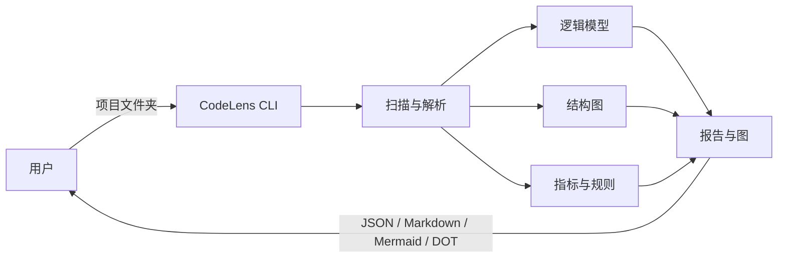

# CodeLens 软件需求规范书（SRS）

## 文档控制

| 项目 | 内容 |
|---|---|
| 文档编号 | CL-SRS-001 |
| 文档版本 | v1.0 |
| 编制日期 | 2026-10-17 |

### 修订记录

| 版本 | 日期 | 修订内容 | 修订人 |
|---|---|---|---|
| v1.0 | 2026-10-17 | 初稿：功能需求 19 条、非功能需求 10 条、接口与数据需求、验收与追溯 | 钱永康 |

---

## 1. 引言

### 1.1 目的

本文档定义 CodeLens 的系统需求，作为设计、开发、测试与验收的共同依据。文档回答三个问题：

1. 系统必须提供哪些能力（功能需求）；
2. 这些能力必须达到什么质量水平（非功能需求）；
3. 如何验证系统满足要求（验收与追溯）。


### 1.2 范围

**产品定位**：输入一个由 AI 生成或 AI 辅助生成的 Python 项目文件夹，输出代码逻辑、结构图与质量/风险报告，使黑盒代码成为可审查对象。

**本期范围（P0/P1）**

- 单语言：Python 3.11；
- 输入：本地项目文件夹；
- 输出：语句轨迹、CFG、def-use、类图、调用图、时序图、模块依赖图、复杂度、坏味、SOLID、AI 代码风险 A1–A5、健康度评分、Markdown/JSON 报告；
- 形态：CLI 为主，Web 预览列为后续迭代；
- 分析方式：纯静态，不执行被测代码，不调用大模型。

**范围外**

- 运行时动态追踪、自动修复、自动重构；
- IDE 插件、多语言支持（Java/C++ 等）；
- 基于模型的问答（GraphRAG）与代码生成/修改（任何阶段均不做）；
- 模型参与结构推断、指标计算与规则判定（说明层同样不做）；
- 增量分析（P2 规划）。

> 说明：MVP 全流程不调用模型；P2 交付说明层（FR-19），默认使用模板，配置模型后启用 LLM，仅限三种文字用途。

### 1.3 术语与缩略语

| 术语 | 说明 |
|---|---|
| AST | 抽象语法树（Abstract Syntax Tree） |
| CFG | 控制流图（Control Flow Graph） |
| def-use | 变量定义点与使用点的数据流关系 |
| IR | 中间表示（Intermediate Representation），本项目指统一的图/逻辑/指标数据结构 |
| FQN | 全限定名（Fully Qualified Name），如 `pkg.mod.Class.method` |
| CC | 圈复杂度（Cyclomatic Complexity） |
| WMC | 类的方法复杂度总和（Weighted Methods per Class） |
| Finding | 一条规则命中记录，含规则、位置、实际值、阈值与建议 |
| Sans-IO | 核心逻辑不直接进行文件或网络 IO，便于测试与复用 |

### 1.4 参考资料

| 编号 | 文档 |
|---|---|
| R1 | `docs/requirements/problem_definition.md` |
| R2 | `docs/mgmt/branching-and-commit.md` |
| R3 | ISO/IEC/IEEE 29148:2018 *Systems and software engineering — Life cycle processes — Requirements engineering* |
| R4 | radon 6.0.1 源码与指标定义（开发期对拍基准） |
| R5 | pyan 主分支源码（作用域解析与图折叠参考） |

### 1.5 文档结构

第 2 章描述产品背景、用户、环境与约束；第 3 章给出功能需求；第 4 章给出非功能需求；第 5、6 章定义接口与数据；第 7 章定义验收与验证方法；第 8 章给出需求追溯矩阵；第 9 章列出后续规划。

---

## 2. 总体描述

### 2.1 产品定位与系统边界



系统不访问网络、不执行被测代码、不修改用户源码。

### 2.2 用户类别

| 用户 | 特征 | 主要诉求 |
|---|---|---|
| 使用 AI 编码的开发者 | 代码能跑但理解不完全 | 看懂逻辑与风险 |
| 代码评审者 | 审查时间有限 | 按风险排序的审查清单 |
| 项目接手者（含初学者） | 面对陌生代码库 | 结构图与阅读顺序 |
| 课程评审教师 | 评估项目质量 | 可复核的指标与依据 |

### 2.3 运行环境

| 项 | 要求 |
|---|---|
| 操作系统 | Windows 10+ / macOS 12+ / Linux（x86_64） |
| Python | 3.10 及以上 |
| 运行时依赖 | 仅 Python 标准库 |
| 工具 | GraphViz、Mermaid CLI |

### 2.4 设计约束

| 编号 | 约束 |
|---|---|
| C-01 | 分析过程不得执行被测代码，不得产生 import 副作用 |
| C-02 | 核心流程不得调用大模型或任何外部服务 |
| C-03 | 输出必须确定：同一输入与配置，输出逐字节一致 |
| C-04 | 所有结论必须可溯源|
| C-05 | 单文件解析失败不得中断整体分析 |
| C-06 | 运行时不得引入第三方依赖 |

### 2.5 需求优先级定义

| 优先级 | 含义 | 对应阶段 |
|---|---|---|
| P0 | 必须交付，缺失则系统不可用 | MVP-1（W4–W5） |
| P1 | 应当交付，构成完整审查能力 | MVP-2（W6） |
| P2 | 后续迭代，非本期验收范围 | W7 之后 |

---

## 3. 功能需求

### 3.1 解析与逻辑建模

| 编号 | 需求 | 描述与验收标准 | 优先级 | 追溯 |
|---|---|---|---|---|
| FR-01 | 项目扫描与排除 | 递归扫描 `.py` 文件；默认忽略 `.git`、虚拟环境、构建产物与测试目录；`--exclude` 支持可重复的 glob。验收：200 文件扫描 ≤15 秒；单个文件错误只产生一条 error 记录，其余文件继续。 | P0 | F1 |
| FR-02 | 作用域与绑定追踪 | 建立模块/类/函数/匿名作用域；解析局部、全局、`global`/`nonlocal`、类属性与 `self.attr = Class()` 绑定。验收：20 个标注样例（含闭包、属性赋值、同名变量）解析正确率 ≥90%；全程不 import 被测代码。 | P0 | F1、F2 |
| FR-03 | 继承与 `super()` 解析 | 按 MRO 解析继承链与 `super()` 调用；无法解析时跳过该边并记录 warning。验收：构造样例中继承与 super 边 100% 正确；未解析场景不产生错误连线。 | P0 | F2 |
| FR-04 | 匿名作用域与同名消歧 | lambda 与推导式建立 `lambda.N`/`listcomp.N` 作用域，解析后折叠到父节点；符号使用模块限定名区分同名定义与外部调用。验收：折叠后图中无匿名节点；同名类/函数可唯一标识；外部库调用不误连内部同名方法。 | P0 | F2 |
| FR-05 | 语句轨迹 | 按源码顺序输出语句序列，每条包含 AST 类型、行号范围、赋值目标/调用表达式。验收：20 个标注函数的语句顺序与行号 100% 匹配 AST；输出稳定排序。 | P0 | F2 |
| FR-06 | 控制流图（CFG） | 生成基本块与边：顺序、条件真/假、循环回边、异常边；支持导出。验收：`if/for/while/try/return/break/continue` 的边类型与手工 CFG 一致。 | P0 | F2 |
| FR-07 | 数据流与隐含假设 | 生成 def-use 链（参数、局部变量、字段读写）；从守卫条件推导前置假设。验收：标注样例中参数→返回值链路正确；每条假设附行号与推导依据。 | P1 | F2 |
| FR-08 | 模板化逻辑说明 | 由逻辑模型生成文字说明，每条引用行号；不调用模型。验收：每条说明可回溯到源码；同一输入两次运行输出逐字节一致（golden test）。 | P0 | F3 |

### 3.2 结构视图

| 编号 | 需求 | 描述与验收标准 | 优先级 | 追溯 |
|---|---|---|---|---|
| FR-09 | 类图 | 输出类、属性、方法及继承、实现、组合、关联、依赖五类关系；支持 Mermaid 与 DOT。验收：关系识别 F1 ≥0.85；导出文件可被标准渲染器渲染。 | P0 | F4 |
| FR-10 | 调用图 | 函数级调用关系；支持 `--depth {0,1,2,max}`、`--focus <FQN>`、`--direction {up,down,both}`、`--exclude`。验收：depth 语义为 0=模块、1=模块+类/顶层函数、2=+方法、max=全量；direction 必须配合 focus；输出按节点/边排序。 | P0 | F5、F6 |
| FR-11 | 时序图 | 从入口函数或 `--focus` 指定函数出发，生成参与者与消息序列；标注循环/条件；推断调用标 `inference`。验收：20 条典型调用链消息顺序正确率 ≥80%；导出 Mermaid 可渲染。 | P1 | F5 |
| FR-12 | 模块依赖与循环检测 | 生成包/文件级依赖方向；检出强连通分量（循环依赖）。验收：构造样例循环依赖 100% 检出并标注。 | P0 | F6 |

### 3.3 质量与风险

| 编号 | 需求 | 描述与验收标准 | 优先级 | 追溯 |
|---|---|---|---|---|
| FR-13 | 复杂度度量 | 计算函数级 CC、函数长度、嵌套深度、参数个数；类级 WMC。CC 口径对齐 radon：起始 1，`if`/三元 +1，`for`/`while` +1（有 else 再 +1），`try` +处理分支数（有 else 再 +1），`assert` +1，`and`/`or` +操作数−1，`match` +case−1（有 `_` 不计），推导式 +if 数+1，lambda 不计。验收：与 radon 在样例集上偏差 ≤5%；输出分级（A–F）。 | P0 | F7 |
| FR-14 | 坏味检测 | 实现 4 类规则：长函数、大类、深嵌套、重复代码（token 相似度）。验收：每类规则 ≥3 正例、≥3 反例；构造样例检出率 ≥85%，误报率 ≤20%。 | P1 | F7 |
| FR-15 | SOLID 检查（S/O/D） | SRP-01：类方法按共享字段聚类，簇数 >1 且类规模超阈；OCP-01：类型分支链 ≥3 处；DIP-01：高层模块直接依赖具体实现类。验收：每条规则 ≥3 正例、≥3 反例；结论标注置信度。 | P1 | F8 |
| FR-16 | AI 代码风险（A1–A5） | A1 可疑依赖调用；A2 重复实现；A3 未处理异常；A4 硬编码敏感信息；A5 死代码。验收：每条规则 ≥3 正例、≥3 反例；构造样例检出率 ≥85%，误报率 ≤20%；`fact`/`inference` 标注正确。 | P1 | F9 |
| FR-17 | 健康度评分 | 按「单项扣分 = 权重 × 严重度系数；文件得分 = max(0, 100 − 10 × 扣分和/千行)；模块/项目按行数加权」计算三级得分，输出五档分级。验收：报告展示公式、权重与计算依据；样例项目得分与人工预期分档一致。 | P1 | F7 |

### 3.4 输出

| 编号 | 需求 | 描述与验收标准 | 优先级 | 追溯 |
|---|---|---|---|---|
| FR-18 | 产物与证据 | 输出 `logic.json`、`graph.json`、`metrics.json`、`findings.json`、`report.md` 及图文件。每条 finding 必须含 `rule_id`、`severity`、`evidence_type`、`file`、`line`、`actual`、`threshold`、`confidence`、`message`、`suggestion`。验收：产物齐全；100% finding 字段完整；JSON 可通过 schema 校验。 | P0 | F11 |
| FR-19 | 可选 LLM 说明层 | 产品内置能力（P2 交付）：默认使用模板生成，配置模型后启用 LLM；仅消费 IR 与 findings，不参与解析、图构建、指标与规则判定；输出必须引用节点或行号；未配置模型时全部核心功能可用。验收：模板模式零网络请求；两种模式的结构结论完全一致；无引用句子删除。 | P2 | — |

**FR-19 允许的三种用途**

| 编号 | 用途 | 输出约束 |
|---|---|---|
| FR-19.1 | 语句轨迹转自然语言 | 每个步骤引用行号；不得新增未在轨迹中出现的操作 |
| FR-19.2 | 类/模块职责摘要 | 节点属性、方法与调用关系（`graph.json`） | 一段不超过 3 句的职责描述；不得推断不存在的依赖 |
| FR-19.3 | 审查报告摘要 | 排序后的 Top-N `findings` | 归纳「最该看的三点」；每条对应至少一个 `rule_id` 与位置 |

**明确禁止（任何阶段）**

- 不做代码问答、GraphRAG 或多轮对话；
- 不生成、补全、修改或重构代码（包括以建议形式输出可直接替换的代码块）；
- 不参与类/调用关系推断、指标计算与规则命中判定；
- 修复建议只能由规则模板输出文字方向，不由模型生成代码。

### 3.5 关键口径补充

**（1）证据等级**

- `fact`：由 AST、符号表、CFG、def-use、调用图直接得到；
- `inference`：由启发式规则推断，必须附置信度；
- 不允许出现无来源的结论。

**（2）图的作用域参数**

| 参数 | 取值 | 语义 |
|---|---|---|
| `--depth` | 0 / 1 / 2 / max | 模块 / +类与顶层函数 / +方法 / 全量 |
| `--direction` | up / down / both | 只看调用者 / 只看被调用者 / 双向；需配合 `--focus` |
| `--exclude` | glob，可重复 | 不含分隔符匹配 basename，含分隔符匹配完整路径 |

**（3）同名消歧规则**

- 节点 ID 使用 FQN（`pkg.mod.Class.method`）；
- 外部调用必须能解析到已声明依赖或标准库，否则标记 `unresolved`；
- 不同模块的同名类不得合并。

---

## 4. 非功能需求

| 编号 | 类别 | 需求 | 指标 | 验证方法 |
|---|---|---|---|---|
| NFR-01 | 性能 | 中等项目完成全量分析 | 200 文件冷启动 P95 ≤15 秒；峰值内存 ≤300MB | 基准测试 |
| NFR-02 | 确定性 | 相同输入与配置输出一致 | 两次运行产物逐字节相同；节点/边/finding 全部排序；不写时间戳 | golden 对比 |
| NFR-03 | 容错 | 局部失败不影响整体 | 单文件异常隔离；缺 GraphViz 时保留 DOT 并给出提示；warning 含修复建议 | 故障注入测试 |
| NFR-04 | 兼容性 | 支持现代 Python 语法与主流平台 | Python 3.10+；Windows/macOS/Linux | 多版本矩阵测试 |
| NFR-05 | 可测试性 | 核心分析与 IO 解耦 | `analyze_sources(dict[str,str])` 不读文件、不联网、不执行代码 | 单元测试 |
| NFR-06 | 可解释性 | 结论可复核 | 100% finding 含规则 ID、阈值、实际值、证据等级、位置 | 报告抽查 |
| NFR-07 | 隐私 | 核心流程不外传源码 | 零网络请求；日志不含源码内容；不写临时副本 | 抓包检查 + 代码审查 |
| NFR-08 | 轻量依赖 | 运行时依赖最小化 | 仅 Python 标准库；radon 仅开发期对拍 | 依赖清单检查 |
| NFR-09 | 可用性 | 新用户可快速完成一次分析 | 无配置情况下 3 步内生成报告；错误信息含下一步操作 | 可用性测试（≥5 人） |
| NFR-10 | 可维护性 | 规则与语言可扩展 | 核心模块单测覆盖 ≥70%；每条规则有正反例 fixture；新增语言不改动图/报告层 | 覆盖率报告 + 评审 |
| NFR-11 | 可选增强降级 | 未配置模型时功能完整 | 模板输出覆盖 FR-19.1–19.3；配置模型后自动切换；无 key 时不报错、不联网 | 配置矩阵测试 |

---

## 5. 外部接口需求

### 5.1 命令行接口

```text
codelens analyze <project_path> [options]

选项：
  --out <dir>                 输出目录（默认 ./codelens-out）
  --depth {0,1,2,max}         图折叠层级（默认 max）
  --focus <FQN>               聚焦到某个类/函数
  --direction {up,down,both}  配合 --focus 使用（默认 both）
  --exclude <glob>            排除文件/目录，可重复
  --format {md,json,mermaid,dot}  输出格式，可重复（默认 md,json）
  --no-cfg                    跳过 CFG 生成
  --no-risk                   跳过 AI 风险规则
  --explain {template,llm}    说明层实现（默认 template；llm 需配置模型）
```

**退出码**

| 码 | 含义 |
|---|---|
| 0 | 至少一个文件分析成功（允许存在 warning） |
| 2 | 参数错误 |
| 3 | 未找到可分析文件 |
| 4 | 输出写入失败 |

**输出约定**：进度与 warning 写 stderr，最终摘要写 stdout；warning 格式为 `WARNING[code] file:line message (fix: ...)`。

### 5.2 文件产物

| 文件 | 内容 | 必需 |
|---|---|---|
| `logic.json` | 函数级逻辑模型（语句、分支、异常、def-use、副作用、假设） | 是 |
| `graph.json` | 图 IR（节点、边、位置、置信度） | 是 |
| `metrics.json` | 文件/函数/类/模块指标 | 是 |
| `findings.json` | 坏味、SOLID、AI 风险等规则命中 | 是 |
| `report.md` | 人类可读审查报告 | 是 |
| `diagrams/*.mmd` | Mermaid 类图/时序图/依赖图 | 条件 |
| `diagrams/*.dot` | GraphViz 源文件 | 条件 |

### 5.3 核心 API（Sans-IO）

```python
analyze_sources(
    sources: dict[str, str],   # {模块全限定名: 源码文本}
    config: Config,            # 阈值、排除规则、开关
) -> AnalysisResult            # logic / graph / metrics / findings
```

约束：不读取磁盘、不访问网络、不执行被测代码；包 `__init__` 模块以 `pkg.__init__` 命名。

### 5.4 网络与模型接口

- 核心流程不定义网络接口；
- 说明层通过独立 `ExplanationProvider` 接口接入：`template`（默认）与 `llm` 两种实现，均只支持 FR-19.1–FR-19.3；
- 未显式启用时，程序不得发起任何外部请求。

---

## 6. 数据需求

### 6.1 图 IR（`graph.json`）

| 字段 | 类型 | 说明 |
|---|---|---|
| `schema_version` | string | 数据结构版本，如 `1.0` |
| `nodes[].id` | string | FQN 或稳定哈希 ID |
| `nodes[].type` | string | module / class / function / method |
| `nodes[].file` / `.line` | string / int | 定义位置 |
| `nodes[].metrics` | object | 该节点的指标（可选） |
| `edges[].source` / `.target` | string | 节点 ID |
| `edges[].type` | string | inherits / implements / composes / associates / depends / calls |
| `edges[].confidence` | string | `fact` / `inference` |

### 6.2 逻辑模型（`logic.json`）

每个函数包含：`fqn`、`file`、`line_range`、`statements[]`、`branches[]`、`exceptions[]`、`dataflow[]`、`side_effects[]`、`assumptions[]`。每条记录必须带 `line` 或 `line_range`。

### 6.3 指标（`metrics.json`）

文件级：`path`、`loc`、`lloc`、`sloc`、`comments`；函数级：`fqn`、`cc`、`length`、`nesting`、`params`、`rank`；类级：`fqn`、`wmc`、`methods`；模块级：`dependencies`、`instability`。

### 6.4 规则命中（`findings.json`）

| 字段 | 必需 | 说明 |
|---|---|---|
| `rule_id` | 是 | 如 `CC-01`、`SRP-01`、`A3` |
| `severity` | 是 | info / warning / critical |
| `evidence_type` | 是 | fact / inference |
| `file` / `line` | 是 | 源码位置 |
| `actual` / `threshold` | 条件 | 指标类规则必填 |
| `confidence` | 条件 | inference 必填（low/medium/high） |
| `message` | 是 | 问题描述 |
| `suggestion` | 否 | 修复方向 |

### 6.5 版本与兼容

- 所有 JSON 含 `schema_version`；
- 新增字段保持向后兼容，删除或改语义必须升主版本；
- 报告记录分析配置（阈值版本、排除规则、工具版本）。

---

## 7. 验收与验证

### 7.1 验收指标

| 指标 | 目标 |
|---|---|
| 样例项目端到端成功率 | ≥90% |
| 逻辑步骤/分支正确率 | ≥85% |
| 类图关系 F1 | ≥0.85 |
| 时序图消息顺序正确率 | ≥80% |
| 坏味/风险检出率 | ≥85% |
| 坏味/风险误报率 | ≤20% |
| 复杂度与 radon 偏差 | ≤5% |
| 输出可复现 | 100% |
### 7.2 测试层级

| 层级 | 范围 | 工具 |
|---|---|---|
| 单元测试 | 解析、绑定、指标、规则、导出 | pytest |
| 集成测试 | 样例项目端到端 | pytest + fixtures |
| 回归测试 | 逻辑与报告 golden 对比 | 逐字节 diff |
| 渲染测试 | Mermaid/DOT 语法与渲染 | 固定版本渲染器 |
| 性能测试 | 200 文件基准 | 计时 + 内存采样 |

### 7.3 验证方法矩阵

| 需求组 | 验证方法 |
|---|---|
| FR-01–FR-08 | 单元测试 + 标注样例 + golden |
| FR-09–FR-12 | 人工标注 F1 + 渲染测试 |
| FR-13–FR-17 | 对拍（radon）+ 规则正反例 |
| FR-18 | schema 校验 + 报告抽查 |
| FR-19（P2） | 模板/LLM 对比 + 引用完整性检查 + 确认无代码变更与问答接口 |
| NFR-01–NFR-10 | 基准测试、故障注入、抓包、代码审查 |

### 7.4 里程碑对应

| 阶段 | 交付需求 | 验收方式 |
|---|---|---|
| MVP-1（W4–W5） | FR-01、02、03、04、05、06、08、09、10、12、13、18 | 样例项目演示 + 单元/集成测试 |
| MVP-2（W6） | FR-07、11、14、15、16、17 | 迭代演示 + 指标验收 |
| P2 | FR-19 | 单独评审 |

---

## 8. 需求追溯矩阵

| 问题定义 | 需求 |
|---|---|
| F1 项目扫描与多文件解析 | FR-01、FR-02 |
| F2 逻辑抽取 | FR-02–FR-07 |
| F3 逻辑说明 | FR-08 |
| F4 类图 | FR-09 |
| F5 时序图 | FR-10、FR-11 |
| F6 模块依赖/调用图 | FR-10、FR-12 |
| F7 复杂度与坏味 | FR-13、FR-14、FR-17 |
| F8 SOLID | FR-15 |
| F9 AI 风险 | FR-16 |
| F10 交互式审查 | 未纳入本期（P2） |
| F11 报告导出 | FR-18 |

---

## 9. 后续规划（P2）

| 编号 | 内容 | 前置条件 |
|---|---|---|
| P2-01 | Web 交互式审查 | 核心 IR 稳定 |
| P2-02 | 增量分析 | 文件级缓存与变更检测 |
| P2-03 | PR 影响面分析 | 调用图与 diff 对齐 |
| P2-04 | 多语言支持 | 解析层插件化 |
| P2-05 | 可选 LLM 说明层（FR-19，仅三种说明用途） | 评测集与引用校验机制就绪 |

---

## 附录 A · 需求变更流程

1. 在 Issue 中说明变更原因、影响的需求编号与验收标准；
2. 更新本文档并提升版本号；
3. 通过评审后同步更新追溯矩阵与测试用例；
4. 涉及范围变更的，需在 `problem_definition.md` 中同步修订。

## 附录 B · 开放问题

| 编号 | 问题 | 影响 | 计划 |
|---|---|---|---|
| Q-01 | 健康度权重与分档是否按课程评分口径调整 | FR-17 | W2 评审 |
| Q-02 | 时序图入口是自动识别还是必须手动指定 | FR-11 | W2 评审 |
| Q-03 | 是否输出 SARIF 以接入 CI | FR-18 | P2 讨论 |
| Q-04 | 目标项目规模上限是否提高到 500 文件 | NFR-01 | 基准测试后决定 |
