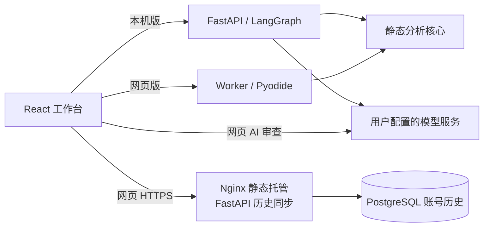
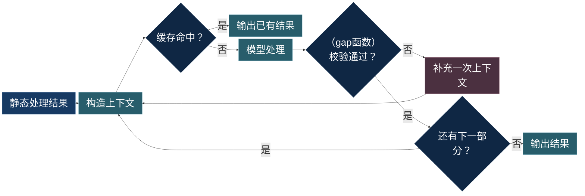
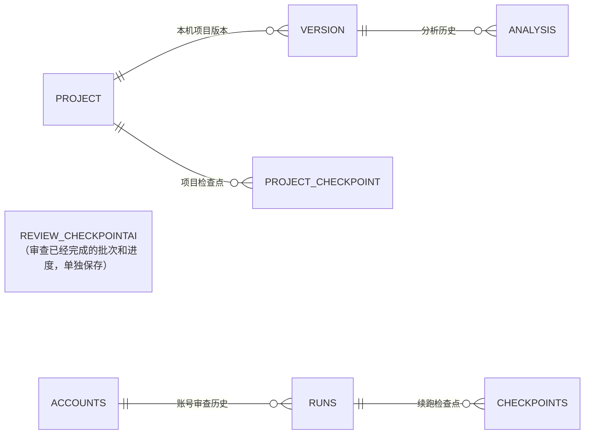
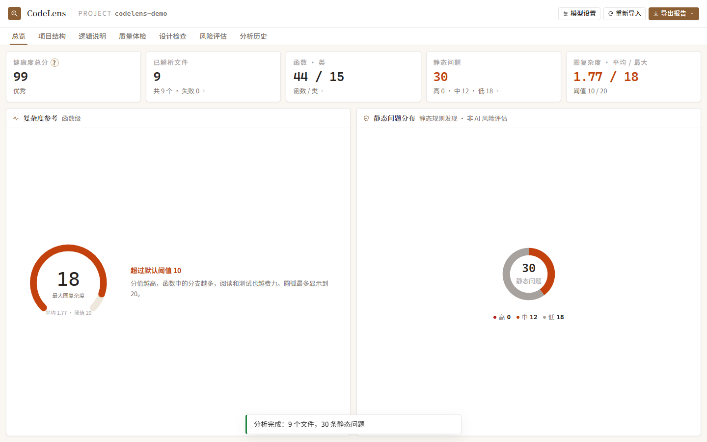
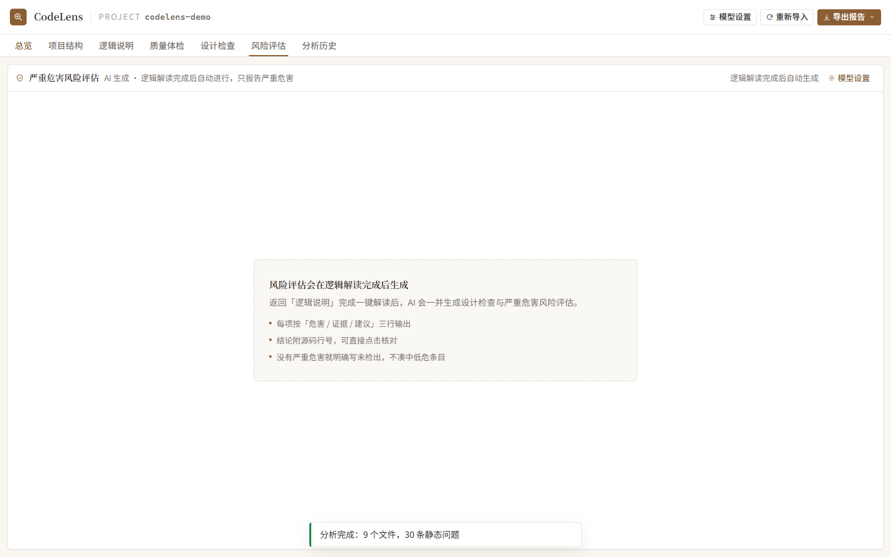
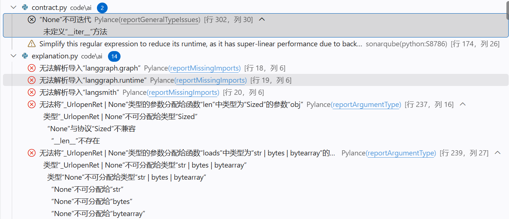
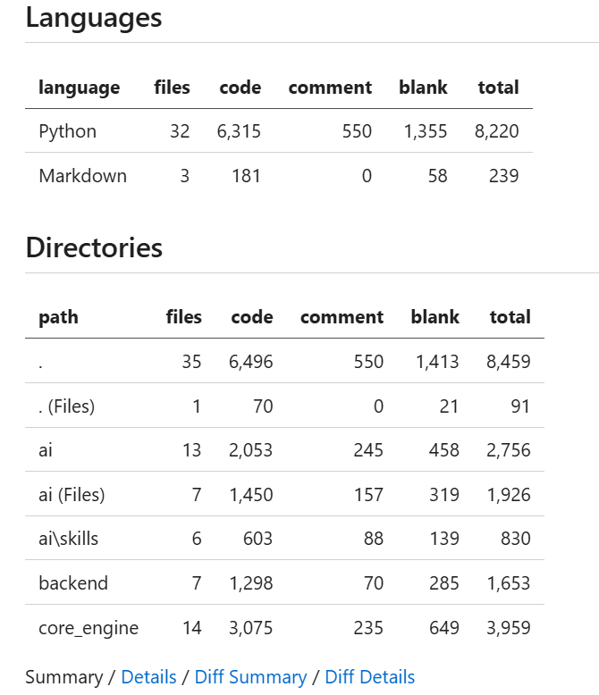

# CodeLens

## 项目结构可视化工具

【光圈】 · 2026 年 11 月

---

### 1.1.1 使命

解决 AI 生成代码的黑盒问题，让开发者能看懂、能验证、能审查 AI 写出的项目代码。

### 1.1.2 口号

Make Code Visible.

### 1.1.3 目标用户

使用 AI 编码的开发者

### 1.1.4 如何获得用户

- 与高校开发者社团、开源项目合作；
- 在 小红书、B站、GitHub发布推广与使用教程。

### 1.1.5 团队优势
团队多人有 OPC 项目开发经验。成员分工覆盖产品、市场、内容、开发和设计，技术和非技术能力互补。团队作为真实用户，重视用户体验，并能根据真实体验反馈快速校准规则。

---

### 1.1.6 竞争对手与差异化竞争

| 工具 | 核心定位 | 主要强项 | 与 CodeLens 的区别 |
|---|---|---|---|
| radon | 复杂度度量 | 圈复杂度、认知复杂度、可维护性指数 | 不产出逻辑、结构和风险审查报告 |
| pyan | 调用关系分析 | 函数与模块调用图 | 主要提供调用关系视图 |
| pyreverse | UML 建模 | 类图、包图和继承关系 | 侧重结构表达，不做质量与风险审查 |
| Noodles | 控制流可视化 | 函数级控制流图 | 不负责完整项目审查，无源码证据 |
| **CodeLens** | **代码分析审查 Agent** | **逻辑、质量、设计与风险统一分析** | **/** |

---

## 1.2 产品定义

对于**使用 AI 编码的初级开发者**，他们**能生成代码，却难以确认 AI 写的逻辑、结构与风险**，**CodeLens** 是一个**代码分析 agent**，它能够**输出语句级逻辑、SOLID 结构分析与质量风险报告，每条结论可溯源原码行**，不同于 **Noodles、Understand Anything 等偏理解与展示的工具**，我们的产品**实现了把逻辑、结构、设计、风险放在同一次报告里，方便对项目的审查**。

### 1.2.1 解决的问题

AI 代码逻辑不透明、通读困难、风险难定位。

### 1.2.2 对客户的价值

作为使用 AI 写代码的开发者，我想在采用生成代码前看懂它主要完成了哪些处理、哪些条件会影响结果，以便判断这段代码是否需要测试、调整或重写。

### 1.2.3 解决方案

Web 应用

---

# 2 产品设计应用的原则

| 原则 | 落地 |
|---|---|
| 需求 / 信息 / 创新 | 需求真实存在；通过静态处理降低大模型理解成本 |
| 系统 / 收敛 / 优化 | 通过统一的静态事实保证结果一致性，使得 AI 推断收敛于源码，并通过源码证据和缺口标注优化报告质量。|
| 继承 / 效益 / 时间 | 充分调研复用成熟技术，在保证分析效果的同时，控制开发时间成本|
| 定量 / 简化 / 审核 | 统计圈复杂度、函数长度和最大嵌套将代码质量量化，结果可审核 |

---

# 3 产品实现

## 3.1 用户体验设计考虑的因素

降低使用门槛，用户直接选择项目文件夹即可分析，无需学习命令；

分层呈现信息，先看总览和风险摘要，再进入逻辑、结构和源码；

支持连续使用，提供进度反馈、断点恢复、历史记录和报告导出，减少重复操作。

---

## 3.2 技术选型

| 条目 | 技术 | 版本 |
|---|---|---|
| 语言 | Python / TypeScript | 本机 Python 3.11+ / TS `~5.7.2` | 共用静态核心与前端类型定义 |
| 后端 | FastAPI / Uvicorn | / | 本机分析与审查 API，网页历史同步 |
| 前端 | React + Vite | `^18.3.1` / `^6.0.5` | 组件化界面与构建 |
| 样式 / 网页引擎 | Tailwind / Pyodide | `^4.1.7` / `0.27.7` | 网页界面与浏览器内静态分析 |
| 数据库 | PostgreSQL | 16 | 持久化本机与网页历史 |
| 测试 | unittest + Vitest | 标准库 / `^5.1.0` | 覆盖引擎、接口与前端 |

---

## 3.3 代码仓库链接及代码提交历史截图

代码仓库：https://github.com/kane0204/CodeLens

---

## 3.4 整个生命周期的主要问题及解决方法

| 问题类别 | 问题名称 | 发生原因 | 解决办法 |
|---|---|---|---|
| 分析 | 部分调用关系找不全 | 只分析源码、不运行程序，动态调用难以确认 | 标明不确定和未分析的位置，支持回查源码 |
| 模型 | llm幻觉 | 模型可能误解代码或生成不存在的内容 | 核对源码引用，校验失败时保留静态分析结果 |
| 交互 |项目结果过长 | 分析内容多，一次输出有限 | 按文件或模块分批分析，支持单文件解读 |

---

## 3.5 软件概要设计

### 3.5.1 系统架构图

---

### 3.5.3 总工作流

<svg viewBox="0 0 1200 620" role="img" aria-label="CodeLens 总工作流">
  <defs>
    <marker id="arrow" markerWidth="10" markerHeight="10" refX="8" refY="3" orient="auto">
      <path d="M0,0 L0,6 L9,3 z" fill="context-stroke" />
    </marker>
    <marker id="arrow-reverse" markerWidth="10" markerHeight="10" refX="1" refY="3" orient="auto">
      <path d="M9,0 L9,6 L0,3 z" fill="context-stroke" />
    </marker>
    <filter id="node-shadow" x="-20%" y="-20%" width="140%" height="140%">
      <feDropShadow dx="0" dy="2" stdDeviation="2" flood-color="#173a63" flood-opacity="0.16" />
    </filter>
  </defs>

  <rect class="panel front" x="0" y="0" width="1200" height="140" rx="14" />
  <rect class="panel-accent front" x="0" y="0" width="6" height="140" rx="3" />
  <text class="panel-title" x="24" y="29">前端</text>
  <rect class="panel agent" x="0" y="152" width="1200" height="224" rx="14" />
  <rect class="panel-accent agent" x="0" y="152" width="6" height="224" rx="3" />
  <text class="panel-title" x="24" y="179">Agent 与记忆</text>
  <rect class="panel backend" x="0" y="388" width="1200" height="232" rx="14" />
  <rect class="panel-accent backend" x="0" y="388" width="6" height="232" rx="3" />
  <text class="panel-title" x="24" y="416">静态分析</text>

  <path class="edge" d="M315 110 V388 H110 V450" marker-end="url(#arrow)" />
  <path class="edge" d="M190 480 H210 V444 H240" marker-end="url(#arrow)" />
  <path class="edge" d="M190 510 H210 V547 H240" marker-end="url(#arrow)" />
  <path class="edge" d="M420 444 H450 V485 H480" marker-end="url(#arrow)" />
  <path class="edge" d="M420 547 H450 V485" />
  <line class="edge" x1="670" y1="495" x2="720" y2="495" marker-end="url(#arrow)" />
  <line class="edge" x1="860" y1="495" x2="920" y2="495" marker-end="url(#arrow)" />
  <path class="edge" d="M990 455 V390 H950 V375" marker-end="url(#arrow)" />
  <path class="edge storage-edge" d="M1060 495 H1080 V245" marker-end="url(#arrow)" />
  <path class="edge return" d="M1040 310 H1160 V30 H435 V81 H460" marker-end="url(#arrow)" />
  <path class="edge return" d="M545 225 V110" marker-end="url(#arrow)" />

  <line class="edge" x1="180" y1="81" x2="230" y2="81" marker-end="url(#arrow)" />
  <line class="edge" x1="630" y1="81" x2="750" y2="81" marker-end="url(#arrow)" />
  <path class="edge" d="M860 310 H850 V252 H840" marker-end="url(#arrow)" />
  <path class="edge" d="M760 280 V310" marker-start="url(#arrow-reverse)" marker-end="url(#arrow)" />
  <line class="edge" x1="680" y1="252" x2="630" y2="252" marker-end="url(#arrow)" />
  <path class="edge storage-edge" d="M630 240 H655 V200 H990" marker-start="url(#arrow-reverse)" marker-end="url(#arrow)" />

  <rect class="node" x="30" y="52" width="150" height="58" rx="8" />
  <text class="label" x="105" y="87">导入项目</text>
  <rect class="node" x="230" y="52" width="170" height="58" rx="8" />
  <text class="label" x="315" y="73"><tspan x="315">提交分析</tspan><tspan x="315" dy="22">任务</tspan></text>
  <rect class="node" x="460" y="52" width="170" height="58" rx="8" />
  <text class="label" x="545" y="87">结果展示</text>
  <rect class="node" x="750" y="52" width="190" height="58" rx="8" />
  <text class="label" x="845" y="73"><tspan x="845">源码回查</tspan><tspan x="845" dy="22">与报告导出</tspan></text>

  <polygon class="decision" points="950,245 1040,310 950,375 860,310" />
  <text class="label" x="950" y="301"><tspan x="950">配置</tspan><tspan x="950" dy="21">模型?</tspan></text>
  <rect class="agent-node" x="680" y="225" width="160" height="55" rx="8" />
  <text class="label" x="760" y="259">Agent处理</text>
  <rect class="agent-node" x="680" y="310" width="160" height="50" rx="8" />
  <text class="label small-label" x="760" y="329"><tspan x="760">缓存 / 历史线索</tspan><tspan x="760" dy="19">/ 检查点</tspan></text>
  <rect class="agent-node" x="460" y="225" width="170" height="60" rx="8" />
  <text class="label" x="545" y="261">结果合并</text>
  <rect class="node db-node" x="990" y="180" width="160" height="65" rx="12" />
  <text class="label" x="1070" y="205"><tspan x="1070">PostgreSQL</tspan><tspan x="1070" dy="21">分析历史</tspan></text>

  <rect class="node" x="30" y="450" width="160" height="90" rx="8" />
  <text class="label" x="110" y="474"><tspan x="110">文件识别</tspan><tspan x="110" dy="20">（结构、</tspan><tspan x="110" dy="20">语言）</tspan></text>
  <rect class="node" x="240" y="410" width="180" height="68" rx="8" />
  <text class="label" x="330" y="437"><tspan x="330">Python</tspan><tspan x="330" dy="20">AST(tokenize)</tspan></text>
  <rect class="node" x="240" y="505" width="180" height="85" rx="8" />
  <text class="label small-label" x="330" y="526"><tspan x="330">其他语言</tspan><tspan x="330" dy="19">类AST(tokenize)</tspan><tspan x="330" dy="19">函数</tspan></text>
  <rect class="node" x="480" y="445" width="190" height="100" rx="8" />
  <text class="label small-label" x="575" y="475"><tspan x="575">生成IR、CFG、</tspan><tspan x="575" dy="20">def-use等/定量</tspan><tspan x="575" dy="20">计算code smell</tspan></text>
  <rect class="node" x="720" y="455" width="140" height="75" rx="8" />
  <text class="label" x="790" y="485"><tspan x="790">切片 /</tspan><tspan x="790" dy="22">静态证据</tspan></text>
  <rect class="node report-node" x="920" y="455" width="140" height="75" rx="8" />
  <text class="label" x="990" y="501">静态报告</text>

  <rect class="edge-label-bg" x="842" y="282" width="24" height="20" rx="5" />
  <text class="edge-label" x="854" y="297">是</text>
  <rect class="edge-label-bg" x="1080" y="286" width="30" height="20" rx="5" />
  <text class="edge-label" x="1095" y="301">否</text>
  <rect class="edge-label-bg" x="1010" y="405" width="140" height="24" rx="6" />
  <text class="edge-label" x="1080" y="422">静态结果分发</text>
  <rect class="edge-label-bg" x="455" y="154" width="180" height="24" rx="6" />
  <text class="edge-label" x="545" y="171">结果回传 / 历史回看</text>
  <rect class="edge-label-bg" x="720" y="184" width="90" height="24" rx="6" />
  <text class="edge-label" x="765" y="201">历史读写</text>
</svg>

---

### 3.5.3 Agent工作流：Plan-and-Execute

---

### 3.5.3 Agent 组成

本项目采用“确定性静态分析 + 可选模型增强”架构：静态分析负责事实与证据，模型基于证据生成说明。

| 核心组件 | 源码位置 | 具体实现 | 作用 |
|---|---|---|---|
| **模型** | `code/ai/provider.py` `code/ai/explanation.py` `code/ai/prompts.py` | OpenAI 兼容 `chat/completions`，支持 GPT、DeepSeek、Qwen等 | 生成逻辑、设计与风险说明（将静态输出翻译成人话） |
| **规划** | `code/ai/explanation.py` | LangGraph 固定流程：`阅读 → 综合`，依次生成逻辑、设计、风险三部分 | 将复杂审查拆分为源码阅读与报告综合 |
| **记忆** | `code/ai/review_store.py` `code/backend/history.py` | PostgreSQL 检查点 + 阅读单元缓存 + 分层摘要 | 断点恢复和未变源码复用 |
| **知识** | `code/core_engine/` | 本地 AST等、调用图、依赖图、复杂度指标 | 提供结构化事实和源码位置 |
| **执行与可靠性** | `code/backend/asgi.py` `code/ai/explanation.py` | NDJSON 进度流、有限重试、断点续跑 | 展示审查进度并从异常中恢复；失败时保留已有静态结果 |
| **安全护栏** | `code/backend/credentials.py` `code/backend/observability.py` `code/ai/contract.py` | `source_consent` 授权、系统 `keyring` 密钥管理、证据校验、日志脱敏 | 未经授权不发送源码，不泄露密钥，丢弃无证据结论，不执行或修改目标代码 |

---

### 3.5.4 数据库设计

---

### 3.5.5 接口设计

| 方法 / 接口 | 接口功能 | 输入 | 输出 | 备注 |
|---|---|---|---|---|
| `GET /api/status` | 获取服务状态 | 无 | 版本、能力、令牌和凭据状态 | 页面初始化 |
| `POST /api/analyze` | 项目静态分析 | 项目名称、源码文件列表 | 文件、函数、指标、问题和结构关系 | 核心业务接口 |
| `POST /api/review` | AI 项目审查 | 源码、审查范围、模型配置、`source_consent: true` | `progress`、`result`、`error` 事件流 | 流式返回，支持续跑 |
| `POST /api/review/cached` | 获取缓存审查结果 | 与项目审查相同的输入 | 已完成的审查结果或空结果 | 避免重复调用模型 |
| `POST /api/explain` | 单文件逻辑解读 | 源码、目标函数、上下文开关、`source_consent: true` | 逻辑说明和源码引用 | 兼容保留接口 |
| `/api/sync/*` | 历史与检查点同步 | 账号、历史记录或检查点 | 同步状态和同步结果 | 网页部署版使用 |

---

### 3.5.6 前端设计

| 项目总览 | AI 风险评估 |
|---|---|
|  |  |

---

## 3.6 软件质量

### 3.6.1 质量控制和保证方法

日志，unittest 与 Vitest 测试

### 3.6.2 质量工具使用

Pylint 静态检查结果：

---

## 3.7 代码统计

### 模块数

 共 **68 个 Python / TypeScript 源文件**。

### 行数

合计 **16,045 行**

| 后端代码统计 | 前端代码统计 |
|---|---|
|  |  |

