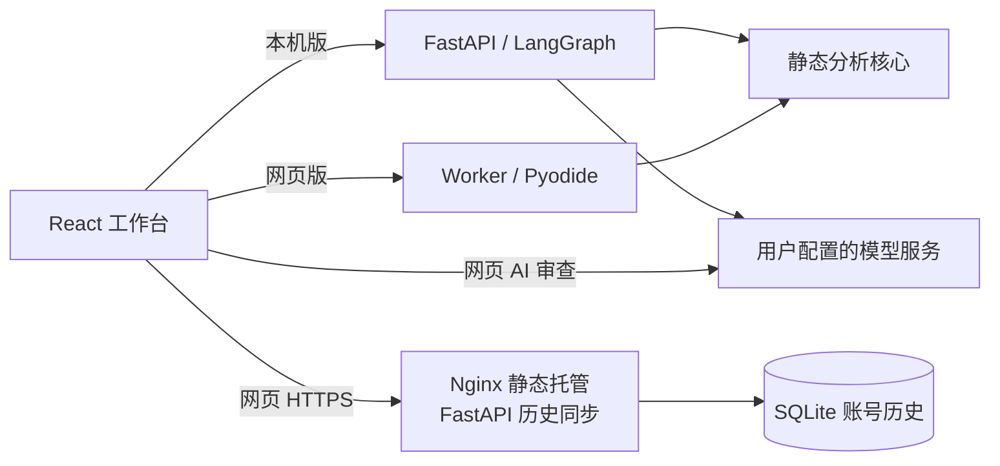
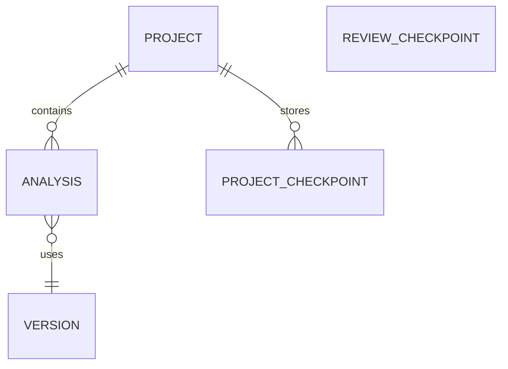

# CodeLens

## AI 生成代码的可解释性与可信度分析

【光圈】 · 2026 年 11 月

---

# 1.产品设计

## 1.1 产品使命、口号和策略

### 1.1.1 使命

解决 AI 生成代码的黑盒问题，让开发者能看懂、能验证、能审查 AI 写出的项目代码。

### 1.1.2 口号

Make Code Visible.

### 1.1.3 目标用户

使用 AI 编码的开发者

---

### 竞争对手与差异化竞争

| 维度 | CodeLens | Noodles | Understand Anything | Sourcetrail | pyreverse | pyan | radon |
|---|---|---|---|---|---|---|---|
| 语句级逻辑 / CFG / def-use | ✅ | ❌ | ❌ | ❌ | ❌ | ❌ | ❌ |
| 复杂度 | ✅ | ❌ | ❌ | ❌ | ❌ | ❌ | ✅ |
| 坏味 / SOLID | ✅ | ❌ | ❌ | ❌ | ❌ | ❌ | ❌ |
| AI 代码风险（A1–A5） | ✅ | ❌ | ❌ | ❌ | ❌ | ❌ | ❌ |
| 行级可溯源 | ✅ | 部分 | 部分 | ✅ | 部分 | 部分 | ✅ |
| 核心分析确定可复现 | ✅ | 部分 | ❌ | ✅ | ✅ | ✅ | ✅ |

---

## 1.2 产品定义

对于**使用 AI 编码的初级开发者**，他们**能生成代码，却难以确认 AI 写的逻辑、结构与风险**，**CodeLens** 是一个**代码分析 agent**，它能够**输出语句级逻辑、SOLID 结构分析与质量风险报告，每条结论可溯源原码行**，不同于 **Noodles、Understand Anything 等偏理解与展示的工具**，我们的产品**核心分析（code smell）确定可复现，并把逻辑、结构、AI 风险放在同一次解析里**。

### 1.2.1 解决的问题

AI 代码能跑，但逻辑不透明、隐含假设多、风险难定位，评审只能逐行读。

### 1.2.2 对客户的价值

作为使用 AI 写代码的开发者，我想在采用生成代码前看懂它主要完成了哪些处理、哪些条件会影响结果，以便判断这段代码是否需要测试、调整或重写。

### 1.2.3 解决方案

网站

---

# 2 产品设计应用的原则

| 原则 | 在 CodeLens 的落地 |
|---|---|
| 需求 / 信息 / 创新 | 分层展示文件清单、结构图和逻辑步骤 |
| 系统 / 收敛 / 优化 | 用统一静态事实组装报告，标明推断与覆盖缺口 |
| 继承 / 效益 / 时间 | 复用 Python `ast` 与 `tokenize`，按规则验证结果 |
| 定量 / 简化 / 审核 | 按复杂度、长度与嵌套计算健康度，支持回查源码 |

---

# 3 产品实现

## 3.1 用户体验设计考虑的因素

降低使用门槛，用户直接选择项目文件夹即可分析，无需学习命令；

分层呈现信息，先看总览和风险摘要，再进入逻辑、结构和源码；

支持连续使用，提供进度反馈、断点恢复、历史记录和报告导出，减少重复操作。

---

## 3.2 技术选型

| 条目 | 技术 | 版本 | 选型理由 |
|---|---|---|---|
| 语言 | Python / TypeScript | 本机 Python 3.11+ / TS `~5.7.2` | 共用静态核心与前端类型定义 |
| 后端 | FastAPI / Uvicorn | 见依赖文件 | 本机分析与审查 API，网页历史同步 |
| 前端 | React + Vite | `^18.3.1` / `^6.0.5` | 组件化界面与构建 |
| 样式 / 网页引擎 | Tailwind / Pyodide | `^4.1.7` / `0.27.7` | 网页界面与浏览器内静态分析 |
| 数据库 | SQLite | Python 标准库 | 持久化本机与网页历史 |
| 测试 | unittest + Vitest | 标准库 / `^5.1.0` | 覆盖引擎、接口与前端 |

---

## 3.3 代码仓库链接及代码提交历史截图

代码仓库：https://github.com/kane0204/CodeLens

本地 `HEAD` 可达 **84 个提交**，`git shortlog -s HEAD` 统计到 **5 个作者名**。

---

## 3.4 整个生命周期的主要问题及解决方法

| 问题类别 | 问题名称 | 发生原因 | 解决办法 |
|---|---|---|---|
| 分析 | 动态调用难还原 | 静态分析局限 | 标注静态推断与覆盖缺口，供人工复核 |
| 模型 | 模型可能编造 | LLM 幻觉 | 校验结构化结果和引用，失败时保留静态结果 |
| 交互 | 解读冗长或截断 | 范围过大或输出预算有限 | 按范围分批审查，支持单文件解读 |
| 测试 | 阈值误报 | 启发式规则有适用范围 | 用带标签样例检查误报、召回和覆盖缺口 |

---

## 3.5 软件概要设计

### 3.5.0 使用工具

画图使用 Mermaid，文档使用 Markdown，IDE 使用 VS Code 与 PyCharm。

### 3.5.1 系统架构图

---

### 3.5.2 基础设施图

本机接口校验 Host、Origin 和 Token。启用网页 AI 后，浏览器直接请求模型服务。历史与检查点通过 HTTPS 按账号同步。

本项目按单机服务部署，不单独绘制基础设施图。

---

### 3.5.3 智能体技术设计 · 总览

图示概括本地 Skill 与分批审查的共同步骤。**静态事实与模型表述分开处理**。

- 项目、目录和文件审查按范围读取源码，再生成结构化报告。
- 图中的补充上下文用于本地 Skill。分批审查按模型预算切片，校验通过后再计入进度。

---

### 3.5.3 智能体 · 任务编排与工具调用

本机 LangGraph 按**阅读 → 综合**编排。单批直接使用源码，多批先生成共享阅读记录。网页在浏览器内运行，并与本机版共用核心审查提示词。

下表为本机 Skill 接口。每次请求最多处理 **24 个目标**，可补一次上下文。

| 方法 | 职责 |
|---|---|
| `candidates` | 确定性排序候选目标 |
| `context` | 从 IR 切片结构化事实 |
| `gap` / `repair` | 判断证据是否够，补一次上下文 |
| `render` | 确定性模板产出 |
| `prompt` | 将切片事实组装成模型提示 |

---

### 3.5.3 智能体 · 记忆与护栏

**本机与网页记忆**

- 本机 Skill 有 256 条进程内 LRU 缓存。分批审查用 SQLite 保存阅读批次和报告，支持按指纹恢复。
- 网页通过 IndexedDB 暂存待同步记录，服务端 SQLite 按账号保存历史和续跑检查点。

**证据与输出校验**

- 本机 Skill 校验信封、条目和证据引用，过滤无法解析的条目。
- 分批审查校验输出结构和引用的文件与行号范围。部分格式或输出超限错误会重试。
- 分批审查失败时显示错误，静态结果继续可用。

---

### 3.5.3 智能体 · 项目事实、结构关系与记忆如何协作 ★

- **知识来源**包括本次导入的源码、逻辑模型、指标和规则命中。
- **结构关系**包括类关系、依赖关系与静态调用序列。
- **上下文获取**按目标切片，或按项目、目录、文件范围分批读取。
- **记忆**保存可复用的阅读批次和报告。
- 分析引擎生成结构关系。审查流程读取切片和检查点。

---

### 3.5.4 数据库设计

本机 SQLite 保存项目历史与检查点，网页同步版用服务端 SQLite 按账号保存记录。

---

### 3.5.5 接口设计

| 接口名称 | 接口功能 |
|---|---|
| `/api/analyze` | 本机项目静态分析 |
| `/api/review` | 本机流式项目审查 |
| `/api/explain` | 兼容的单文件逻辑解读 |
| `/api/sync/` | 网页同步版历史与检查点同步 |

本机接口校验 Host、Origin 和 Token。Swagger 文档由 FastAPI 自动生成。

---

### 3.5.6 前端设计

前端使用 React + Vite + Tailwind，导入项目后查看报告并回查源码。

| 项目总览 | AI 风险评估 |
|---|---|
|  |  |

截图来自本机工作台导入 `codelens-demo` 后的实测。总览中的 30 条为静态问题，AI 风险评估在逻辑解读完成后生成。

---

## 3.6 软件质量

### 3.6.1 质量控制和保证方法

结构化脱敏日志，unittest 与 Vitest 回归测试，以及带标签样例的 SOLID 基准。

### 3.6.2 质量工具使用

Pylint 静态检查结果：

---

## 3.7 代码统计

### 模块数

当前工作区的 `code/`、`codelens-prototype/src/` 和 `deploy/sync/` 共 **68 个 Python / TypeScript 源文件**。

### 行数

合计 **16,045 个物理行**，含空行和注释。

| 后端代码统计 | 前端代码统计 |
|---|---|
|  |  |

AI Vibe coding / 团队自己编写代码的比例：当前材料未提供可核验统计。
