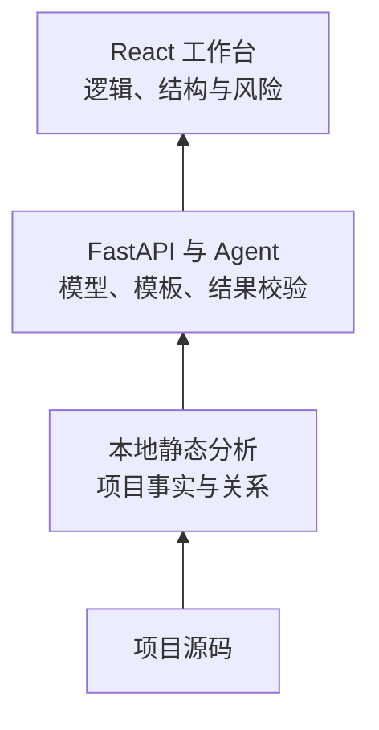
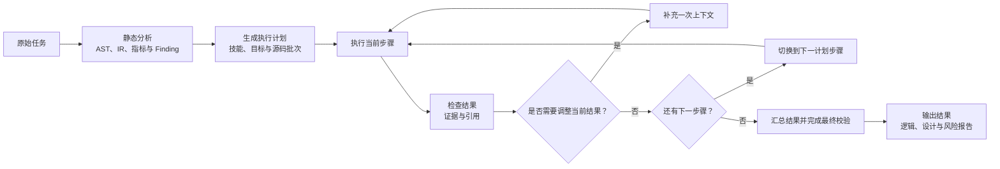
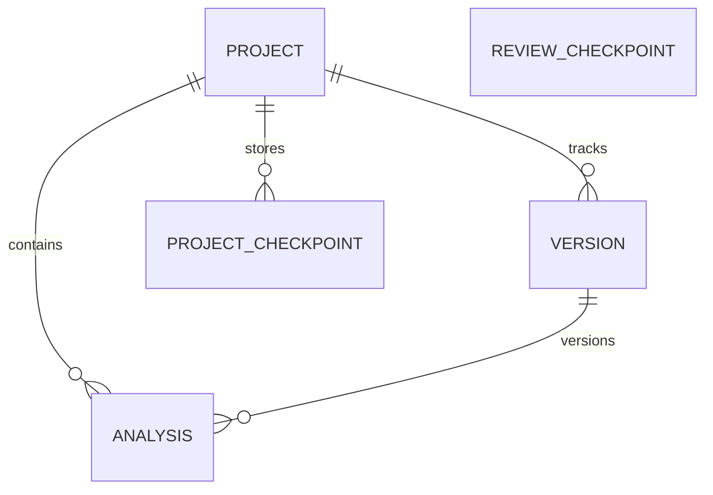

# CodeLens

## AI 生成代码的可解释性与可信度分析

Make Code Visible · 光圈

创新工程实践营项目汇报 · 2026 年 11 月

<!--
开场用一句话说明：项目帮助开发者看懂并检查 AI 生成的代码。
-->

---

# 1.1 产品使命、口号与策略

| 项目 | 内容 |
| --- | --- |
| 1.1.1 使命 | 让 AI 生成的代码更容易看懂、验证和审查 |
| 1.1.2 口号 | Make Code Visible |
| 1.1.3 目标用户 | 使用 AI 写代码的开发者、代码评审者、项目接手者 |
| 1.1.4 获客方式 | 从 AI 编码课程项目和真实评审场景开始，通过演示、仓库和试用反馈扩散 |
| 1.1.5 团队优势 | 小团队反馈快，能够按真实项目持续调整分析和交互 |
| 1.1.6 差异化 | 把逻辑、结构、质量和风险放在同一份项目事实中 |

团队背景：苏州大学计算机学院课程小组。

<!--
这一页对应规范中的使命、口号、目标用户、获客方式、团队优势和差异化。
-->

---

# 1.2 产品定义与客户价值

> 对于使用 AI 编码的开发者与代码评审者，他们能快速生成代码，却难以确认代码的逻辑、结构和风险。CodeLens 是一个本地代码分析工具，能够把项目整理成可阅读、可定位、可复核的审查结果。它不同于通用代码助手或单文件检查工具，核心事实由本地静态分析确定，模型只参与可选的文字说明。

## 1.2.1 解决的问题

AI 代码能运行，但逻辑不透明、隐含假设多、风险位置难找，人工评审只能逐行阅读。

## 客户价值概览

缩短理解和评审时间，让开发者先找到最需要人工确认的部分，再决定采用、测试还是重写。

<!--
按规范中的产品定义模板讲，控制在 40 秒内。
-->

---

# 1.2.2 用户故事

| 用户 | 完成的活动 | 带来的价值 |
| --- | --- | --- |
| 使用 AI 写代码的开发者 | 在采用生成模块前查看处理步骤、分支和风险 | 知道该重点测试什么，减少盲目采用 |
| 代码评审者 | 按风险排序查看问题，并跳转到对应源码 | 把时间花在真正需要人工判断的位置 |
| 项目接手者 | 先看项目总览、模块关系和一个函数的逻辑说明 | 更快建立整体认识，减少阅读陌生代码的成本 |

<!--
这里只用业务语言，不讲 AST、IR、CFG 等术语。
-->

---

# 1.2.3 解决方案与差异化

| 方案 | 主要能力 | CodeLens 的区别 |
| --- | --- | --- |
| 通用代码助手 | 生成和解释单段代码 | 面向整个项目，结论带源码位置，可随项目保存 |
| IDE 图表插件 | 展示类、调用或依赖关系 | 同时提供逻辑说明、质量指标和风险清单 |
| 单文件 Lint | 检查格式和局部规则 | 分析跨文件关系、设计线索和项目级风险 |
| CodeLens | 本地静态分析加可选模型说明 | 事实先确定，模型后表达，证据可以回查 |

解决方案采用本地 Web 工作台，用户通过浏览器导入项目并查看结果，不需要学习命令行。

<!--
不讲未经核实的竞品性能，只讲产品定位和输出范围。
-->

---

# 2 产品设计应用原则

| 原则 | CodeLens 的落实 |
| --- | --- |
| 需求、信息、创新 | 从真实评审痛点出发；首页先给摘要，再逐层展开；突出 AI 代码风险 |
| 系统、收敛、优化 | 一次静态分析形成统一事实；不同页面复用同一结果；按需读取上下文 |
| 继承、效益、时间 | 复用 Python AST 和成熟开源思路；分批审查并保存检查点 |
| 定量、简化、审核 | 用复杂度和风险等级排序；少用术语；关键结论显示源码引用 |

<!--
四行分别对应课程材料中的四组产品设计原则。
-->

---
layout: two-cols
---

# 3.1 用户体验设计

产品形态是本地 Web 工作台，不要求用户学习命令。

- **导入**：选择文件夹，默认排除测试、缓存和构建目录
- **查看**：先看总览、复杂度和风险，再进入具体页面
- **定位**：点击结论中的文件位置，直接回到对应代码
- **导出**：按需启用模型，并导出 Markdown、JSON 或 CSV

页面不把模型设置放在第一步。静态结果先可用，AI 审查由用户主动触发。

::right::


<!--
这一页说明用户体验因素：低配置门槛、渐进展示、源码可定位、失败可恢复。
-->

---
layout: two-cols
---

# 3.2 技术选型与系统架构



::right::

| 条目 | 版本与选择 |
| --- | --- |
| 语言与后端 | Python 3.11、FastAPI 0.162.7、uvicorn 0.54.0 |
| 前端 | React 18.3.1、Vite 6.0.5、Tailwind 4.1.7 |
| Agent | LangGraph 1.2.21、LangChain Core 1.8.0 |
| 数据 | SQLite，本地保存历史和检查点 |
| 运行与开发 | Windows、macOS、Linux；VS Code、PyCharm、Git、GitHub Actions |

选择原则是本地优先、依赖适中、前后端职责清晰。静态分析不依赖模型，模型不可用时仍能浏览结果。

架构对应 3.5.1。基础设施为单机本地服务，对应 3.5.2，无需单独部署图。

<!--
版本来自 requirements-backend.txt 和 package.json。部署为单机本地服务，因此本次不单独绘制基础设施图。
资料来源：Python https://docs.python.org/3/library/ast.html；FastAPI https://fastapi.tiangolo.com/；LangGraph https://langchain-ai.github.io/langgraph/；React https://react.dev/；Vite https://vite.dev/。
-->

<style>
.mermaid svg {
  max-height: 420px !important;
}
</style>

---
layout: two-cols
---

# 3.3 代码仓库与协作

项目地址：

https://github.com/kane0204/CodeLens

提交排行截图与最近一周 Pulse 摘要：

- 4 位作者提交了 21 次
- 68 个文件发生变化
- 新增 12,358 行，删除 1,059 行
- 使用 Issues、Pull Requests 和 GitHub Actions 协作

这些数据来自公开的 GitHub Pulse 页面，截图时间为 2026 年 11 月 21 日。

::right::


<!--
如需补充 Kanban 截图，可在此页替换右侧图片，不影响其他页面。
-->

---

# 3.4 生命周期问题与解决

| 问题 | 发生原因 | 解决方法 |
| --- | --- | --- |
| 动态调用无法完整还原 | 系统只读代码，不运行程序 | 只展示可解析关系，其余标为未知或推断 |
| 模型可能编造结论 | 自然语言生成存在不确定性 | 事实层和表达层分离，检查结果格式和源码引用 |
| 长项目等待时间长 | 模型上下文有限 | 分批读取、保存笔记、按章节生成、支持断点恢复 |
| 多语言解析结果不一致 | 非 Python 使用轻量解析 | 明确标注近似结果，并计划接入正式语法解析器 |
| 密钥和本地接口风险 | 模型配置和本地服务需要权限 | 系统凭据库保存密钥，校验来源和令牌，不在浏览器保存 Key |

<!--
这页覆盖分析、设计、开发、测试和部署过程中最典型的问题。
-->

---

# 3.5.3 Agent 工作流



原始任务先形成静态事实，再由程序确定执行计划。模型只完成被分配的表达步骤，系统检查结果和源码引用。

<!--
流程固定为计划、执行、检查、局部补充和汇总。正常服务会提前准备语法结构，补充上下文是异常兜底。
-->

<style>
.mermaid svg {
  max-height: 300px !important;
}
</style>

---

# 3.5.3 Agent 技术设计

| 组成 | 当前实现 |
| --- | --- |
| 任务编排 | 使用 Plan-and-Execute：先确定技能、目标和源码批次，再逐项执行 |
| 工具调用 | 静态分析、项目事实查询、源码切片、模型或模板、结果校验 |
| 记忆 | 项目历史、反复问题、批次笔记、SQLite 检查点和进程内缓存 |
| 护栏 | 不执行目标代码；检查引用；证据不足时停止；密钥写入系统凭据库 |
| 知识库 | 项目事实和关系图；使用精确结构化检索，不使用模糊向量检索 |

<div class="text-sm opacity-70">

模型不负责决定全局计划，也不会自由扩大分析范围。

</div>

<!--
这一页覆盖规范要求的任务编排、工具调用、记忆、护栏和知识库设计。
-->

---
layout: two-cols
---

# 3.5.3 代码理解与结果可信度

```python
def check(x):
    if x:
        return 1
    return 0
```

::right::

系统先生成三类事实：

1. 当前函数有哪些语句
2. 条件成立和不成立时走哪里
3. 哪个源码位置可以支撑结论

模型或模板只负责把这些事实写成：

> 条件成立时返回 1，否则返回 0。

关键结论会检查源码引用。无法确认时显示“未知”或“证据不足”，系统不承诺所有文字绝对正确。

<!--
这页避免把模型输出当成事实，也解释了两跳上下文和引用检查的设计目的。
-->

---
layout: two-cols
---

# 3.5.4 数据库、接口与前端设计

| 接口 | 输入 | 输出 |
| --- | --- | --- |
| `/api/analyze` | 项目名称和源码文件 | 静态分析结果 |
| `/api/review` | 源码、模型设置和审查范围 | 流式进度及逻辑、设计、风险结果 |
| `/api/review/cached` | 相同输入指纹 | 已完成审查或断点 |
| `/api/history/*` | 项目 ID 和分析 ID | 历史列表、详情或删除结果 |

::right::



<!--
重要业务功能对应 analyze、review 和 history。工具类接口不展开。前端对应 3.5.6，包括总览、项目结构、逻辑说明、质量体检、设计检查、风险评估和分析历史。本机接口会校验来源和访问令牌。
-->

---
layout: two-cols
---

# 3.6 软件质量

- Python 单元测试：315 通过
- 前端单元测试：109 通过
- 本机集成测试：28 通过
- Python 与前端行覆盖率：均为 100%
- 类型检查和生产构建：通过
- pycodestyle 2.15.0：93 条格式提示
- IDE 静态检查：仍有未解析导入和类型提示

运行日志已脱敏并带请求编号。下一步修复格式和类型提示，并把 PEP8、Pylint 纳入 CI 强制门禁。

::right::


<!--
这页如实展示质量结果。自动测试通过不代表 AI 输出质量已经验证。
-->

---

# 3.7 代码统计

<div style="display:flex; gap:1rem; justify-content:center; align-items:flex-start;">
  
  
</div>

代码行合计 12,283，包含注释和空行的总行数合计 14,762。

AI 辅助与团队手写比例：仓库未保留可核验记录，本次不估算。

<!--
统计截图来自云端最新版，范围为 code/ 和 codelens-prototype/src/ 的生产代码。
-->

---
layout: two-cols
---

# 第二部分 作品功能演示

建议演示顺序：

1. 导入 `CodeLens-Demo` 项目
2. 查看项目总览和复杂度最高的函数
3. 打开 `OrderService.place_order` 的逻辑说明
4. 查看风险清单和设计检查
5. 再导入一次，展示历史记录和报告导出

演示项目包含循环依赖、复杂函数、重复代码、敏感信息、死代码和 JavaScript 文件。

::right::

<div>


</div>

<!--
第二部分只操作真实产品，控制在一到两分钟。
-->

---

# 第三部分 总结与问答

| 当前边界 | 下一步 |
| --- | --- |
| TypeScript/React 复杂文件可能漏识别函数 | 接入正式的 TypeScript 和 JSX 解析器 |
| 动态调用和运行时行为无法完整还原 | 保持未知标注，继续增强静态关系推断 |
| 单函数解释只向下看两层，不追踪调用者 | 增加从入口出发的连续调用链 |
| 真实模型的响应质量尚未系统评测 | 固定项目集、真实模型和人工评分标准 |

主要资料：Python、FastAPI、LangGraph、React、Vite 官方文档。

## 谢谢，欢迎提问

<!--
收尾回到用户价值，不重复技术栈。
-->
