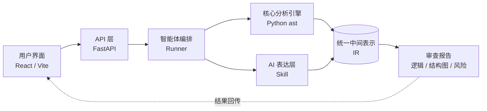
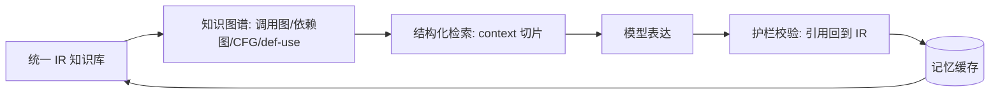

# CodeLens

## AI 生成代码的可解释性与可信度分析

Make Code Visible · 【光圈】 · 2026 年 11 月

---

## 一、产品使命、口号与策略

| 项 | 内容 |
|---|---|
| **使命** | 解决 AI 生成代码的黑盒问题，让开发者能看懂、能验证、能审查 |
| **口号** | Make Code Visible |
| **目标用户** | 使用 AI 编码的开发者、代码评审者、项目接手者 |
| **如何获客** | 核心分析纯静态、可复现；从课程项目组试点，靠口碑扩散 |
| **团队优势** | 小团队迭代快，按真实项目反馈快速校准阈值 |

**差异化**：逻辑 + 结构 + AI 风险放在**同一次解析**里，结论 100% 可溯源。

---

## 二、产品定义

> 对于**使用 AI 编码的开发者与评审者**，他们**能生成代码，却难以确认 AI 写的逻辑、结构与风险**，CodeLens 是一个**本地运行的静态分析与 AI 表达工具**，它能够**输出语句级逻辑、结构图与风险报告，每条结论可回到源码行**，不同于 **Noodles、Understand Anything 等偏"理解展示"的工具**，我们的产品**核心确定可复现，并用受护栏约束的智能体把事实讲清楚**。

**解决的问题**：AI 代码能跑，但逻辑不透明、假设多、风险难定位，评审只能逐行读。

---

## 三、用户故事（业务语言）

- 作为**使用 AI 的开发者**，我想要**看懂生成代码在做什么**，以便**放心决定采用还是重写**。
- 作为**代码评审者**，我想要**按风险排序的清单**，以便**把有限时间花在最危险的地方**。
- 作为**项目接手者**，我想要**先看逻辑说明和结构图**，以便**快速接手陌生的 AI 模块**。

---

## 四、产品设计原则

| 原则 | 在 CodeLens 的落地 |
|---|---|
| 需求 / 信息 / 创新 | 从真实痛点出发；信息分层：一句话摘要 → 步骤 → 细节 |
| 系统 / 收敛 / 优化 | 一次解析收敛到统一 IR；证据分级收敛不确定结论 |
| 继承 / 效益 / 时间 | 复用标准库 `ast` 与开源规则思想；MVP 分阶段交付 |
| 定量 / 简化 / 审核 | 健康度 0–100 可量化；模板简化输出；每条结论可审核 |

---

## 五、技术选型

| 条目 | 技术 | 版本 | 选型理由 |
|---|---|---|---|
| 语言 | Python | 3.11 | 标准库 `ast` 够用，零运行时依赖 |
| 后端 | FastAPI / uvicorn | 见 requirements | 本机 API + 流式审查 |
| 前端 | React + Vite | 18.3.1 / 6.0.5 | 轻量、生态成熟 |
| 样式 / 语言 | Tailwind + TypeScript | 4.1.7 / 5.7.2 | 快速构建可维护界面 |
| 数据库 | SQLite | 标准库 | 本地持久化，无需部署 |
| 测试 | pytest + vitest | 9.2.0 / 5.1.0 | 前后端双向覆盖 |

> 版本已写入项目 `README.md` 与各 `package.json`。

---

## 六、系统架构图

---

## 七、智能体技术设计 · 总览

五要素：**任务编排 · 工具调用 · 记忆 · 护栏 · 知识库**。设计原则：事实层与表达层分离——智能体只"讲清楚事实"，不新增事实。

- 主线：任务 → 静态分析 → 生成计划 → 逐步执行 → 结果校验 → 汇总输出
- 回退：证据不足时**只补一次上下文**，外层不重规划，成本与延迟可控

---

## 八、任务编排 + 工具调用

**任务编排** — 固定 DAG：`候选 → 切片 → 表达 → 校验`，仅在单任务内"补一次上下文"局部回退，**外层不重规划**，成本与延迟可控。一次请求上限 24 个目标。

**工具调用** — 每个 Skill 五段式：

| 方法 | 职责 |
|---|---|
| `candidates` | 确定性排序候选目标 |
| `context` | 从 IR 切片结构化事实 |
| `gap` / `repair` | 判断证据是否够，补一次上下文 |
| `render` | 确定性模板产出 |
| `prompt` | 只含已切片事实的模型提示 |

---

## 九、记忆 + 护栏

**记忆（两级）**&#8203;

- 进程内 **LRU 缓存**（256 条）：key 由 skill 版本、prompt 版本、provider、目标指纹构成，不含时间与随机数 → 可复现。
- **SQLite 检查点**（`reviews.sqlite3`，256 条）：按指纹持久化，支持断点续读。

**护栏（三层校验 + 禁写规则）**&#8203;

- L1 信封 / L2 条目 / L3 **证据引用解析**：引用在 IR 上解不出，整条结论丢弃。
- 禁写：百分比、绝对断言、HTML、代码围栏、指令注入；规则编号白名单。
- 模型失败或输出不合格 → **自动降级到确定性模板**。

---

## 十、知识库：RAG / 图谱 / 记忆如何协作 ★

- **知识库**：IR 统一存放图数据、逻辑模型、指标、findings；
- **知识图谱**：类图、调用图、依赖图、控制流与数据流，组织结构化事实；
- **RAG**：采用**结构化检索**而非向量检索——精确切片相关事实喂给模型（源码分析要精确证据，不适合模糊匹配）；
- **记忆**：缓存已校验结论，避免重复计算。
- 四者闭环：**事实 → 图谱 → 检索 → 表达 → 校验 → 记忆**。

---

## 十一、数据库 / 接口 / 前端设计

| 项 | 设计 |
|---|---|
| 数据库 | SQLite `review_checkpoint(fingerprint, payload, updated)`，按指纹去重、限 256 条 |
| 接口 | `/api/analyze` `/api/explain` `/api/review`(流式) `/api/ai-skills` |
| 前端 | React + Vite + Tailwind；上传源码 → 展示逻辑/图/风险 → 点击定位源码 |

接口统一做**本机校验**：Host / Origin / Token 三重防护，源码不出本机。

---

## 十二、生命周期问题与解决

| 问题 | 原因 | 解决办法 |
|---|---|---|
| 动态调用难还原 | 静态分析局限 | 标注"推断"+ 置信度，需人工复核 |
| 模型可能编造 | LLM 幻觉 | 三层校验 + 引用必须可解析 + 降级模板 |
| 说明冗长不看 | 逐行解释太多 | 分层输出：摘要 → 步骤 → 细节 |
| 阈值误报 | 规则阈值不准 | 阈值可配置 + 样例校准 + 分级展示 |

---

## 十三、软件质量与代码统计

**质量控制**：结构化日志 + 脱敏（observability）；分级异常处理与降级；PEP8（autopep8）；复杂度用自身工具"吃自己的狗粮"；pytest + vitest 双向测试。

**代码统计**：【此处插入 VS Code Counter / Statistic 插件截图：模块数、代码行数、AI 辅助与手写比例】

**提交历史**：【此处插入 GitHub `pulse` 截图：各成员提交次数】

---

## 十四、参考与来源

- Python `ast` / `tokenize` — Python 官方标准库
- radon、pyreverse、pyan — 指标与图解析参考（GitHub 开源）
- Sourcetrail、Noodles、Understand Anything — 竞品对标
- ISO/IEC/IEEE 29148:2018 — 需求工程依据
- 需求细节见仓库 `docs/requirements/srs.md`

---

## 总结

- **产品**：AI 代码的 X 光机，让黑盒代码看得懂、验得证、审得动
- **亮点**：一次解析产出逻辑 + 结构 + 风险，结论 100% 可溯源
- **智能体**：固定 DAG 编排 + 工具化 Skill + 双层记忆 + 三层护栏 + IR 知识库协同

# 谢谢！

欢迎提问
