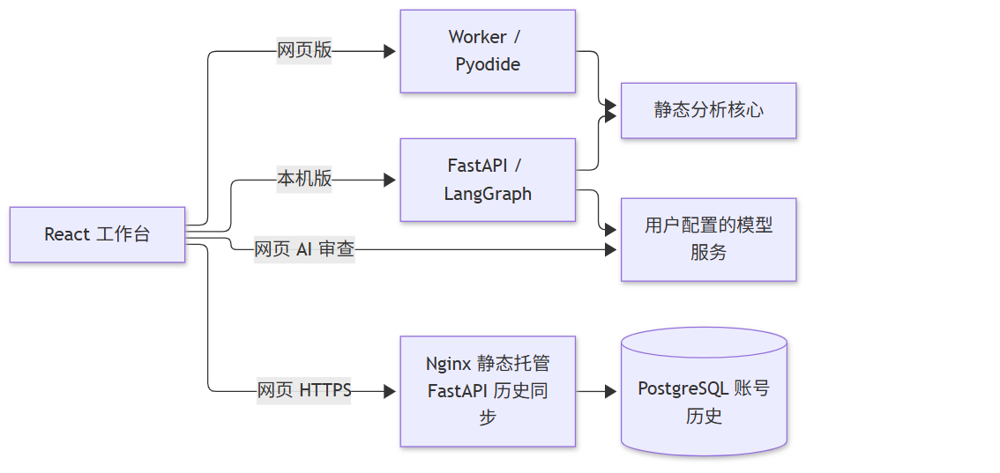
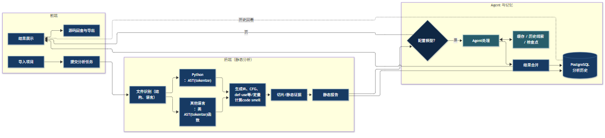
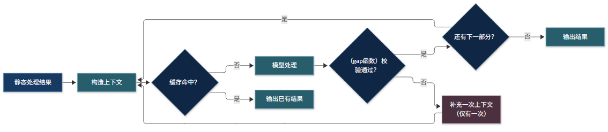
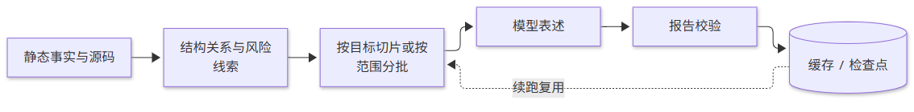
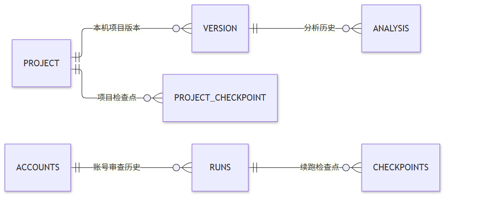
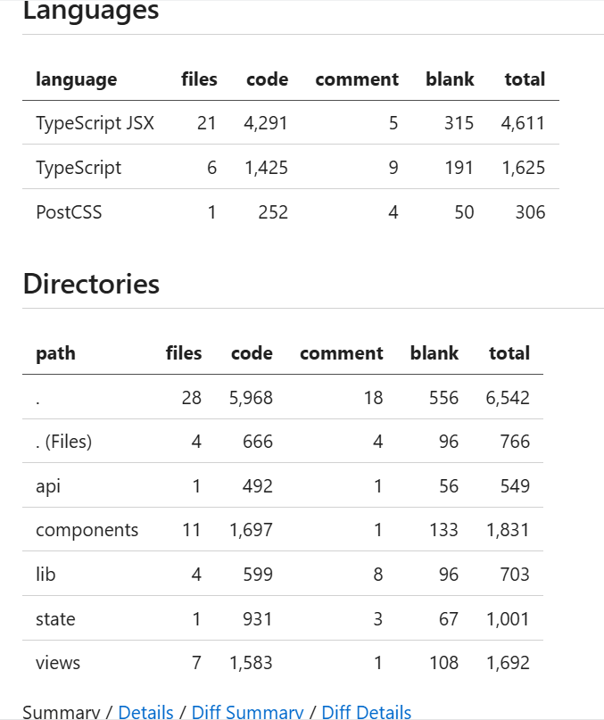

# CodeLens

## 项目结构可视化工具

【光圈】 · 2026 年 11 月

---

# 1.产品设计

### 1.1.1 使命

解决 AI 生成代码的黑盒问题，让开发者能看懂、能验证、能审查 AI 写出的项目代码。

### 1.1.2 口号

Make Code Visible.

### 1.1.3 目标用户

使用 AI 编码的开发者

### 1.1.4 如何获得用户

- 与高校开发者社团、开源项目合作；
- 在 GitHub、掘金、抖音和 B 站发布推广与使用教程。

### 1.1.5 团队优势
重视结果可信、贴近真实用户

---

### 1.1.6 竞争对手与差异化竞争

| 工具 | 核心定位 | 主要强项 | 与 CodeLens 的区别 |
|---|---|---|---|
| radon | 复杂度度量 | 圈复杂度、认知复杂度、可维护性指数 | 提供指标，不产出逻辑、结构和风险审查报告 |
| pyan | 调用关系分析 | 函数与模块调用图 | 主要提供调用关系视图 |
| pyreverse | UML 建模 | 类图、包图和继承关系 | 侧重结构表达，不做质量与风险审查 |
| Noodles | 控制流可视化 | 函数级控制流图 | 提供 CFG，不负责完整项目审查与源码证据链 |
| Sourcetrail | 代码导航 | 跨文件符号跳转和依赖浏览 | 侧重阅读与导航，不直接给出质量判断 |
| **CodeLens** | **可审查的代码分析 Agent** | **逻辑、结构、质量与风险统一分析** | **一次解析、多视图、可复核** |

---

## 1.2 产品定义

对于**使用 AI 编码的初级开发者**，他们**能生成代码，却难以确认 AI 写的逻辑、结构与风险**，**CodeLens** 是一个**代码分析 agent**，它能够**输出语句级逻辑、SOLID 结构分析与质量风险报告，每条结论可溯源原码行**，不同于 **Noodles、Understand Anything 等偏理解与展示的工具**，我们的产品**实现了把逻辑、结构、设计、风险放在同一次报告里，方便对项目的审查**。

### 1.2.1 解决的问题

AI 代码逻辑不透明、隐含假设多、风险难定位。

### 1.2.2 对客户的价值

作为使用 AI 写代码的开发者，我想在采用生成代码前看懂它主要完成了哪些处理、哪些条件会影响结果，以便判断这段代码是否需要测试、调整或重写。

### 1.2.3 解决方案

网站

---

# 2 产品设计应用的原则

| 原则 | 落地 |
|---|---|
| 需求 / 信息 / 创新 | 从总览进入文件、结构和逻辑步骤，再查看质量与风险，并可回查源码 |
| 系统 / 收敛 / 优化 | 用统一静态事实组装报告，区分事实与推断，并标明覆盖缺口 |
| 继承 / 效益 / 时间 | 以 Python `ast` 为核心解析源码，`tokenize` 辅助词法统计，规则引擎生成并校验结果 |
| 定量 / 简化 / 审核 | 按圈复杂度、函数长度和最大嵌套计算函数健康度，项目分数取函数平均分 |

---

# 3 产品实现

## 3.1 用户体验设计考虑的因素

降低使用门槛，用户直接选择项目文件夹即可分析，无需学习命令；

分层呈现信息，先看总览和风险摘要，再进入逻辑、结构和源码；

支持连续使用，提供进度反馈、断点恢复、历史记录和报告导出，减少重复操作。

---

## 3.2 技术选型

| 条目 | 技术 | 版本 | 备注 |
|---|---|---|---|
| 语言 | Python / TypeScript | 本机 Python 3.11+ / TS `~5.7.2` | 共用静态核心与前端类型定义 |
| 后端 | FastAPI / Uvicorn | 见依赖文件 | 本机分析与审查 API，网页历史同步 |
| 前端 | React + Vite | `^18.3.1` / `^6.0.5` | 组件化界面与构建 |
| 样式 / 网页引擎 | Tailwind / Pyodide | `^4.1.7` / `0.27.7` | 网页界面与浏览器内静态分析 |
| 数据库 | PostgreSQL | 16 | 持久化本机与网页历史 |
| 测试 | unittest + Vitest | 标准库 / `^5.1.0` | 覆盖引擎、接口与前端 |

---

## 3.3 代码仓库链接及代码提交历史截图

代码仓库：https://github.com/kane0204/CodeLens

---

## 3.4 整个生命周期的主要问题及解决方法

| 问题类别 | 问题名称 | 发生原因 | 解决办法 |
|---|---|---|---|
| 分析 | 动态调用难还原 | 静态分析局限 | 标注静态推断与覆盖缺口，供人工复核 |
| 模型 | 模型可能编造 | LLM 幻觉 | 校验结构化结果和引用，失败时保留静态结果 |
| 交互 | 解读冗长或截断 | 范围过大或输出预算有限 | 按范围分批审查，支持单文件解读 |
| 测试 | 阈值误报 | 启发式规则有适用范围 | 用带标签样例检查误报、召回和覆盖缺口 |

---

## 3.5 软件概要设计

### 3.5.1 系统架构图

---

### 3.5.3 总工作流

---

### 3.5.3 Agent工作流：Plan-and-Execute

---

### 3.5.3 智能体 · 项目事实、结构关系与记忆如何协作

- **知识来源**包括本次导入的源码、逻辑模型、指标和规则命中。
- **结构关系**包括类关系、依赖关系与静态调用序列。
- **上下文获取**按目标切片，或按项目、目录、文件范围分批读取。
- **记忆**保存可复用的阅读批次和报告。

---

### 3.5.4 数据库设计

---

### 3.5.5 接口设计

| 方法 / 接口 | 接口功能 | 输入 | 输出 | 备注 |
|---|---|---|---|---|
| `GET /api/status` | 获取服务状态 | 无 | 版本、能力、令牌和凭据状态 | 页面初始化 |
| `POST /api/analyze` | 项目静态分析 | 项目名称、源码文件列表 | 文件、函数、指标、问题和结构关系 | 核心业务接口 |
| `POST /api/review` | AI 项目审查 | 源码、审查范围、模型配置、`source_consent: true` | `progress`、`result`、`error` 事件流 | 流式返回，支持续跑 |
| `POST /api/review/cached` | 获取缓存审查结果 | 与项目审查相同的输入 | 已完成的审查结果或空结果 | 避免重复调用模型 |
| `POST /api/explain` | 单文件逻辑解读 | 源码、目标函数、上下文开关、`source_consent: true` | 逻辑说明和源码引用 | 兼容保留接口 |
| `/api/sync/*` | 历史与检查点同步 | 账号、历史记录或检查点 | 同步状态和同步结果 | 网页部署版使用 |

---

### 3.5.6 前端设计

| 项目总览 | AI 风险评估 |
|---|---|
|  |  |

---

## 3.6 软件质量

### 3.6.1 质量控制和保证方法

日志，unittest 与 Vitest 测试

### 3.6.2 质量工具使用

Pylint 静态检查结果：

---

## 3.7 代码统计

### 模块数

 共 **68 个 Python / TypeScript 源文件**。

### 行数

合计 **16,045 行**

| 后端代码统计 | 前端代码统计 |
|---|---|
|  |  |

