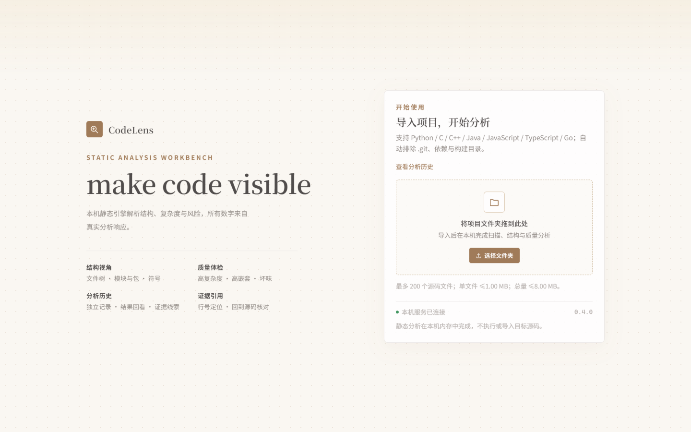
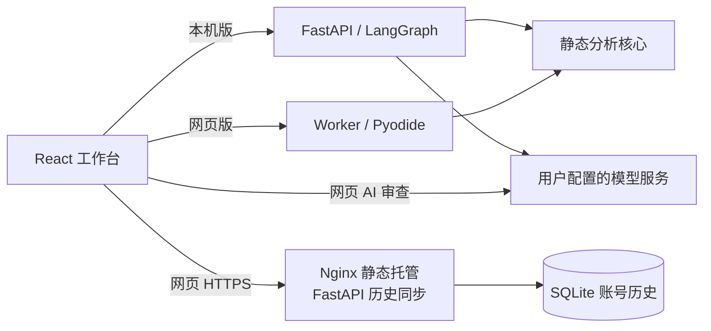
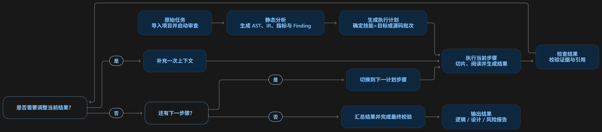
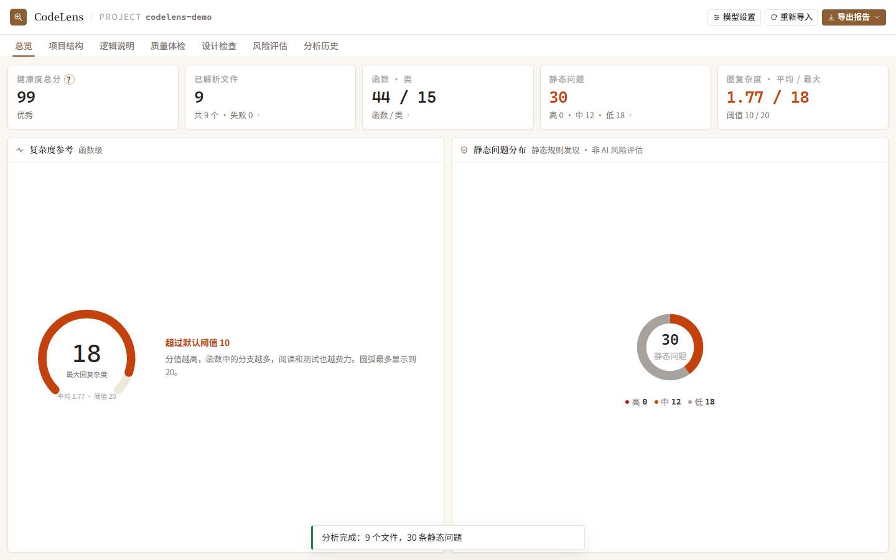
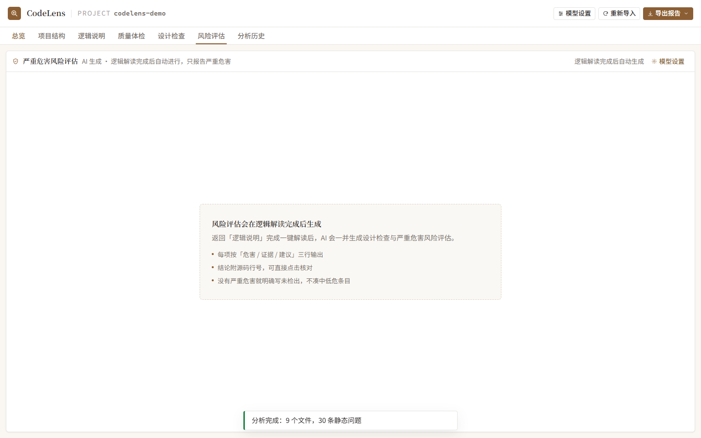
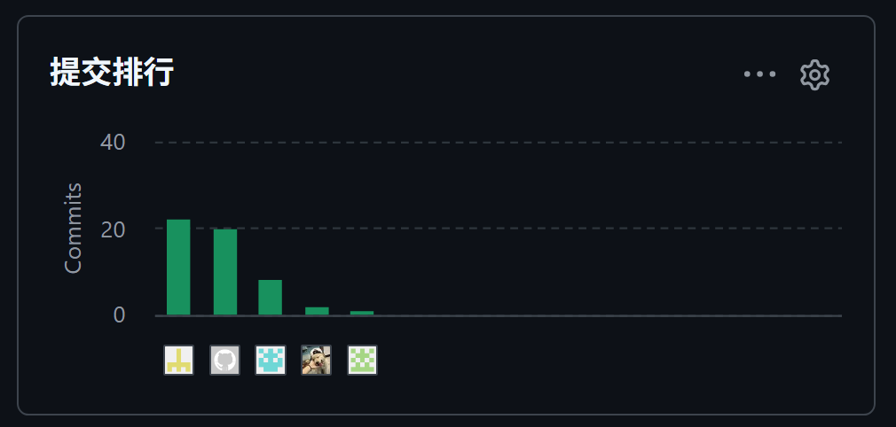

# CodeLens

## AI 生成代码的可解释性与可信度分析

Make Code Visible · 【光圈】 · 2026 年 11 月

实现说明涵盖本机工作台与当前工作区的网页同步版。

---

## 一、产品使命、口号与策略

| 项 | 内容 |
|---|---|
| **使命** | 帮助开发者看懂、验证和审查 AI 生成的代码 |
| **口号** | Make Code Visible |
| **目标用户** | 使用 AI 编码的开发者、代码评审者、项目接手者 |
| **如何获客** | 核心分析纯静态、可复现；从课程项目组试点，靠口碑扩散 |
| **团队优势** | 小团队迭代快，按真实项目反馈快速校准阈值 |

**差异化**　同一工作台展示逻辑、结构、质量与风险，支持按源码位置复核证据。

---

## 二、产品定义

> 对于**使用 AI 编码的开发者与评审者**，CodeLens 是一套**支持本机运行与浏览器访问的代码分析工作台**。导入项目可查看语句级逻辑、结构图、质量指标和静态风险。启用模型后，可按项目、目录或文件发起 AI 审查，并通过源码引用复核报告。

**解决的问题**：AI 代码能跑，但逻辑不透明、假设多、风险难定位，评审只能逐行读。

---

## 三、用户故事（业务语言）

- 作为**使用 AI 的开发者**，我想要**阅读按源码顺序组织的函数逻辑步骤**，以便**逐条核对代码实际做了什么**。
- 作为**代码评审者**，我想要**查看带规则和源码位置的风险线索**，以便**优先复核高风险代码**。
- 作为**项目接手者**，我想要**先确认纳入分析的文件，再查看结构图**，以便**明确接手范围和模块关系**。

---

## 四、产品设计原则

| 原则 | 在 CodeLens 的落地 |
|---|---|
| 需求 / 信息 / 创新 | 分层展示文件清单、结构图和逻辑步骤 |
| 系统 / 收敛 / 优化 | 用统一静态事实组装报告，标明推断与覆盖缺口 |
| 继承 / 效益 / 时间 | 复用 Python `ast` 与 `tokenize`，按规则验证结果 |
| 定量 / 简化 / 审核 | 按复杂度、长度与嵌套计算健康度，支持回查源码 |

---

## 五、技术选型

| 条目 | 技术 | 版本 | 选型理由 |
|---|---|---|---|
| 语言 | Python / TypeScript | 本机 Python 3.11+ / TS `~5.7.2` | 共用静态核心与前端类型定义 |
| 后端 | FastAPI / Uvicorn | 见依赖文件 | 本机分析与审查 API，网页历史同步 |
| 前端 | React + Vite | `^18.3.1` / `^6.0.5` | 组件化界面与构建 |
| 样式 / 网页引擎 | Tailwind / Pyodide | `^4.1.7` / `0.27.7` | 网页界面与浏览器内静态分析 |
| 数据库 | SQLite | Python 标准库 | 持久化本机与网页历史 |
| 测试 | unittest + Vitest | 标准库 / `^5.1.0` | 覆盖引擎、接口与前端 |

> 版本口径见 `README.md`、后端依赖文件和前端 `package.json`。

---

## 六、系统架构图

网页历史由同步版提供。纯浏览器版使用 IndexedDB 保存本地历史。

---

## 七、智能体技术设计 · 总览

图示概括本地 Skill 与分批审查的共同步骤。**静态事实与模型表述分开处理**。

- 项目、目录和文件审查按范围读取源码，再生成结构化报告。
- 图中的补充上下文用于本地 Skill。分批审查按模型预算切片，校验通过后再计入进度。

---

## 八、任务编排 + 工具调用

本机 LangGraph 按**阅读 → 综合**编排。单批直接使用源码，多批先生成共享阅读记录。网页在浏览器内运行，并与本机版共用核心审查提示词。

下表为本机 Skill 接口。每次请求最多处理 **24 个目标**，可补一次上下文。

| 方法 | 职责 |
|---|---|
| `candidates` | 确定性排序候选目标 |
| `context` | 从 IR 切片结构化事实 |
| `gap` / `repair` | 判断证据是否够，补一次上下文 |
| `render` | 确定性模板产出 |
| `prompt` | 将切片事实组装成模型提示 |

---

## 九、记忆 + 护栏

**本机与网页记忆**

- 本机 Skill 有 256 条进程内 LRU 缓存。分批审查用 SQLite 保存阅读批次和报告，支持按指纹恢复。
- 网页通过 IndexedDB 暂存待同步记录，服务端 SQLite 按账号保存历史和续跑检查点。

**证据与输出校验**

- 本机 Skill 校验信封、条目和证据引用，过滤无法解析的条目。
- 分批审查校验输出结构和引用的文件与行号范围。部分格式或输出超限错误会重试。
- 分批审查失败时显示错误，静态结果继续可用。

---

## 十、知识库：项目事实、结构关系与记忆如何协作 ★

- **知识来源**包括本次导入的源码、逻辑模型、指标和规则命中。
- **结构关系**包括类关系、依赖关系与静态调用序列。
- **上下文获取**按目标切片，或按项目、目录、文件范围分批读取。
- **记忆**保存可复用的阅读批次和报告。
- 分析引擎生成结构关系。审查流程读取切片和检查点。

---

## 十一、数据库 / 接口 / 前端设计

| 项 | 设计 |
|---|---|
| 数据库 | 本机 SQLite 保存项目历史与检查点，网页同步版用服务端 SQLite 按账号保存记录 |
| 接口 | 本机 `/api/analyze`、`/api/review`（流式）及兼容接口 `/api/explain`，网页同步版使用 `/api/sync/` |
| 前端 | React + Vite + Tailwind，导入项目后查看报告并回查源码 |

本机接口校验 Host、Origin 和 Token。启用网页 AI 后，浏览器直接请求模型服务。历史与检查点通过 HTTPS 按账号同步。

| 项目总览 | AI 风险评估 |
| --- | --- |
|  |  |

截图来自本机工作台导入 `codelens-demo` 后的实测。总览中的 30 条为静态问题，AI 风险评估在逻辑解读完成后生成。

---

## 十二、生命周期问题与解决

| 问题 | 原因 | 解决办法 |
|---|---|---|
| 动态调用难还原 | 静态分析局限 | 标注静态推断与覆盖缺口，供人工复核 |
| 模型可能编造 | LLM 幻觉 | 校验结构化结果和引用，失败时保留静态结果 |
| 解读冗长或截断 | 范围过大或输出预算有限 | 按范围分批审查，支持单文件解读 |
| 阈值误报 | 启发式规则有适用范围 | 用带标签样例检查误报、召回和覆盖缺口 |

---

## 十三、软件质量与代码统计

**质量控制**　结构化脱敏日志，unittest 与 Vitest 回归测试，以及带标签样例的 SOLID 基准。

**代码统计**　当前工作区的 `code/`、`codelens-prototype/src/` 和 `deploy/sync/` 共 **68 个 Python / TypeScript 源文件、16,045 个物理行**，含空行和注释。

**提交历史**　本地 `HEAD` 可达 **84 个提交**，`git shortlog -s HEAD` 统计到 **5 个作者名**。

| Pylint 历史检查截图 | GitHub Pulse 历史截图 |
| --- | --- |
|  |  |

---

## 十三、代码统计截图

以下是原答辩稿的前后端统计截图。上一页的数字使用修订时的工作区统计口径。

| 后端代码统计 | 前端代码统计 |
| --- | --- |
|  |  |

---

## 十四、参考与来源

- Python `ast` / `tokenize` — Python 官方标准库
- 分析设计与验证见 `docs/software/quality-evaluation.md`
- 工作台与审查见 `docs/software/local-workbench.md`、`ai-logic-explanation.md`
- 浏览器运行与账号历史同步见当前工作区的 `docs/deployment.md`
- 需求与用户场景见 `docs/requirements/srs.md`、`user-stories.md`

---

## 总结

- **产品**　帮助开发者和评审者核对 AI 生成代码的逻辑、结构与风险。
- **亮点**　静态分析提供可复核的源码位置，AI 报告补充逻辑、设计与风险说明。
- **智能体**　分批读取与校验支持续跑，网页版审查历史按账号同步。

# 谢谢！

欢迎提问
