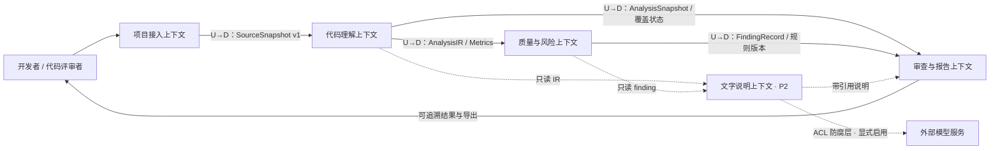
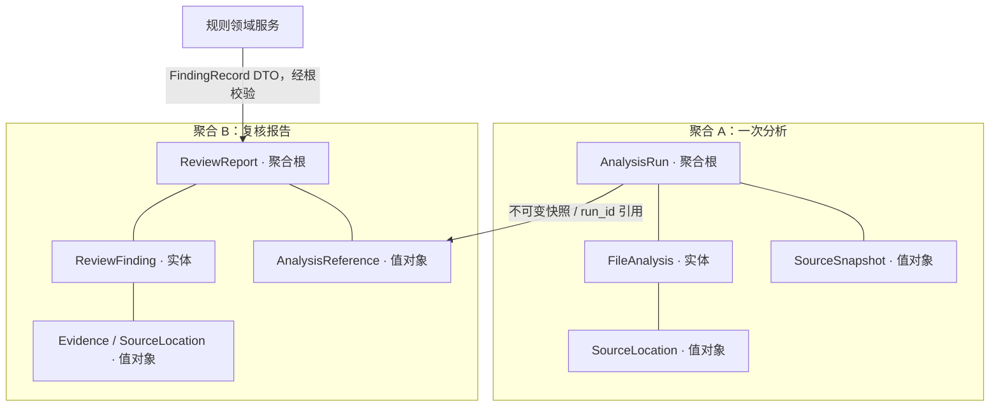

# CodeLens 技术设计实践：领域驱动设计（DDD）

文档日期：2026-10-24。对应课堂任务“第 2 天第 3 部分，选择 1：DDD”。

**交付状态：** 本文为结合现有 CodeLens 源码编写的技术设计稿；领域模型示例可独立运行检查，尚未接入生产接口。通用语言和职责分配供组内讨论确认，不代表已经召开组员会议或获得全组认可。本次成果仅保存在本地。

## 0. 项目背景与依据

CodeLens 面向使用 AI 辅助编码的开发者、代码评审者和项目接手者。用户提交 Python 项目文件夹，工具通过本地静态分析提供逻辑步骤、结构关系、指标与规则发现，使每项结论能够回到具体源码位置。

核心业务问题是“如何形成可追溯、可复核的代码审查证据”。AST 解析、HTTP、SVG 和 JSON 是实现手段，不应直接充当全部领域边界。

本设计依据：

- [软件需求规范书](../../requirements/srs.md)：功能、证据等级及模型用途边界。
- [问题定义](../../requirements/problem_definition.md)：用户、黑盒问题与业务价值。
- [现有引擎](../../../code/core_engine/engine.py)：真实 AST 分析、指标、基础规则与输出结构。
- [现有本机服务](../../../code/backend/server.py)和[本地工作台说明](../local-workbench.md)：当前入口及实现限制。

现有系统已具备文件读取、Python AST 解析、函数/类与逻辑步骤、基础指标、部分关系与六条规则。完整 CFG、def-use、时序图、SOLID、重复代码、综合健康度和可选 LLM 说明层仍未完成。本文提出的人工复核状态、聚合根、领域事件与仓储属于演进设计，不能据此声称现有程序已经采用完整 DDD 架构。

## 1. 通用语言表（24 个术语）

以下术语建议同时用于需求、界面、代码命名、测试名称和组内沟通，避免同一概念多种说法。

| 序号 | 通用术语 / 代码名 | 业务含义 | 使用约束与例子 |
|---|---|---|---|
| 1 | 项目 Project | 用户选择的一组具有共同分析目标的源码 | 项目显示名不是唯一身份；同名目录可能内容不同 |
| 2 | 源码快照 SourceSnapshot | 某次分析实际接受的文件内容及配置对应的不可变输入 | 文件内容变化后必须生成新快照；不以目录名判断相同输入 |
| 3 | 快照清单 SourceManifest | 相对文件路径及对应内容哈希的稳定排序清单 | 记录纳入范围，不包含被排除目录的源码 |
| 4 | 一次分析 AnalysisRun | 对一个固定快照执行指定版本分析的一次业务活动 | run_id 标识这一次活动；重新分析属于新的一次 |
| 5 | 文件分析 FileAnalysis | 一次分析中某个源文件的解析结果和覆盖状态 | 身份为 run_id + 相对路径，不能跨分析混用 |
| 6 | 源码位置 SourceLocation | 项目相对路径与起止行组成的定位值 | 行号从 1 开始；位置依附具体快照才有稳定含义 |
| 7 | 符号 Symbol | 静态解析得到的模块、类、函数或方法定义 | 同名符号用作用域限定名区分 |
| 8 | 全限定名 FQN | 包含模块及所属作用域的符号名称 | 如 services.order.create_order；名称不是跨版本永久身份 |
| 9 | 语句轨迹 StatementTrace | 按源码顺序列出的语句类型、位置和模板描述 | 静态轨迹不等于运行时所有分支都会依次执行 |
| 10 | 分析中间表示 AnalysisIR | 代码理解上下文向下游发布的结构化事实契约 | AST 节点属于内部实现，不直接暴露给界面 |
| 11 | 结构关系 Relation | 模块导入、函数调用或类继承等带来源的关系 | 未解析关系必须单列，不能补出猜测连线 |
| 12 | 指标 Metric | 按公开口径计算的可量化值 | 如函数 CC=12；需保留粒度和算法版本 |
| 13 | 规则 Rule | 将输入事实或指标映射到待复核记录的判定约定 | 规则有编号、版本、适用范围和阈值 |
| 14 | 发现记录 FindingRecord | 规则执行后形成的原始命中结果 | 是检测输出，不直接等于已确认的业务缺陷 |
| 15 | 证据 Evidence | 支撑发现记录的来源、源码位置和证据类型 | 每项结论必须有依据，不能只有一句判断 |
| 16 | 事实 Fact | 从 AST、明确关系或指标直接得到的证据 | “存在字面量赋值”是事实；“凭据有效”不由此成立 |
| 17 | 推断 Inference | 根据局部上下文或启发式规则得到的判断 | 必须给出置信度，提示人工核实 |
| 18 | 置信度 Confidence | 对推断依据充分程度的分档 | low / medium / high；不是严重度，也不是经校准概率 |
| 19 | 严重度 Severity | 用于安排审查优先顺序的风险级别 | critical / warning / info，与置信度分别保存 |
| 20 | 覆盖状态 CoverageStatus | 本次输入实际被成功分析的范围状态 | complete / partial / failed / empty；complete 不代表所有规划能力都已执行 |
| 21 | 复核发现 ReviewFinding | 被一份报告收纳、允许人工标注的发现实体 | 身份为 report_id + finding_id；原始证据不能被人工结论覆盖 |
| 22 | 复核决定 ReviewDecision | 人对发现项作出的结论 | unreviewed / confirmed / false_positive / follow_up；属于新增设计 |
| 23 | 复核报告 ReviewReport | 针对固定分析结果组织证据与人工决定的报告 | 报告引用快照和分析身份，不能悄悄替换成新的源码结果 |
| 24 | 文字说明 Explanation | 对已有事实及发现的文字表达 | 默认模板；可选模型只能改写允许的说明，不产生新的结构或规则结论 |

**组内讨论与确认清单：** 需求角色确认“发现不等于缺陷”；算法角色确认 CC、证据与置信度口径；前端角色统一界面术语；测试角色将术语对应到断言。尚需确认人工复核是否进入下个迭代、规则版本的发布方式，以及正式报告是否需要保存历史。未确认前不将这些新增设计并入当前 API。

## 2. 限界上下文与上下文映射

限界上下文按业务语义和规则的归属划分，不等同于前后端目录，也不要求部署成多个服务。当前团队规模采用**模块化单体**：同一 Python 进程中保持职责与契约边界。

| 上下文 | 子域定位 | 负责什么 | 不负责什么 |
|---|---|---|---|
| 项目接入 Source Intake | 支持域 | 选择/读取源码、排除、限制校验、形成固定输入快照 | 不判断代码质量，不执行目标项目 |
| 代码理解 Code Understanding | 核心域 | 解析符号、逻辑轨迹、可确定关系、基础指标；维护一次分析的覆盖状态 | 不决定人工误报标签，不生成营销式文字结论 |
| 质量与风险 Quality Assessment | 核心域 | 解释规则与阈值、执行检测、输出带证据的 FindingRecord | 不修改源码，不将命中自动变成人工确认缺陷 |
| 审查与报告 Review & Reporting | 支持域 | 组织审查视图、人工决定、来源校验和报告导出 | 不重新推断调用边，不重新计算 CC |
| 文字说明 Explanation | 支持域，P2 扩展 | 默认模板说明；可选模型适配与引用校验 | 不参与核心解析、关系推断、指标和规则判定 |

上下文图的 Mermaid 源文件见 [context-map.mmd](context-map.mmd)。实线表示核心数据流，虚线表示 P2 可选能力；U 为上游，D 为下游。



**映射关系：**

1. 项目接入→代码理解：上游发布 SourceSnapshot 契约，领域服务只接收已归一化相对路径与内容，隔离浏览器 File、HTTP 和磁盘 IO 差异。
2. 代码理解→质量与风险：使用已发布语言（Published Language）传递带 schema_version 的 IR/指标，下游不依赖 Python AST 对象的内部结构。
3. 分析/风险→审查报告：下游遵循发布的证据及字段契约，不能为显示效果补出缺失指标。前端 DTO 是读模型，不是可任意改写聚合的领域对象。
4. 文字说明→外部模型：通过防腐层（ACL）将领域 DTO 转为模型请求，并将响应校验为“带合法引用的说明 DTO”。模型供应商的消息格式、错误码和返回结构不得侵入核心域。

上下文之间共享的是版本化契约及不可变副本，不是共享一套可以互相修改的 ORM 实体。目前 engine.py 同时包含多个上下文的逻辑，因此该图是分解依据，不能把现有文件数直接当成已完成的上下文数。

## 3. 至少两个聚合根与聚合边界

### 3.1 聚合 A：一次分析 AnalysisRun

**聚合根：** AnalysisRun，以 run_id 标识一次分析。它维护输入快照、分析生命周期及每个文件的完成状态。

**边界内对象：** SourceSnapshot / SourceManifest（值对象），FileAnalysis（实体），SourceLocation（值对象），各文件分析结果的不可变引用。AST 是领域服务计算过程中的临时结构，不要求作为持久实体保存。

**核心不变量：**

- 输入快照、引擎修订、规则版本及配置一旦开始就固定；源码或配置变化必须创建新 run。
- 同一 run 内相对文件路径唯一；输入清单中的每个文件只能有一份最终文件结果。
- 文件结果必须属于输入清单，错误必须指向该文件；单个解析失败不能伪装成零复杂度或健康结果。
- 生命周期建议 created→running→finished；finished 后不再变更。覆盖状态独立计算：无输入为 empty；全成功为 complete；部分成功为 partial；全失败为 failed。
- 完成汇总必须由实际文件结果导出，不由调用者任意填入统计数字。

**命令与查询：** start、record_file_result、finish；查询 progress / coverage / snapshot。领域状态变化可形成 AnalysisFinished 事件；当前同步 API 不需要为此引入消息队列。

### 3.2 聚合 B：复核报告 ReviewReport

**聚合根：** ReviewReport，以 report_id 标识一份针对固定分析的复核报告。

**边界内对象：** ReviewFinding（实体），AnalysisReference、Evidence、SourceLocation（值对象）。报告通过 run_id 及输入摘要引用分析，不持有可变 AnalysisRun 根，也不拥有它的源码文件实体。

**核心不变量：**

- 一份报告只能引用一次分析和固定的规则版本，不能混入另一快照的位置。
- 发现项身份为 report_id + finding_id；同一报告内不能重复，也不能收纳其他报告的实体。
- 每条证据必须指向本次分析源码清单；推断必须带 low/medium/high，严重度与置信度不能混用。
- 人工复核只更新 ReviewDecision，不覆盖原规则命中、证据类型、行号或检测指标。
- 草稿可逐项标注；“复核完成”前所有发现项都必须有明确决定。follow_up 表示已作出“继续跟进”的决定，不代表问题已经修复。
- failed / empty 不得被标为复核完成。partial 必须显式确认覆盖不足；确认后仍然保留 partial，不能升级成 complete。
- 完成的复核报告不可修改；重新分析或变更决定应创建后续报告/修订。

**命令与查询：** add_finding、review、acknowledge_partial_coverage、finalize；查询 findings / report view。ReportFinalized 只是“人工复核决定已整理完成”，不表示代码没有风险或问题已经修复。

当前网页的“导出分析报告”无需完成所有人工复核，仍可导出带“未复核/部分分析”状态的结果；它与此处新增的“完成复核报告”命令是不同业务动作。

### 3.3 聚合图及一致性策略

独立源文件：[aggregate-boundaries.mmd](aggregate-boundaries.mmd)。



一个命令的强一致性范围是一个聚合。分析完成后，应用服务读取完成快照和规则输出，创建报告；报告创建失败不会回滚已经完成的分析。创建报告可用 run_id + 报告用途 + 修订号作为幂等键，重复请求返回原报告而不是重复插入发现项。日后如增加并发持久化，仓储采用 version 乐观锁，拒绝旧版本覆盖；当前内存演示不宣称已支持并发写入。

不把 Project 作为“包含全部历史分析、全部报告和所有源码”的大聚合根，以免无界增长；Project 可作为目录/项目登记信息，历史结果通过身份关联和读模型查询。

## 4. 实体、值对象与聚合根代码示例

可执行文件：[domain_model.py](domain_model.py)。它使用 Python 标准库 dataclass 与 Enum，不依赖框架。

| 示例类型 | DDD 分类 | 关键行为 |
|---|---|---|
| SourceLocation | 值对象 | 无独立 ID，按路径与行号值相等；不可变，校验安全相对路径及有效行范围 |
| Evidence / AnalysisReference | 值对象 | 约束事实/推断、置信度、分析身份、输入摘要和版本 |
| ReviewFinding | 实体 | 按 report_id + finding_id 识别；人工决定变化后身份不变 |
| ReviewReport | 聚合根 | 所有新增、复核和完成命令在根上校验；内部发现项以只读 tuple 暴露 |

核心调用方式（变量由应用层把真实分析结果转换而来，不预置产品数据）：

```python
report = ReviewReport(report_id, analysis_reference, source_file_paths)
report = report.add_finding(review_finding)
report = report.review(review_finding.finding_id, ReviewDecision.FOLLOW_UP)
# 部分分析时，必须先明确确认覆盖不足：
if report.analysis.status == "partial":
    report = report.acknowledge_partial_coverage()
report = report.finalize()
```

实现选择不可变副本：命令返回“相同身份、更新状态”的新聚合根，调用者必须保存返回值。即使有人直接调用 dataclass 构造函数或 replace，构造校验也会再次检查成员归属和完成条件。Python 模型保护的是正常应用路径的一致性，不是针对恶意反射的安全隔离。

测试文件：[test_domain_model.py](test_domain_model.py)。在仓库根目录执行：

```bash
python -B -m unittest discover -s docs/software/ddd -p 'test_domain_model.py' -v
```

测试覆盖值相等与不可变、实体身份、非法源码位置、推断缺少置信度、跨报告成员、重复身份、未复核完成、完成后修改、空/失败分析、部分覆盖确认及构造函数绕过检查等场景。测试中使用的少量构造输入仅用于设计验证，不进入实际分析界面。

本地验证记录（2026-10-24）：上述命令执行 **14 项检查，全部通过**。此结论只适用于本目录的 DDD 设计示例。

**与现有结果的适配：** 当前 result.findings 转为 ReviewFinding 时，保留 rule_id、file、line、message 等原始证据，另加 report_id 与人工决定。当前 API 尚无 run_id、input_digest、rules_version 和 ReviewDecision，需要应用层补建快照与版本契约后才能正式接入。不能把现有 finding-1 当作全系统唯一身份，也不能仅凭 engine_version 字符串认定引擎源码完全相同。

## 5. 技术方案与 AI 算法/模型融入方式

### 5.1 当前技术方案

| 层次 | 方案 | 选择理由与边界 |
|---|---|---|
| 用户入口 | 原生 HTML/CSS/JS，本机 HTTP | 与现有工作台一致，选择目录并只向同源服务提交源码 |
| 接口/应用层 | 当前标准库 HTTP 适配器；应用服务编排 | 校验请求、映射 DTO、调用领域服务；正式 FastAPI 为后续计划 |
| 核心计算 | Python 3.11 语法 AST、名称绑定、图与指标算法 | 确定性、可测试、不执行目标代码；不确定关系不伪造 |
| 质量领域服务 | 固定规则与阈值、统一证据契约 | 当前 CC-01、LEN-01、DEPTH-01、A4、A3-IO、CYCLE-01；不声称覆盖全部坏味或 SOLID |
| 领域模型 | 聚合根封装业务不变量，值对象校验与不可变 | 防止结果、证据和人工决定混杂；本次提供独立示例 |
| 数据与仓储 | 当前结果在内存；后续通过仓储接口保存快照/报告 | 不因 DDD 自动引入数据库；若需历史记录，可先以 SQLite 适配，须另行实现并验收 |
| 导出 | 读取已冻结的结果生成 Markdown/JSON/Mermaid | 不重新计算指标；保留版本、覆盖状态、限制与证据位置 |

建议按“现有字典 DTO→应用层适配→逐步提取领域服务”演进，不同时重写前端、HTTP 和所有算法。DTO 的 schema_version 用于契约兼容；领域对象可按业务需要独立演进，不能把 ORM/JSON 字段机械复制为 DDD 设计。

### 5.2 一次真实分析的领域流程

1. 项目接入形成 SourceManifest：按相对路径排序，记录每文件原始字节 SHA-256、排除规则及输入大小。
2. 应用服务创建 run_id，固定引擎修订、规则实现版本和配置；以稳定序列化的清单与配置计算 input_digest。仅目录名、文件修改时间或配置哈希不足以代表完整输入。
3. AnalysisRun 开始；代码理解领域服务逐文件解析并记录 FileAnalysis。解析失败作为文件结果，不中断其他文件。
4. 完成解析与指标汇总，冻结 AnalysisSnapshot；质量领域服务消费只读事实，产生 FindingRecord。每条记录注明规则来源与位置。
5. 应用服务把快照及发现映射为报告读模型；若启用人工复核功能，再创建 ReviewReport 聚合并通过根执行决定。
6. 导出读取固定版本结果。新源码、新规则或配置变更必须重新分析，旧报告保留原引用，不原地替换证据。

run_id / report_id 可以不同，但同一源码、配置及引擎修订下的**规范化分析内容**应可逐字节复现。对拍时不把新生成的活动 ID、时间戳等元数据混入确定性比较。模型生成文字不纳入核心结果确定性承诺。

### 5.3 AI 算法和模型如何融入

CodeLens 的“AI 代码风险”表示分析对象和规则关注点，**不等于必须调用生成式模型**。当前核心计算是 AST、名称绑定、判定点计数、强连通分量和规则匹配，这些结果直接进入领域事实与证据。

按 SRS FR-19，P2 可选模型仅允许三类用途：

| 允许用途 | 输入 | 输出及检查 |
|---|---|---|
| 语句轨迹转文字 | 已有语句类型、位置、目标 | 每个步骤引用已有行号，不新增操作 |
| 类/模块职责摘要 | 已有节点、方法和调用关系 | 最多 3 句，引用已有节点，不创造依赖 |
| 报告重点归纳 | 排序后的 Top-N findings | 每点引用至少一个 rule_id 及合法源码位置 |

领域层定义 ExplanationProvider 契约，基础设施层实现 TemplateProvider 和可选 LLMProvider。模型只能消费只读、最小必要的 DTO；默认不发送原始源码或疑似密钥。外部调用需用户显式配置并明确数据发送范围，未启用时核心分析保持本地、零模型请求。

说明适配器校验每句引用是否存在于本次快照、引用的规则与节点是否匹配；无合法引用的句子删除，空结果、超时或响应不合规回退模板。引用有效并不能证明句意完全正确，仍需样例评测和人工抽查，且展示为辅助说明，不提升原始证据等级。

禁止模型决定调用/继承边、计算复杂度、判定规则命中、修改严重度、替用户做复核决定、生成修复代码或修改源码。模型输出不能调用 ReviewReport.review，也不能把 inference 改成 fact。模型供应商 SDK 和响应类型被防腐层隔离，核心领域对象保持无网络依赖。

### 5.4 验证标准与实施顺序

- 第一阶段：统一术语和 DTO；保持现有真实分析回归通过，发布字段兼容说明。
- 第二阶段：加入 SourceLocation / Evidence 及适配层，再引入 AnalysisRun 的输入固定与完成校验，逐步抽离现有领域服务。
- 第三阶段：按明确需求加入 ReviewReport、人工决定与仓储适配；校验跨快照、重复身份和错误覆盖等异常场景。
- P2 阶段：先实现模板契约与引用校验，再试验可选模型。用同一输入比较两模式，结构、指标及原始 findings 必须完全一致；未配置模型时所有核心功能仍可用。

当前示例的通过只表示领域不变量示例正确，不能替代 AST 准确率、完整 SRS、性能或模型质量验收。

## 6. 新技术学习计划

以 5 个学习/实践日安排，不绑定尚未确认的组员姓名。角色可兼任，交付物和检查方法明确后再由组内认领。

| 时间 | 学习主题 | 建议负责角色 | 实践与可交付成果 | 完成判断 |
|---|---|---|---|---|
| 第 1 日 | DDD 通用语言、限界上下文、聚合与分层 | 全员，需求角色整理 | 逐条讨论本文 24 个术语；修改上下文图；记录术语分歧与决定 | 能解释“发现≠缺陷、置信度≠严重度”；每个上下文有明确拥有者 |
| 第 2 日 | Python AST、作用域与静态分析边界 | 算法角色 | 在真实小型项目中验证函数/类、同名符号、相对导入和未解析调用；手工标注预期 | 不执行目标代码；位置可回溯；不确定调用不产生确定连线 |
| 第 3 日 | 值对象、实体身份、聚合不变量与不可变建模 | 后端/模型角色 | 阅读并运行 domain_model.py 示例；补一个跨快照误用或身份冲突用例 | 能通过根执行命令；不能收纳跨报告实体或完成未复核报告 |
| 第 4 日 | 领域服务、DTO/防腐层、仓储接口与集成测试 | 后端与测试角色 | 编写“真实 result→领域对象”适配设计，明确新增身份/版本字段；制定兼容策略 | 原始证据不丢失；输入/规则版本能追溯；不影响现有结果读模型 |
| 第 5 日 | 确定性回归与可选模型说明评测 | 测试角色，前端/算法参与 | 核心结果对拍；完成模板说明与引用校验设计；列出模型超时和非法引用负例 | 核心结果不受说明模式影响；无配置无外部请求；失败可回退模板 |

每日结束用约 15 分钟展示“输入、实际结果、依据、限制”，将新术语和决定回填本文；尚未完成的功能保留为待办，不用预置图表或模拟结果代替验证。

**学习风险与应对：**

- 把 DDD 当成多建类：每个对象必须说清业务身份或不变量；纯计算优先放领域服务。
- 聚合过大：分析与报告各自独立，按身份引用历史，不让 Project 装下全部活动。
- 过早上微服务/消息队列：先以单进程模块边界验证契约，业务需要出现后再调整部署。
- 把 LLM 当成事实来源：模型仅在说明适配层；原始结构、指标与规则证据可脱离模型独立验证。

## 7. 课堂任务交付对照

| 课堂要求 | 本次交付 | 状态 |
|---|---|---|
| 通用语言表，至少 10 个术语 | 第 1 节，24 项及组内确认清单 | 已编写；组员讨论确认待完成 |
| 限界上下文图 | 第 2 节及 context-map.mmd | 已编写，含上下游、发布契约与 ACL |
| 至少 2 个聚合根并标边界 | 第 3 节及 aggregate-boundaries.mmd | AnalysisRun、ReviewReport；边界和不变量明确 |
| 至少 1 实体、1 值对象、1 聚合根代码 | 第 4 节及 domain_model.py | 已实现独立设计示例，未接入生产服务 |
| 确认技术方案，含 AI 模型融入 | 第 5 节 | 已给出方案与决策边界；待组内确认 |
| 规划新技术学习 | 第 6 节 | 5 日计划、角色、成果与完成标准 |
