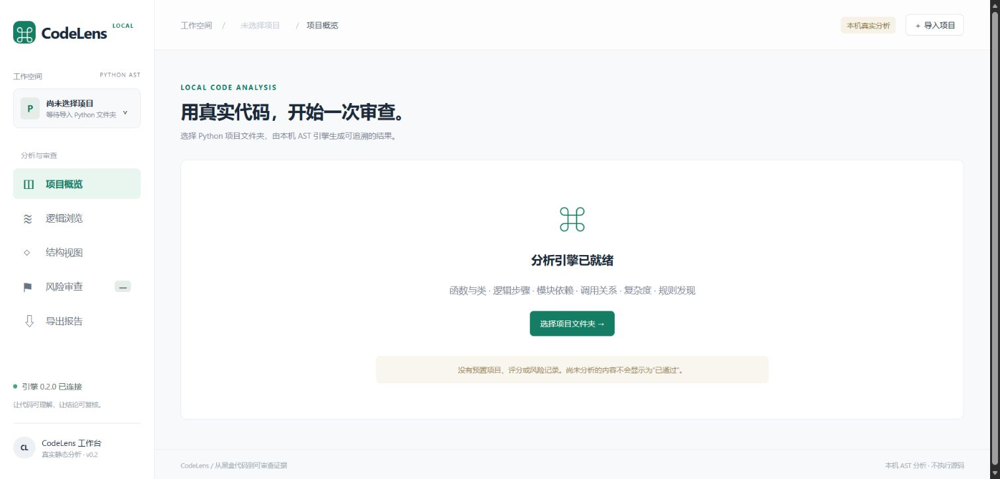

# 本地真实分析工作台

## 启动与结构

要求 Python 3.11+，无需第三方依赖。在仓库根目录运行 `python -B code/backend/server.py --port 18766`，打开终端显示的地址，选择 Python 项目目录开始分析。Windows 可双击 `start-codelens.cmd`；macOS/Linux 可运行 `sh start-codelens.sh`。Ctrl+C 停止服务。

| 位置 | 职责 |
|---|---|
| code/core_engine/engine.py | 确定性 AST 分析，不执行输入代码 |
| code/backend/server.py | 本机 HTTP 适配器、请求限制与静态服务 |
| code/frontend/ | 项目选择、结果、源码定位与导出 |
| tests/unit/test_engine.py | 引擎回归 |
| tests/integration/test_server.py | HTTP、实际源码与访问限制 |
| tests/integration/test_frontend.cjs | 前端真实请求、结果、导出与错误处理 |

当前标准库服务是本地适配层；原架构规划的 FastAPI、后台任务和持久化尚未交付。

实际本机工作台截图（尚未选择项目，已连接真实引擎）：



## 能力与需求对应

| 已实现能力 | SRS 对应切片 |
|---|---|
| 所选目录扫描、排除、编码/语法错误隔离 | FR-01 |
| 模块、类、函数、名称绑定及保守消歧 | FR-02 / FR-04 基础切片 |
| 按源码顺序输出语句类型、准确行号与模板步骤 | FR-05 / FR-08 |
| 可唯一解析的继承、直接调用、显式导入及循环依赖 | FR-09 / FR-10 / FR-12 基础切片 |
| CC、有效代码行、嵌套、参数与分级 | FR-13 基础切片 |
| 长函数、深嵌套及基础风险规则 | FR-14 / FR-16 基础切片 |
| 带证据/位置/阈值的 Markdown、JSON、Mermaid 导出 | FR-18 基础切片 |

没有预置项目、固定指标或备用风险记录。空项目、全部失败、部分完成分别展示，未运行的检查不显示为通过。

## 计算口径

- CC 初始 1；if/三元/assert +1；循环 +1（else 再+1）；try 按 except 数（else 再+1）；布尔 n 项 +n−1；推导式 +1 及 if 数；match 非通配 case +1。内层函数、类、lambda 不计入外层。
- A=1–5、B=6–10、C=11–20、D=21–30、E=31–40、F≥41。尚未完成与 radon 的全量对拍。
- 长度：物理有效代码行，排除空行、纯注释及独立文档字符串；包含定义行和范围内的内层定义。
- 嵌套：if、循环、try、with、match 等控制区域最大深度；内层定义独立计算。

| 规则 | 触发 | 证据 |
|---|---|---|
| CC-01 | CC >10 警告，>20 严重 | fact |
| LEN-01 | 有效代码行 >50 | fact |
| DEPTH-01 | 最大嵌套 >4 | fact |
| A4 | 敏感变量名赋予长度至少8的非占位字符串 | fact（模式，不验证凭据有效性） |
| A3-IO | 内置 open 局部路径未见匹配 OSError/IOError/Exception 捕获 | inference / medium |
| CYCLE-01 | 内部模块强连通分量形成循环或自依赖 | fact |

每条 finding 含 rule_id、severity、evidence_type、file、line、actual、threshold、confidence、message、suggestion。不适用字段为 null。编码通过 tokenize.detect_encoding 识别，按 Python 3.11 语法解析。

调用只连接唯一绑定的函数、类与显式导入。遮蔽或重复定义等情况保守处理；实例类型、多态、动态导入、完整 super 和装饰器语义未还原。未解析调用单列。上层可能统一处理异常，A3-IO 必须人工复核。

## 接口与本机边界

- GET /api/status：版本与当前会话令牌。
- POST /api/analyze：同源 JSON，需 X-CodeLens-Token。输入 `{project, files: [{path, content_base64}]}`；内部调用也可传 content 字符串。
- 输出 schema_version、engine_version、project、status、config、summary、files、functions、classes、findings、graph、errors、warnings、limitations。
- status 为 complete、partial、failed、empty。单文件错误属于有效分析响应；输入错误为400、请求体超限413、来源/令牌错误403。
- JSON 导出剔除 files[].source，A4 不输出字符串值。页面保留完整源码用于定位。

仅监听 127.0.0.1；源码在服务内存中解析，不执行、不 import、不上传外部服务、不保存副本。校验 Host、Origin 和令牌，静态资源采用白名单。

最多 200 个 Python 文件、单文件1 MB、总计8 MB、请求体12 MB。默认排除 .git、.venv、venv、__pycache__、node_modules、build、dist、tests。图形最多60节点，完整关系仍在清单和JSON中。

完整 CFG、def-use、时序图、SOLID、重复代码、死代码和综合健康度尚未实现，不生成占位数值，不声称覆盖全部 SRS。

## 验证

```bash
python -B -m unittest discover -s tests -p 'test_*.py' -v
node --check code/frontend/app.js
node tests/integration/test_frontend.cjs
```

Python 覆盖真实源码、错误隔离、不执行源码、指标、依赖与调用、编码、规则、确定性和接口限制。前端测试读取真实服务源码并调用引擎，但使用轻量 DOM 桩，不替代系统目录选择、完整浏览器交互及移动端验证。
