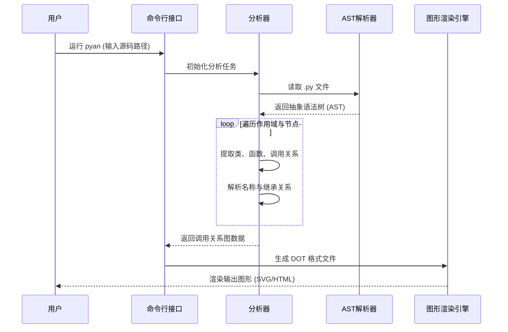
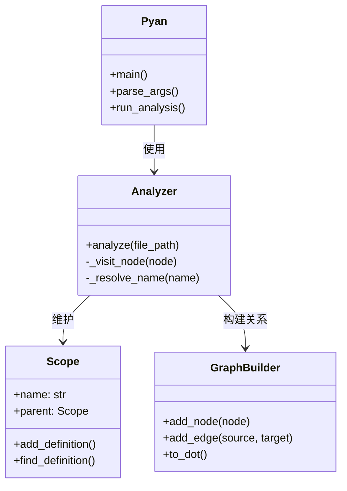

# pyan 项目逆向工程分析（UML）

## 1. 核心时序图 (Sequence Diagram)
展示了 pyan 从读取源码到生成可视化图表的完整工作流程。

## 2. 核心类图 (Class Diagram)
展示了 pyan 内部的主要模块及其相互关系。

## 3. pyreverse 逆向工程实践记录

根据课程指导，我尝试使用 `pyreverse` 对本地 CodeLens 项目进行了逆向分析。

- **安装依赖**：`pip install pylint graphviz`
- **执行命令**：`pyreverse -o dot -p CodeLens .`
- **执行结果**：成功在根目录下生成了 `classes_CodeLens.dot` 文件。